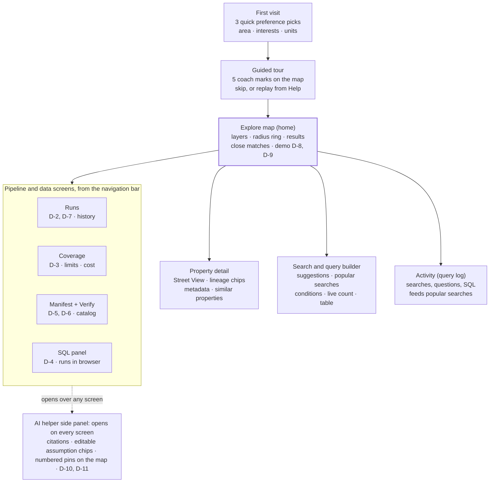

# CountyLens: UX context

Oct 17, 2026 · HebaGaber · Source: the "CountyLens UX Research and Design Brief" doc. The prompts are in [02-claude-design-prompts.md](02-claude-design-prompts.md), and the demo script is in [03-demo-script.md](03-demo-script.md).

CountyLens is a data-exploration tool, not a lead tool. It should let anyone find, read and trust Travis County property data in a few taps, with an AI helper beside them. This document sets the UX standards from a benchmark of comparable apps.

## Product direction

The explorer is judged on how easily someone can find and trust real Travis County data, so ease of use and visible provenance come before any lead-generation feature. Lead workflows belong to the Roofing CRM (Task B).

| Decision | Choice | Why |
| --- | --- | --- |
| Purpose | Data exploration and a helper tool, not lead generation | The README puts the CRM UI out of scope; this app proves the pipeline and the data |
| Primary users | The evaluator and CRM developers; any analyst exploring the county | They walk the demo transcript and judge usability, search depth and trust |
| First screen | Map first, then a short preference pick-up and an in-app tutorial | The data is geographic; first-time users need a guided start |
| AI helper | A side panel that opens from every screen and knows what is on screen | Questions arise in context, so the helper stays beside the data |
| Search | Simple search box first, advanced filters and a query builder one tap away, SQL for experts | Serves novices and power users without two separate apps |
| Trust | Source, capture time, CID and run on every value; gaps labelled, never blank | Evaluation points A2 and A4 reward provenance and verifiable publication |
| Pipeline visibility | Runs, sync status and history log visible in the app | Evaluation point A3 rewards visible continuous ingestion |
| Look | Atlas design system (Material 3), mobile-first at 390, 768 and 1440 px | Mandated by the project rules; same tokens as the code |
| Geography | Travis County, TX is the first county and is selected by default. A location switcher (state, then county) lists other counties and states as "Coming soon": visible, but not selectable for data | The README targets Travis; the switcher shows the platform is built to grow beyond one county, without implying data that does not exist yet |

**What a first-time user should manage in under 2 minutes, without help:** open the map, search an area, filter by roof age, open a property, see where each value came from, and ask the helper a question.

## Value: pains solved and benefits delivered

The explorer turns scattered, untraceable public records into one place where every Travis County property, permit and contractor can be found in seconds and checked back to its source. These three promises should be readable in the design itself: the welcome line, empty states, help text and the order of information on each screen.

**The three promises**
1. **Everything in one place.** Property, owner, sale, location, permit, contractor, BBB and business data, joined on each property.
2. **Proof behind every value.** Each value shows its source, capture time and CID, and anyone can verify the published files.
3. **Answers, not dead ends.** Plain-language search, an AI helper, close matches and suggestions, so every search leads somewhere.

### Pains solved and added value

| Pain today | Who feels it | What the explorer does | Added value | Where the design shows it |
| --- | --- | --- | --- | --- |
| Property, permit, contractor and rating data sit on many separate sites, each searched differently | Analyst, CRM developer | Joins every source on the property; one search box covers all of them | One search replaces many sites | Universal search, property detail |
| Data tools hide where their numbers come from, so nothing can be checked | Evaluator, CRM developer | Shows source, capture time, run and CID on every value; the two-gateway check proves the published bytes | Trust you can verify, not just believe | Source chips, lineage, Verify gateway race |
| Roof age is guessed from year built, with no caveat | Analyst | Estimates roof age from reroof permits first, then new-build date, then year built, with a confidence badge | An honest roof age with its evidence | Roof-age chips, property Roof section |
| Roofing permits are buried in messy text: only 52 Austin permits are labelled "Roof", but 22,083 describe a reroof | Analyst, CRM developer | Classifies roofing permits from their descriptions and groups status into open, stalled and closed | Long-open and stalled roofing work found in one filter | Permit layer, open-duration colours |
| You cannot tell whether data is current | Evaluator, analyst | Shows the current run, last sync and a timestamp on every count; stale data gets a warning | Always know how fresh the data is | Sync badge, Runs, Coverage |
| Missing values are left blank, so gaps look like "no" | Everyone | Labels every gap with its reason ("BBB not available, source blocked") | No silent gaps; decisions rest on what is known | Labelled empty fields, Coverage limitations |
| Powerful tools need SQL or bury users in 100+ filters | Analyst | Simple search first; AI search and a query builder one tap away; SQL only for experts | Depth without a learning curve | Search, query builder, SQL panel, guided tour |
| A search with no results is a dead end | Analyst | Shows close matches that miss one criterion, and "Try next" suggestions | Every search leads somewhere | Close matches, Try next, helper |
| Developers have no stable model to build on | CRM developer | Four frozen tables, a metadata panel with field meanings, and an MCP interface on the same model | Build once against a contract that will not change | Data catalog, metadata panel, SQL schema browser |
| Commercial data is paid, closed and tied to one vendor | Everyone | Publishes public CIDs that stay retrievable without any single vendor, at zero standing cost | Free, durable, independent access | Manifest, Coverage cost panel |

### Key benefits by user

| User | Key benefits |
| --- | --- |
| Evaluator | Walks every demo line in a few taps; sees provenance, freshness and verification without asking; the pipeline's history is on screen |
| CRM developer | Understands the data model from the app itself (catalog, metadata, schema); queries the same views the CRM will use; verifies CIDs |
| Analyst or curious user | Finds an area, a property or a pattern without SQL; gets a helper that explains answers and cites records; never hits a dead end |

## Benchmark

The comparable apps are strong at map search and filters, but they hide where their data comes from, how fresh it is and what is missing. That gap is where the explorer wins.

| App | What it is | Pros to borrow | Cons | Where we add value |
| --- | --- | --- | --- | --- |
| [PropStream](https://www.propstream.com/how-to-search) | Property lead lists for investors | Draw circle, rectangle or free shape on the map and results fill in at once; 165+ filters; ready-made saved lists ([press, Jul 2026](https://www.propstream.com/news/meet-the-propstream-team-at-the-tom-ferry-success-summit)) | Filter overload; no roof-age field; sources and freshness hidden | Fewer, smarter filters with presets; roof age with basis and confidence; source on every value |
| [BatchLeads](https://batchleads.io/blog/reimagining-how-easy-roofing-lead-generation-can-be) | Lead lists marketed to roofers | Boundary drawing on the map; property-type and year-built filters | Year built stands in for roof age with no caveat | True roof-age estimate from reroof permits, with its evidence |
| [Shovels](https://thegtmdirectory.com/tools/shovels) | US building-permit data platform | AI classifies raw permit text into work types (roofing, solar, HVAC); contractor profiles; stated refresh cadence ([API listing](https://apis.apievangelist.com/store/shovels-api)) | Paid and closed; records cannot be traced to their source | Same classification idea, but every permit links to its public source record and CID |
| [Regrid](https://support.regrid.com/property-app/filter-data) | Parcel map with owner data | Filter pane with a live count of matching parcels; sale date and mailing address per parcel ([app](https://regrid.com/property-app)) | No tenure filter; filters are a paid, web-only feature | Owner tenure and out-of-area owner as ready filters; free and public |
| [HailTrace](https://spotio.com/integrations/hailtrace/) | Storm maps for roofers | Map overlay layers you toggle; filters by severity and date | Built for storms, not property data | Layer toggles for roof age, permits and coverage on one map |
| [SalesRabbit / Spotio](https://spotio.com/blog/salesrabbit-app/) | Door-to-door canvassing apps | Color-coded pins by status; bottom sheet with property details on phones | Reviews say the map shows where reps went, not which homes matter | Pins colored by data meaning (roof age, open duration), with a legend that shows numbers |
| [Perplexity-style citations](https://aiuxplayground.com/guides/how-to-design-ai-citations) | AI answer pattern | Source chip beside each claim; hover preview; layered detail ([design breakdown](https://www.925studios.co/blog/perplexity-design-breakdown)) | Citations can point at weak or invented sources | Citations point at real records and CIDs that open in the explorer |
| [Baymard split view](https://baymard.com/research-articles/accommodations-split-view) | UX research on property search | Map and list side by side on desktop; results follow the map ([raw.studio](https://raw.studio/blog/using-maps-as-the-core-ux-in-real-estate-platforms/)) | General guidance only | Applied with Atlas mobile rules: full-bleed map and bottom sheet at 390 px |
| Data catalogs ([lineage freshness](https://oneuptime.com/blog/post/2026-09-08-keep-data-lineage-catalog-fresh/view)) | Metadata and lineage tools | Freshness per field; explicit stale state; lineage as a trust signal | Built for engineers, hard for newcomers | Lineage and freshness in plain language on every record |

Most of these pages are vendor or partner content, so feature claims are taken as stated by the vendor.

## UX standards

Every screen follows these thirteen rules; the design checkpoint and the reviewers check against them.

1. **Find anything in three taps.** One search box understands addresses, places, owners, contractors, permit numbers and plain questions; advanced filters and the query builder sit one tap away.
2. **Map first, list beside it.** Desktop shows map and results side by side; at 390 px the map is full-bleed with a bottom sheet and bottom navigation. Results follow the map as it moves.
3. **Source on every value.** Each value shows its source, capture time, run and CID; one tap opens the full lineage (Atlas signature moment #4, "why is this a match?" chips).
4. **Roof age never alone.** It always shows its basis (reroof permit, new build or year built) and a confidence badge (high, medium, low).
5. **Gaps are labelled.** "BBB not available (source blocked)", "Tenure unknown (no deed data)"; never an empty cell.
6. **Readable map.** Zoomed out, properties show as roof-age hexagons; zoomed in, as markers. The legend always shows numbers, not only colours (signature moment #2). A live radius ring with a count chip (#1).
7. **Metadata is visible.** Every record and table shows its metadata: source, field meanings, last updated, run, record counts and licence.
8. **Freshness everywhere.** The header shows the current run and when data last synced; every count shows its timestamp; stale data gets an explicit state.
9. **The pipeline is visible.** Runs, sync status and the history log are first-class screens, with a run timeline scrubber (#6) and delta chips.
10. **Verification is honest.** The two-gateway check shows live lanes (#7) and never says verified when a check failed; a rate limit shows a countdown, not an error.
11. **Every screen has six states:** loading, empty, error, partial data, rate-limited and populated, at 390, 768 and 1440 px.
12. **One county live, more coming.** A location switcher in the header shows the active county (Travis County, TX, the default). Other counties and states appear as "Coming soon" with a muted style and no data behind them; choosing one explains it is not available yet and offers "Notify me" (nice to have). The current county is part of the URL.
13. **Shareable and accessible.** Search state lives in the URL; contrast meets 4.5:1 in light and dark; everything works by keyboard; motion respects reduced-motion settings.

## Helper features

Twelve helper features turn the explorer from a viewer into an assistant. Three are Must because the README asks for them. The rest go beyond its scope and are Nice to have, built only after every demo line passes.

| Feature | Priority | What the user sees | How it works | Constraint or cost |
| --- | --- | --- | --- | --- |
| AI helper | Must (README agent) | A side panel on every screen that knows what is on screen; answers with a result table, citations and stated assumptions | Agent with typed tools over the published data (story A-14) | Answers drop numbered pins on the map (signature moment #5) with editable assumption chips |
| Sync and pipeline status | Must (README run history) | A header badge ("Synced 2 h ago · Run 3"), the Runs screen and a pipeline history log | Read from the run history in each manifest | A stale run gets an explicit warning state |
| Metadata panel | Must (README provenance) | For any table or record: field meanings, source, licence, record count, last updated, run and CID | Read from the data contract and the manifest | Same panel everywhere, so users learn it once |
| AI search | Nice to have | Type a plain-English question in the search box ("old roofs near Pflugerville"); it becomes filters shown as editable chips, with "Ask the helper instead" for complex questions | The same agent tools translate the question into a structured query | The interpreted filters are always shown, so the user can see and fix what the AI understood |
| Most searched shortcuts | Nice to have | The top 5 "Most searched" chips on the search screen and empty states | The 5 most-run searches in the query log over the last 7 days | Labelled "Suggested starting points" until 5 real searches have been logged |
| Query log | Nice to have | An Activity screen listing searches, filters, AI searches, helper questions and SQL queries, with result count, response time, status and run | Every query is recorded with its structured filters, text, response time in ms, and failure reason when it fails | Kept 30 days, then deleted; no personal data; pay-per-request store decided at G3, zero idle cost |
| Weekly activity summary | Nice to have | A card on Activity: last week's searches, top areas and filters, median and p95 response time, failure rate and top failure reasons | Aggregated from the query log for the previous 7 days | Shows "Not enough activity yet" when the week is empty |
| Near matches | Nice to have | Under the results, a "Close matches" section with places that miss one criterion | The query re-runs with one criterion relaxed at a time | Each card says what it misses and by how much: "Roof 13 yrs, 2 short of 15", "5.6 mi, 0.6 outside radius" |
| Recommendations | Nice to have | "Try next" suggestions (add the open-permits layer, widen the radius, same filters next door) and "Similar properties" on a detail page | Rules over the current query and the property's attributes (street, year built, roof-age band) | Rule-based and explainable; the helper can say why each one appears |
| Street View preview | Nice to have | A photo of the actual property on its detail page, with the image date, plus an "Open in Google Maps" link | A free metadata call checks imagery exists first; the image loads only when the panel opens | Images must not be stored or cached, and need Google Maps attribution in the same box, visually separated ([policy](https://developers.google.com/maps/documentation/streetview/policies)). 10,000 free images a month, then $7 per 1,000; metadata calls are free ([pricing](https://developers.google.com/maps/billing-and-pricing/pricing)). Key locked to `countylens.aldarraj.com`, with a daily cap |
| Preference pick-up | Nice to have | On first visit: choose an area (city, ZIP or GPS), what you care about (roof age, permits, owners, contractors) and units | Sets the default map area, layers and sort order | Stored in the browser only; editable in Settings |
| In-app tutorial | Nice to have | A five-step guided tour: search, map layers, open a property, the source chip, ask the helper | Coach marks over the live UI; skippable; replay from Help | Empty states carry one-line hints too |

## Screen map

Every screen is one step from the map, and the helper opens everywhere.

Search results and helper answers both return to the map through "Show on map". Demo line D-12 (MCP) is shown outside the app, through the MCP inspector.

## Decisions and open questions

- [x] Scope: anything beyond the README is Nice to have; only the AI helper, sync and pipeline status, and the metadata panel are Must.
- [x] Street View: yes, with a Google Maps Platform key restricted to `countylens.aldarraj.com` and a daily cap; its per-use cost goes into the cost evidence.
- [x] Query log: kept 30 days; captures each query, its type, result count, response time and failure reason; no personal data.
- [x] Shortcuts: AI search in the search box and the top 5 "Most searched" chips.
- [x] Weekly summary of users' activity on the Activity screen.
- [x] Geography: Travis County, TX is the default and only live county; other counties and states show as "Coming soon". The coming-soon list in the prototype is illustrative and is confirmed before build.
- [x] DNS: `aldarraj.com` is on Namecheap; Amplify's certificate and `explorer` CNAME records are added there in story A-03.
- [x] Popular searches: chips switch from "Suggested starting points" to "Most searched" once 5 real searches have been logged.
- [x] Hosted address: `https://countylens.aldarraj.com`.

## Sources

- [PropStream: How to search](https://www.propstream.com/how-to-search) and [press release, Jul 2026](https://www.propstream.com/news/meet-the-propstream-team-at-the-tom-ferry-success-summit)
- [BatchLeads: roofing lead generation](https://batchleads.io/blog/reimagining-how-easy-roofing-lead-generation-can-be)
- [Shovels on GTM Directory](https://thegtmdirectory.com/tools/shovels) and [Shovels API listing](https://apis.apievangelist.com/store/shovels-api)
- [Regrid filter tool](https://support.regrid.com/property-app/filter-data) and [Regrid property app](https://regrid.com/property-app)
- [Spotio × HailTrace](https://spotio.com/integrations/hailtrace/) and [Spotio: SalesRabbit review](https://spotio.com/blog/salesrabbit-app/)
- [AI UX Playground: designing citations](https://aiuxplayground.com/guides/how-to-design-ai-citations) and [Perplexity design breakdown](https://www.925studios.co/blog/perplexity-design-breakdown)
- [Baymard: split view](https://baymard.com/research-articles/accommodations-split-view) and [raw.studio: maps as core UX](https://raw.studio/blog/using-maps-as-the-core-ux-in-real-estate-platforms/)
- [oneuptime: keeping a lineage catalog fresh](https://oneuptime.com/blog/post/2026-09-08-keep-data-lineage-catalog-fresh/view)
- [Google Street View policies](https://developers.google.com/maps/documentation/streetview/policies) and [Google Maps Platform pricing](https://developers.google.com/maps/billing-and-pricing/pricing)
- Project sources: the README demo transcript, `assessment-guide/templates/design-brief.md` (Brief A) and the Atlas design system § 14 signature moments
