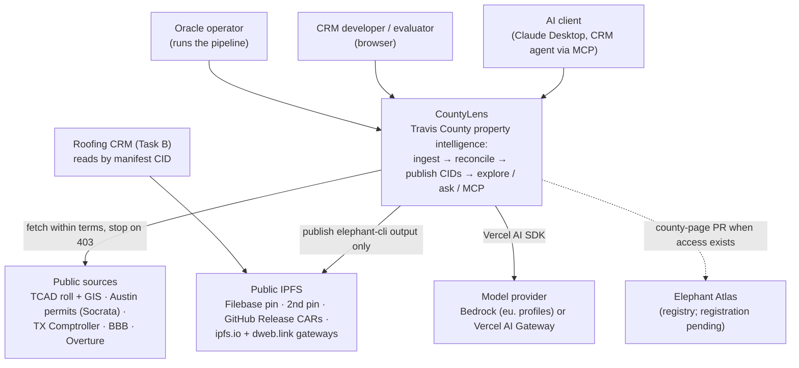
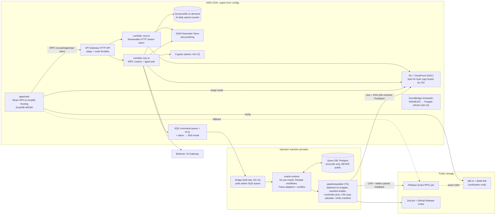
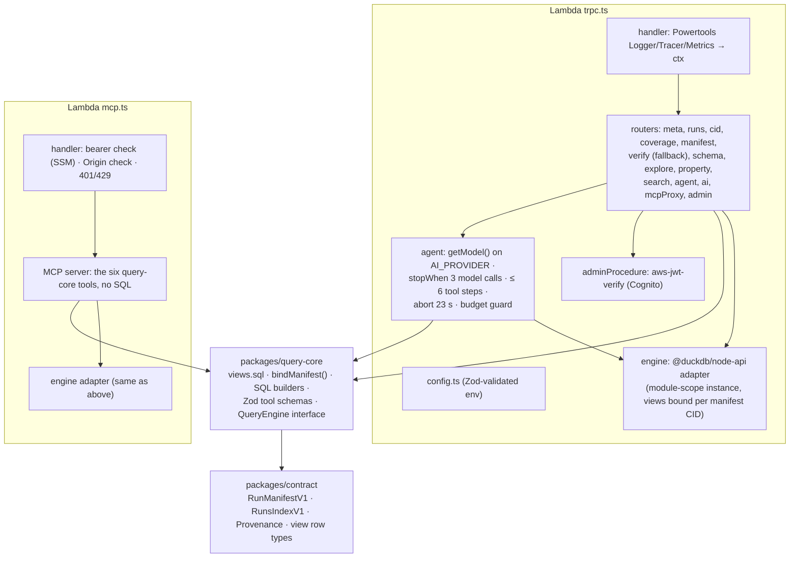
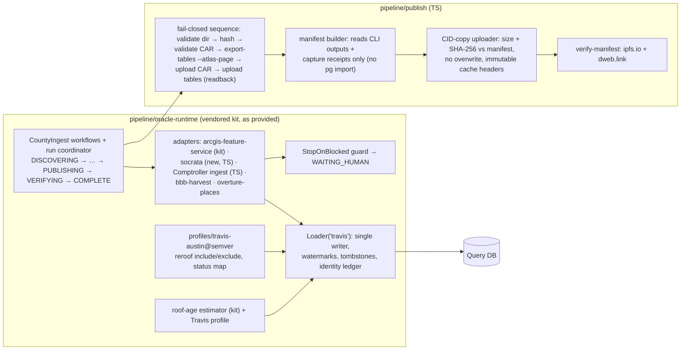

# Architecture Constitution: CountyLens

> Every Spec Kit `plan.md` and every code review is checked against this file. Project-wide governance lives in `.specify/memory/constitution.md`; this file adds the component-level decisions for this repo and is equally binding once G3 approves it.
>
> **Where it comes from.** § 3 copies AD-01 to AD-16 from [ADR-0000](decisions/0000-agent-architecture.md), which the PO confirmed on 2026-10-19. It adds the task guide's key decisions that the ADs do not cover (AD-17 to AD-23), settles the eight disagreements from the 2026-10-19 consult re-run (AD-24 to AD-28), and fixes the Spec Kit workflow and the playbook story-note overrides (AD-29, AD-30). The PO confirmed AD-17 to AD-30 on 2026-10-19.
>
> **Precedence** (ADR-0000 § 4): the constitution and kit P0 rules → the approved planning documents → the agent that owns the area → the design handoff. Where `docs/plan.md` § 3–4 differs from this file (Filebase read path, MCP `query` tool, Secrets Manager), this file wins; the plan calls its architecture "conceptual only; G3 freezes the decisions".

## 1. Architecture style

- **Style:** a modular monolith in a Turborepo for the hosted product, plus a durable, event-driven batch pipeline for ingestion that runs on the operator's machine. The two planes meet only through immutable, CID-addressed files on public IPFS.
- **Three planes:**
  1. **Ingestion (private, local, $0 cloud):** the kit `use-oracle` runtime on local Restate + Postgres, with the internal Query DB.
  2. **Publication (public):** `elephant-cli` output pinned on IPFS (Filebase + second pin + GitHub Release CARs), described by a per-run manifest.
  3. **Hosted (AWS, pay per request):** an Amplify SPA with DuckDB-WASM, and tRPC + agent + MCP on Lambda behind API Gateway, reading a byte-for-byte CID copy on S3 + CloudFront.
- **Primary stack:** TypeScript everywhere; React + Vite; tRPC v11 + Zod; Vercel AI SDK; DuckDB-WASM and `@duckdb/node-api`; AWS CDK (TypeScript), with the region from config (company default `us-east-2`, demo `eu-north-1`).
- **Kit guidance:** `apply-engineering-guidelines`, `build-frontend-backends`, `integrate-ci-cd`, `use-oracle` (with `onboard-county`, `query-db-loading-matching`, `deploy-open-data-mcp`), `build-batch-workflows` (machamp, refresh), `build-rag-systems` (alakazam, agent retrieval).
- **Design owners** (constitution XIII): oracle (ingestion, publication, MCP), metagross (monorepo, app, API, hosting, CI), mew (lexicon names), machamp (scheduled refresh).

## 2. Diagrams (C4 levels 1–3)

These diagrams live only in this file, so there is no copy to drift. `docs/diagrams/` is not used.

### 2.1 Level 1: system context

### 2.2 Level 2: containers

The Query DB has **no edge into AWS**. The bridge pulls commands outbound from the operator machine; nothing in AWS can reach the laptop or the database.

### 2.3 Level 3: components

**apps/api (both Lambdas share `packages/query-core`):**

**pipeline (operator machine):**

## 3. Key decisions (with options and rationale)

Status key: **Accepted** = PO-confirmed. AD-01 to AD-16 were confirmed in ADR-0000; AD-17 to AD-30 were confirmed by the PO on 2026-10-19 after the first G3 pre-check.

### 3.1 From ADR-0000 (AD-01 to AD-16)

| ADR   | Decision                                                                                                                                                                                                                                                                                                                                                                                    | Options considered                                                                                              | Rationale                                                                                                                                                                                                                       | Status                                              |
| ----- | ------------------------------------------------------------------------------------------------------------------------------------------------------------------------------------------------------------------------------------------------------------------------------------------------------------------------------------------------------------------------------------------- | --------------------------------------------------------------------------------------------------------------- | ------------------------------------------------------------------------------------------------------------------------------------------------------------------------------------------------------------------------------- | --------------------------------------------------- |
| AD-01 | Publish only the tables `elephant-cli export-tables` makes. Views in `packages/query-core` shape them at query time. Tune `--part-size` and use a bounding-box prefilter for speed.                                                                                                                                                                                                         | (a) CLI tables + views · (b) an extra slim geo-sorted "serving" Parquet (metagross, handoff)                    | Rule A2: public data comes only from `elephant-cli` (oracle P0-2, mew P0-1). (b) would be a second public dataset outside the CLI.                                                                                              | Accepted                                            |
| AD-02 | App and API read a byte-for-byte copy of the published CLI files on S3 + CloudFront, keyed by CID, checked on upload and never edited. Fallback: a public IPFS gateway. Verify always uses ipfs.io and dweb.link, never the copy.                                                                                                                                                           | (a) Filebase gateway range reads (task guide, plan § 4) · (b) public gateways · (c) S3 + CloudFront CID copy    | Metagross owns hosting. Public gateways are too slow and rate-limited for live range reads. The copy holds nothing that is not on IPFS, so it is a cache, not a second source (oracle's concern). An A-02 spike must prove p95. | Accepted · _amended 2026-10-21 (§ 16 AM-01, AM-04)_ |
| AD-03 | No CountyLens IPNS name. Each manifest links to the one before (`previousManifestCid`). `runs/index.json` is committed and published with each release; the app picks the latest run from it.                                                                                                                                                                                               | (a) own IPNS name (README "if used") · (b) manifest chain + run index                                           | The kit forbids a per-county public pointer (oracle P0-5). IPNS is optional in the README. Dropping it removes a Lambda, a key and a cost line.                                                                                 | Accepted                                            |
| AD-04 | No separate `coverage.json` / `merge_stats.json`. Counts go in the manifest `coverage` section, computed only from published-table row counts, capture-time source totals, and aggregate match counts (numbers only, no rows). Coverage screen, Ownership row and MCP `get_coverage` read that one section.                                                                                 | (a) separate coverage files from the Query DB · (b) counts inside the CID-addressed manifest                    | Oracle P0-6 forbids coverage objects built from the Query DB. The README still gets coverage, in a published manifest, and there is one source of counts.                                                                       | Accepted                                            |
| AD-05 | Contractor identity has five states, owned by oracle: `resolved` (official Comptroller registry identifier match), `candidate`, `ambiguous`, `conflicting`, `unresolved`. The printed name is shown "as printed on permit" and never becomes a company record. An exact, unique, active legal-name match stays `candidate`.                                                                 | (a) 2–3 states · (b) five states · (c) name match = `resolved`                                                  | Rule A5: identity comes from official records only. Fewer states hide "nearly sure" vs "no idea". PO decision 2026-10-19: name match = `candidate`.                                                                             | Accepted                                            |
| AD-06 | Write only `property_improvement_has_contractor`, and only for `resolved`. No `contractor_has_person` or `contractor_has_license` (Texas has no roofer licensing authority). The Comptroller taxpayer number goes in `request_identifier` + `source_http_request`, and a lexicon extension request is filed.                                                                                | (a) all contractor links · (b) resolved-only company link                                                       | Oracle owns publishing (P0-9). Mew found no Texas ID field on `company` (R3).                                                                                                                                                   | Accepted                                            |
| AD-07 | Final column names are mew's (ADR-0000 appendix, mew § 2.3), e.g. `roof_age_years`, `tenure_years` + `tenure_basis`, `owner_is_out_of_area` + `owner_area_class`, `coordinate_source`, `contractor_company_cid`; `roof_age_basis` ∈ `permit/new_construction/built_year/unknown`; `bbb_status` ∈ `rated/not_found/blocked/not_checked`. Frozen in A-02 against a real `tables-export.json`. | (a) handoff names (`roof_age_yrs`, `tenure_yrs`, `contractor_id`, `centroid`) · (b) mew's lexicon-aligned names | Mew owns names (constitution XIII).                                                                                                                                                                                             | Accepted                                            |
| AD-08 | Keep the raw status (`status_raw`) and expiry date in the published record's source data and show them in `v_roofing_permit`. The Travis profile maps them to `open/stalled/closed/exclude`. An expired permit is never relabelled `Completed` or `Cancelled`.                                                                                                                              | (a) force Expired into a lexicon enum value · (b) raw status + profile class                                    | Mew found the enum gap (R2). Oracle's rule: the profile classifies.                                                                                                                                                             | Accepted                                            |
| AD-09 | The agent returns one response through API Gateway, with no streaming in v1. At most 6 tool steps and 3 model calls; hard stop at 25 s; target p95 < 20 s. Steps are shown with the answer. Timeout layering: see AD-27.                                                                                                                                                                    | (a) streaming Lambda Function URL · (b) single response behind API Gateway                                      | Constitution IV puts the agent behind API Gateway (29–30 s, no streaming). A Function URL would bypass the rate limit. Fewer model calls fit Bedrock's 10 req/min limit.                                                        | Accepted                                            |
| AD-10 | MCP requires a bearer token, stored in SSM and shared privately with the evaluator. The Help page's "Try a tool" goes through our API, which adds the token on the server.                                                                                                                                                                                                                  | (a) public MCP · (b) bearer token                                                                               | Intent ASM-10 and NFR-04 require it. Oracle (owner of MCP) agrees.                                                                                                                                                              | Accepted                                            |
| AD-11 | Lambdas: arm64, 1,769 MB, 25 s timeout. Reserved concurrency 3–5 only if `aws lambda get-account-settings` allows it (checked before A-03); otherwise rely on API throttles and the daily AI spend counter.                                                                                                                                                                                 | (a) reserved concurrency always · (b) conditional · (c) provisioned concurrency                                 | Metagross's area. A new account may have a total limit of 10, which makes reserved concurrency fail at deploy. Provisioned concurrency bills while idle (A7).                                                                   | Accepted                                            |
| AD-12 | Admin pieces are built **last**: Cognito email-code sign-in, an SQS command queue, and a local bridge next to the pipeline (Start/Stop/Retry, Activity).                                                                                                                                                                                                                                    | (a) skip admin · (b) build last                                                                                 | Metagross's area. The demo doesn't need them. The bridge is the async path that justifies SQS.                                                                                                                                  | Accepted                                            |
| AD-13 | DNS stays at Namecheap. No Route 53 hosted zone.                                                                                                                                                                                                                                                                                                                                            | (a) Route 53 zone · (b) Namecheap CNAMEs                                                                        | Removes the only fixed cost ($0.50/month), rule A7.                                                                                                                                                                             | Accepted                                            |
| AD-14 | Secrets live in SSM Parameter Store SecureString, not Secrets Manager.                                                                                                                                                                                                                                                                                                                      | (a) Secrets Manager · (b) SSM SecureString                                                                      | Secrets Manager bills $0.40 per secret per month while idle (A7). Constitution XII allows SSM; **article VI and NFR-04 still name Secrets Manager and need a PATCH** (§ 13 D-01).                                               | Accepted                                            |
| AD-15 | Scheduled refresh: EventBridge Scheduler, created **disabled**, targeting a Fargate task running the kit batch image against an operator-chosen private Postgres. Machamp designs it in its own story. See AD-26 for the one-stack rule.                                                                                                                                                    | (a) no scheduler · (b) enabled schedule · (c) disabled schedule → Fargate                                       | A7 (off by default). Machamp owns refresh. Oracle gave the safe default.                                                                                                                                                        | Accepted                                            |
| AD-16 | Reconciled numbers: browser search p95 < 3 s once loaded, first load ≤ 8 s with progress; ≥ 97% of Austin roofing permits matched (every unmatched one kept and counted); AI cap $3/day, alarm at 80%; logs 14 days, query log 30 days.                                                                                                                                                     | Different numbers per agent                                                                                     | NFR-01 + oracle; mew + oracle; metagross; metagross.                                                                                                                                                                            | Accepted · _amended 2026-10-21 (§ 16 AM-03)_        |

### 3.2 From the task guide (§ 3 "Key decisions") not already covered above

| ADR   | Decision                                                                                                                                                                                                                                                                                                                                                                                                                                                                                         | Options considered                                                                                                                           | Rationale                                                                                                                                                                                        | Status   |
| ----- | ------------------------------------------------------------------------------------------------------------------------------------------------------------------------------------------------------------------------------------------------------------------------------------------------------------------------------------------------------------------------------------------------------------------------------------------------------------------------------------------------ | -------------------------------------------------------------------------------------------------------------------------------------------- | ------------------------------------------------------------------------------------------------------------------------------------------------------------------------------------------------ | -------- |
| AD-17 | Ingestion runs on the kit `use-oracle/runtime` in **local** Restate + Postgres mode, extended with Travis adapters (new Socrata adapter, Comptroller ingest) and profiles through the kit's seams.                                                                                                                                                                                                                                                                                               | (a) own pipeline · (b) kit local mode · (c) kit AWS batch mode                                                                               | Constitution A1. $0 cloud, durable resume. The two modes are never mixed in one run (AD-26).                                                                                                     | Accepted |
| AD-18 | Query engine: DuckDB-WASM in the browser (lazy-loaded, self-hosted bundle) and `@duckdb/node-api` in Lambda, both over the CLI Parquet via the AD-02 read path. Free-form SQL runs only in the browser.                                                                                                                                                                                                                                                                                          | (a) hosted DB (RDS/Athena) · (b) DuckDB on both sides                                                                                        | Compute on the consumer side, zero idle cost (README "DuckDB", A7).                                                                                                                              | Accepted |
| AD-19 | One shared query layer, `packages/query-core`: `views.sql`, `bindManifest()`, parameterised SQL builders, Zod tool schemas and an engine-agnostic `QueryEngine` interface, used by the UI, agent and MCP. Schemas live in `packages/contract`.                                                                                                                                                                                                                                                   | (a) per-interface queries · (b) one shared layer                                                                                             | One data model, three interfaces; "MCP-ready without changing the data model". Constitution IV forbids duplicated queries.                                                                       | Accepted |
| AD-20 | Agent: a tRPC procedure `agent.ask` on Lambda using the Vercel AI SDK. `getModel()` switches on `AI_PROVIDER` (`bedrock` with the `eu.` profile ID from config, or `gateway`); agent code never names a provider. Tools come from `query-core`. This is **RAG over the real published records**: the model retrieves rows only through typed tools, and every answer cites `property_cid`, source URL and run (alakazam: structured retrieval, confidence threshold, citations, golden queries). | (a) direct provider SDK · (b) AI SDK with provider switch                                                                                    | Constitution VI; Golden Path non-negotiable. The switch also absorbs the Bedrock quota uncertainty (§ 8 risk).                                                                                   | Accepted |
| AD-21 | MCP: our own TypeScript server (`@modelcontextprotocol/sdk`), stateless Streamable HTTP on a **separate Lambda** at `POST /mcp`, plus a stdio build. Tools: `search_properties`, `list_permits`, `get_property`, `get_coverage`, `list_runs`, `get_schema`; each ≤ 1,000 rows; **no SQL tool**.                                                                                                                                                                                                  | (a) kit Elephant MCP (serves only Jackson FL) · (b) own MCP with read-only SQL (task guide, plan § 3.2) · (c) own MCP with fixed typed tools | The kit MCP cannot serve Travis until Atlas merges it. P0-11 allows free-form SQL only in the browser, so (b) is ruled out. A separate Lambda gives MCP its own throttle, logs and blast radius. | Accepted |
| AD-22 | Pinning: Filebase via Kubo RPC with CLI readback, **plus** a second independent pin (or a kubo node kept online through review), **plus** the CARs on a GitHub Release. The Filebase plan is chosen after the A-03 size measurement.                                                                                                                                                                                                                                                             | (a) Filebase only · (b) three copies                                                                                                         | The README asks for durability without relying on one vendor. Filebase free-tier limits are inconsistent (1–5 GB).                                                                               | Accepted |
| AD-23 | Monorepo layout: `apps/web`, `apps/api`, `packages/{contract, query-core, api-client, shared, tsconfig, eslint-config}`, `pipeline/{oracle-runtime, local-stack, publish}`, `runs/`, `tests/e2e/`, and CDK in a top-level **`infra/`** with five stacks (`CountyLensCert`, `CountyLensData`, `CountyLensApi`, `CountyLensWeb`, `CountyLensOps`).                                                                                                                                                 | (a) skill template `apps/api/cdk/` · (b) top-level `infra/`                                                                                  | The Amplify app, CID-copy bucket, Cognito and scheduler are not API concerns (metagross). Recorded as deviation § 13 D-02.                                                                       | Accepted |

### 3.3 Settling the 2026-10-19 consult disagreements (ADR-0000 appendix table)

ADR-0000's rule applies: where an agent answer and an AD differ, the AD wins. Where the AD is silent, the agent that owns the area decides. Where publication is involved, rule A2 decides, and the result fails closed.

| ADR   | Decision                                                                                                                                                                                                                                                                                                                                                                                                                                                                                                                                                                                                                                                                                                                                                | Options considered                                                                                                | Rationale                                                                                                                                                                                                                                        | Status   |
| ----- | ------------------------------------------------------------------------------------------------------------------------------------------------------------------------------------------------------------------------------------------------------------------------------------------------------------------------------------------------------------------------------------------------------------------------------------------------------------------------------------------------------------------------------------------------------------------------------------------------------------------------------------------------------------------------------------------------------------------------------------------------------- | ----------------------------------------------------------------------------------------------------------------- | ------------------------------------------------------------------------------------------------------------------------------------------------------------------------------------------------------------------------------------------------ | -------- |
| AD-24 | **Per-permit contractor state (disagreement #2).** The five AD-05 states are kept in the Query DB ledger and counted in the manifest `coverage`. A per-permit `candidate`/`ambiguous`/`conflicting` badge is shown only if A-02 finds a lexicon-valid published carrier. Otherwise the public views derive `resolved` (a `property_improvement_has_contractor` edge exists) or `unresolved`, and the UI shows the five-state totals from the manifest next to the badge.                                                                                                                                                                                                                                                                                | (a) publish the ledger as a side file · (b) lexicon carrier · (c) resolved/unresolved per row + five-state counts | (a) breaks A2 and AD-04. (b) is preferred but unconfirmed (mew R1). (c) is what A2 + AD-04 allow if (b) fails. Oracle owns identity; mew owns the carrier. The PO confirmed (c) as the fallback on 2026-10-19; it narrows AD-05's design change. | Accepted |
| AD-25 | **Lexicon-gap fields (disagreements #3, #4, #8).** `roof_age_basis` and `roof_age_confidence` are derived in the view from public fields using mew's § 2.4 rules (replacement permit → `permit`/high, new construction → `new_construction`/medium, built year → `built_year`/low, else `unknown`/none), and tested against the estimator output on 25 properties (25/25). BBB, `status_raw`, `expiry_date` and `contractor_name_raw` are published only through a lexicon class or field confirmed in A-02 (e.g. `fact_sheet` via `company_has_fact_sheet`). If none exists, the field is not published, the UI shows its reason (`bbb_status=not_checked`, reason `no_lexicon_carrier`), and a lexicon extension request is filed. **No side files.** | (a) side files listed in the manifest (mew) · (b) lexicon carrier or not published (oracle)                       | A2: only CLI output is public. Mew owns names; oracle owns publication. P0-9: missing data says why.                                                                                                                                             | Accepted |
| AD-26 | **Profiles, lists and the refresh stack (disagreements #5, #6).** The roofing and status profiles, the Travis ZIP list and the regional-county list stay **versioned code in git**. Their SHA-256 digests are stamped on every classification and listed in the manifest `sources[].limitations` / profile section, so anyone can check derivations against the public repo. They are not separate IPFS artifacts. The scheduled refresh runs the kit AWS batch mode **end to end**, never mixing with local Restate handlers, and writes new snapshots only. No Query DB connection string exists in `apps/` or `infra/`.                                                                                                                              | (a) profiles as manifest artifacts (mew) · (b) profiles as code + digest (oracle)                                 | Oracle owns publication (A2, P0-2). The repo is public via the PR, so derivations stay checkable. Oracle P0-11 (one stack per run); metagross P0-1.                                                                                              | Accepted |
| AD-27 | **Timeout layering (disagreement #7).** Server abort at 23 s (`AbortSignal.timeout(23_000)`) returns `outcome: timed_out`; Lambda timeout 25 s; the client shows "Took too long" at 25 s; HTTP API limit 29–30 s.                                                                                                                                                                                                                                                                                                                                                                                                                                                                                                                                       | (a) single 25 s stop (AD-09/AD-11 read literally) · (b) layered                                                   | Metagross owns API and hosting. With one 25 s limit, Lambda kills the request before it can return `timed_out`, and the demo shows a 5xx. (b) keeps AD-09's 25 s user-visible stop.                                                              | Accepted |
| AD-28 | **Coverage derivation labels (disagreement #1).** AD-04 stands: aggregate match and merge counts (`merge {entityType, inputRecords, canonical}`, `parcel_match`, five-state contractor totals) may appear in the manifest. Each count carries a `derivation` label: `published_rows`, `capture_receipt` or `aggregate_match`. The UI shows the label, so readers can tell recomputable counts from Query DB aggregates.                                                                                                                                                                                                                                                                                                                                 | (a) only counts recomputable from public data (oracle P0-3) · (b) AD-04 as written + labels                       | The AD wins over the agent answer. The label answers oracle's concern without dropping the README's "duplicates merged" statistic (evaluation point A2).                                                                                         | Accepted |

### 3.4 Delivery workflow decisions

| ADR   | Decision                                                                                                                                                                                                                                                                                                                                                                                                                                                                                                                                                                                                                                                                                | Options considered                                                                        | Rationale                                                                                                                                                                                                                                                                          | Status   |
| ----- | --------------------------------------------------------------------------------------------------------------------------------------------------------------------------------------------------------------------------------------------------------------------------------------------------------------------------------------------------------------------------------------------------------------------------------------------------------------------------------------------------------------------------------------------------------------------------------------------------------------------------------------------------------------------------------------- | ----------------------------------------------------------------------------------------- | ---------------------------------------------------------------------------------------------------------------------------------------------------------------------------------------------------------------------------------------------------------------------------------- | -------- |
| AD-29 | **Spec Kit git workflow** (`.specify/extensions/git`). Run `/speckit-specify` only from `feature/oracle-pipeline`, because the script branches from the current `HEAD`. Always pass the story's number and short name from `AGENT-MAP.md` § 4 (e.g. `--number 13 --short-name explorer-ui` → `013-explorer-ui`), never the automatic "highest + 1". Keep `branch_numbering: sequential`, and leave `branch_template` and `branch_prefix` empty, so branches stay `NNN-slug`. Keep every `auto_commit` hook disabled and commit by hand as `A-NN: …`. Push story branches to the fork (`origin`) for Amplify previews; merge back with `git merge --no-ff` after G7; never touch `main`. | (a) automatic numbering · (b) explicit numbers · (c) a branch prefix · (d) auto-commit on | Automatic numbering would mislabel stories built out of order (A-13 overlaps A-12), which breaks the agent map, the G4–G7 checks and the Amplify `NNN-*` pattern. A prefix breaks the same pattern. Auto-commit messages (`[Spec Kit] …`) break constitution XIX. Constitution XX. | Accepted |
| AD-30 | **Playbook story-note overrides.** The story notes in `../assessment-guide/PLAYBOOK-A-oracle.md` Part 3 are older than G3. When a story is written (P8) or specified, the overrides in § 15 replace the conflicting note.                                                                                                                                                                                                                                                                                                                                                                                                                                                               | (a) copy the notes as written · (b) apply § 15                                            | Copying them would reintroduce IPNS, `coverage.json`, an MCP SQL tool and the old domain, each of which breaks an Accepted decision or a P0 rule.                                                                                                                                  | Accepted |

## 4. Layer boundaries

| Layer                                                                              | Owns                                                                                                                      | May depend on                                                                         | Must not depend on                                                                                             |
| ---------------------------------------------------------------------------------- | ------------------------------------------------------------------------------------------------------------------------- | ------------------------------------------------------------------------------------- | -------------------------------------------------------------------------------------------------------------- |
| Entry (`apps/web` routes, `apps/api/src/handlers`, tRPC routers, MCP handler)      | UI screens, tRPC routers, Lambda handlers, Zod validation of input, auth checks                                           | Application, `packages/contract`, `packages/shared`, `packages/api-client` (web only) | Domain internals, DuckDB drivers directly, AWS SDK in UI code, any Postgres client                             |
| Application (`apps/api/src/agent`, router procedures, `pipeline/publish` sequence) | Use cases: agent loop and budget guard, explore/search, publication sequence, manifest building                           | Domain (`query-core`), contracts, engine via the `QueryEngine` interface              | UI framework, handler details, `pg`/`postgres`/`DATABASE_URL` (for `pipeline/publish`, `query-core`, `apps/*`) |
| Domain (`packages/query-core`, `packages/contract`, Travis profiles)               | Views, derivations (roof age, open days, tenure, out-of-area), tool schemas, manifest/index schemas, classification rules | Domain types only, Zod                                                                | HTTP, AWS SDK, any database driver, either DuckDB engine package                                               |
| Data (`apps/web/src/engine`, `apps/api/src/engine`, oracle-runtime Loader)         | Engine adapters (DuckDB-WASM, `@duckdb/node-api`); the single-writer Query DB Loader (pipeline only)                      | Domain contracts, drivers                                                             | UI, application decisions; hosted code may not reach the Query DB                                              |
| External (oracle-runtime adapters, `getModel()`, IPFS/gateway clients)             | Source adapters, StopOnBlocked guard, model provider factory, Filebase/gateway clients                                    | Integration contracts (capture receipt, normalized permit record)                     | Domain internals; direct LLM SDKs (`openai`, `@anthropic-ai/sdk`, `@aws-sdk/client-bedrock-runtime`)           |

Enforced by: dependency-cruiser / ESLint `no-restricted-imports` rules (the Postgres ban in `packages/*`, `apps/*` and `pipeline/publish`; the provider-SDK ban everywhere), and `workspace:*` dependencies only.

## 5. Business-logic placement

- Handlers validate (Zod), map and delegate only.
- Business rules live in `packages/query-core` (view derivations, SQL builders) and in versioned profiles, and are unit tested there (≥ 80% coverage).
- Classification lives only in profiles. A CI grep gate fails on `LIKE '%ROOF%'` or similar in `views.sql`, agent prompts or tools.
- Roof age comes only from the kit estimator with the Travis profile; views only compute `roof_age_years` from the published roof date and `as_of_date` (= run `finishedAt`, never `now()`).
- UI components never own durable business rules. `<Provenance/>`, `<MissingReason/>` and `<ContractorBadge>` render; they do not decide.

## 6. Contracts and validation

- **Request / response:** Zod schemas in `packages/query-core` (tool inputs and outputs) and `packages/contract` (manifest, index, provenance, view rows). tRPC, the agent and MCP all import the same schemas. `AppRouter` is consumed type-only by `packages/api-client`. Procedures change **additively only**, because preview branches share one API deployment.
- **Data contract (`contract/v1`):**
  - `RunManifestV1` (`oracle-travis-run-manifest.v1`): `runId`, county/state/FIPS, `startedAt`/`finishedAt`, `previousManifestCid`, `sources[]` (watermark, records, delta, limitations), `artifacts[] {name, cid, codec, size, sha256, kind, carCid?}`, `coverage` (AD-04, AD-28). No IPNS field. Refinements reject non-CIDv1 values, stored gateway URLs, and directories without `carCid`.
  - `RunsIndexV1`: ordered `runs[] {runId, manifestCid, finishedAt}`.
  - `Provenance` on every row and answer: `{source_url, captured_at, table, table_cid, run_id, manifest_cid}` plus `missing?: {field, reason}` with a reason enum.
  - View row types for `v_property`, `v_roofing_permit`, `v_contractor`, `v_run` (AD-07 names). Provisional until A-02 freezes them against a real `tables-export.json`. Any rename, retype or change of meaning requires `contract/v2`.
- **Internal contracts (never public):** capture receipt, watermark, tombstone, identity-resolution ledger and roof-age lineage, as in ADR-0000 oracle § 2.3–2.4.
- **Validation boundary:** all external input (HTTP, MCP, source payloads, env config) is Zod-validated before any application logic runs. A 403 / challenge page is recorded as `blocked` and never transformed.

## 7. Data access rules

- **The Query DB is internal.** It is never published, never reachable from AWS, the API, the agent, MCP or the browser, and no connection string exists in `apps/` or `infra/`. Its credentials never appear in output or logs.
- **Only `elephant-cli` output is public**, in the order validate → hash → validate CAR → export-tables → upload with readback. No step is skipped on any run size. No serving tables, no side files, no Query DB exports.
- The manifest builder reads only CLI outputs and capture receipts.
- The hosted app, agent and MCP read only the CID copy (AD-02), the fallback gateway, and committed `runs/index.json`. Verify reads only ipfs.io and dweb.link. _(Amended 2026-10-21, § 16 AM-01: Pinata + Filebase.)_
- The CID copy is written only by the uploader, after a size + SHA-256 match against the manifest. It refuses to overwrite and sets `Cache-Control: public, max-age=31536000, immutable`.
- TCAD confidentiality flags (Texas Tax Code §25.025) are applied **before** `validate`. The redacted count goes into manifest limitations.
- The property key is the TCAD identifier exactly as printed (`prop_id` vs `geo_id` chosen and recorded in A-01).

## 8. Async and integration rules

General rules: external calls go through queued boundaries with bounded concurrency, idempotency keys, exponential backoff with full jitter (1 s base, 60 s cap, 5 attempts), a DLQ, and one self-resolving CloudWatch alarm per DLQ (locally, the Restate workflows provide this). Stop on 403; no CAPTCHA, bot-check or rate-limit bypass; no IP or user-agent rotation; bounded crawls. A geo-block may be retried from a US GitHub Actions runner; a 403 or challenge never is.

| External system                                                                       | Direction / use                                                           | Failure handling                                                                                                                                               |
| ------------------------------------------------------------------------------------- | ------------------------------------------------------------------------- | -------------------------------------------------------------------------------------------------------------------------------------------------------------- |
| TCAD certified + supplemental exports                                                 | Property denominator and incremental feed                                 | 403 / timeout → `blocked` receipt, `WAITING_HUMAN`; lawful bulk download or records request; never evade (EXT-05, RISK-03)                                     |
| Travis County GIS (ArcGIS `TCAD_PARCELS`)                                             | Coordinates, 2,000 features/page, concurrency ≤ 2                         | Retry budget; gaps get a `coordinate_source` reason; permit point as fallback; GIS count compared to roll, not used as population                              |
| City of Austin permits (Socrata `3syk-w9eu`)                                          | Permits; `:updated_at` watermark; ≤ 50,000 rows/page with app token       | Backoff on 429/5xx; periodic key-set diff → `source_removed` tombstones; out-of-county permits counted separately                                              |
| Other jurisdictions' portals                                                          | Classified in preflight (supported / records request / no public history) | Unsupported ones listed with evidence in manifest limitations                                                                                                  |
| TX Comptroller (`9cir-efmm`)                                                          | Official business identity, loaded before contractor resolution           | Failure → contractors stay `unresolved`; never fall back to name = identity                                                                                    |
| BBB (`bbb-harvest`, API if approved)                                                  | Enrichment only; ≤ 1 request / 3 s, concurrency 1                         | Stop on the **first** 403 or challenge → `bbb_status=blocked`; never published without a lexicon carrier (AD-25)                                               |
| Overture places                                                                       | Enrichment, own data group, licence recorded                              | Licence gate fails → not ingested, reason recorded                                                                                                             |
| Filebase (Kubo RPC)                                                                   | Pin CARs and tables, readback                                             | Upload failure stops the run before manifest commit; plan size measured in A-03                                                                                |
| Second pin / GitHub Release                                                           | Durability copies                                                         | Release asset ≤ 2 GB; a failed upload blocks the release step, not the run                                                                                     |
| ipfs.io + dweb.link _(retired 2026-09-21; replaced by Pinata + Filebase, § 16 AM-01)_ | Independent verification (UI Verify + `verify-manifest`)                  | Warm CIDs before demo; UI retry state; CLI evidence for artifacts > 50 MB; dweb.link subdomain redirect handled                                                |
| S3 + CloudFront CID copy                                                              | Read path for web, agent, MCP                                             | Web falls back to the Filebase gateway with a "fallback" label; CORS exposes `Content-Range`, `Accept-Ranges`, `Content-Length`, `ETag`                        |
| Bedrock (`eu.` profiles) / Vercel AI Gateway                                          | Agent model calls via AI SDK                                              | Budget guard before each call (`paused` at $3/day); throttle → `outcome: throttled`; 23 s abort → `timed_out`; switch `AI_PROVIDER` if one provider is blocked |
| Cognito (admin)                                                                       | Email-code sign-in, JWT verified in `adminProcedure`                      | Admin is not on the demo path; default sender quota accepted (built last)                                                                                      |
| SQS command queue + bridge                                                            | Admin Start/Stop/Retry                                                    | DLQ + one alarm → SNS email; bridge pulls outbound only                                                                                                        |
| SSM Parameter Store                                                                   | MCP token, AI Gateway key, Filebase keys (operator)                       | Powertools Parameters with cache; missing parameter fails fast at cold start                                                                                   |
| Amplify Hosting + Namecheap DNS                                                       | `countylens.aldarraj.com`, branch previews                                | `*.amplifyapp.com` is the agreed fallback (ASM-8); cert in its own stack                                                                                       |
| Elephant Atlas                                                                        | County-page PR when access exists                                         | Until merged: "public by CID; Atlas registration pending"                                                                                                      |
| Task B (Roofing CRM), downstream                                                      | Reads Task A by manifest CID / MCP                                        | Contract versioned (`contract/v1` immutable under its CID); additive-only changes                                                                              |

## 9. Module boundaries

| Module                    | Owns                                                                                                                 | Public contracts                                                  | Must not                                                                                                          |
| ------------------------- | -------------------------------------------------------------------------------------------------------------------- | ----------------------------------------------------------------- | ----------------------------------------------------------------------------------------------------------------- |
| `apps/web`                | Atlas UI routes (Hub, Runs, Coverage, Explore Filters/SQL/AI, Property, Data, Help·MCP), DuckDB-WASM adapter, Verify | Consumes `AppRouter` via `api-client`; `/build.json` with git SHA | Use non-Atlas styling or literals; hold secrets or `VITE_*` secrets; call MCP directly with the token             |
| `apps/api`                | tRPC routers, agent, MCP server, Node DuckDB adapter, Zod config                                                     | `AppRouter`; `POST /trpc/*`; `POST /mcp` (MCP tools)              | Run free-form SQL from agent/MCP; reach the Query DB; name a model provider outside `getModel()`                  |
| `packages/contract`       | Zod schemas for manifest, run index, provenance, view rows                                                           | `contract/v1` types                                               | Import runtime code or drivers                                                                                    |
| `packages/query-core`     | `views.sql`, `bindManifest`, SQL builders, tool schemas, `QueryEngine` interface                                     | Tool schemas used by UI, agent, MCP                               | Import an engine package or `pg`; contain classification regex                                                    |
| `packages/api-client`     | The only tRPC client, React Query hooks, `splitLink` (agent and mcpProxy never batched)                              | Hooks                                                             | Be duplicated; import server code (type-only `AppRouter`)                                                         |
| `packages/shared`         | `gatewayUrl(cid, gw)`, `copyUrl(cid)`, origin allowlist, formatting, missing-reason labels                           | Utilities                                                         | Store gateway URLs; import AWS SDK                                                                                |
| `pipeline/oracle-runtime` | Vendored kit runtime + Travis adapters/profiles (new code in TS)                                                     | Kit artifacts in `data/artifacts/<track>/travis/<jobId>/`         | Be reimplemented; publish anything itself                                                                         |
| `pipeline/publish`        | `elephant-cli` sequence, manifest builder, `runs/index.json`, CID-copy uploader, `verify-manifest`                   | Manifest, run index                                               | Import `pg`/`postgres`/`DATABASE_URL`; skip or reorder steps (a test asserts the order)                           |
| `infra/`                  | Five CDK stacks, tags, alarms, budgets                                                                               | Stack outputs (URLs, IDs)                                         | Hard-code a region; create Secrets Manager, RDS, KMS CMK, provisioned concurrency, Route 53 zone or us-east-1 ACM |
| `tests/e2e`               | Playwright against the hosted URL                                                                                    | Evidence files with trace IDs                                     | Run against localhost (config throws)                                                                             |

## 10. Non-functional requirements

Every method runs on the hosted runtime (`https://countylens.aldarraj.com` or its Amplify branch URL), never on localhost.

| NFR                          | Threshold                                                                                                                                                                                                                                | How it is verified                                                                                                                          |
| ---------------------------- | ---------------------------------------------------------------------------------------------------------------------------------------------------------------------------------------------------------------------------------------- | ------------------------------------------------------------------------------------------------------------------------------------------- |
| NFR-01 Performance (browser) | 5-mile radius + roof-age and open-permit searches p95 < 3 s once loaded; first DuckDB load ≤ 8 s with progress bar                                                                                                                       | Playwright timing over ≥ 20 runs on the hosted Explore page; p95 written to evidence                                                        |
| Performance (API)            | Non-agent procedures p95 < 1 s warm; cold start incl. DuckDB init < 3 s                                                                                                                                                                  | Powertools `QueryDurationMs` metric + X-Ray traces from hosted calls                                                                        |
| Agent                        | p95 < 20 s; 23 s server abort; 25 s Lambda and client stop; ≤ 6 tool steps; ≤ 3 model calls; ≤ 1,500 output tokens; $3/day cap, alarm at 80%                                                                                             | Golden queries G1–G6 (Vitest against deployed endpoint) record duration and step counts; CDK assertion for alarm; DynamoDB counter readback |
| MCP                          | ≤ 1,000 rows per call; `tools/list` < 500 ms; `tools/call` p95 < 3 s; 5 rps burst 10; 401 without token                                                                                                                                  | Hosted MCP client script (evidence), CDK route-throttle assertion                                                                           |
| Web app                      | Initial JS ≤ 300 KB gzipped (excl. DuckDB); LCP < 2.5 s, CLS < 0.1, INP < 200 ms on mobile 4G; WCAG 2.2 AA; 48 px targets; 390/768/1440                                                                                                  | Lighthouse CI on hosted URL; axe in Playwright; smeargle responsive suite                                                                   |
| NFR-02 Cost                  | $0.00 fixed per month while idle + cents of storage; scheduler disabled; $10 budget alert                                                                                                                                                | CDK assertions (scheduler `DISABLED`, banned resource types); Cost Explorer / Budgets screenshot in `docs/cost.md`                          |
| NFR-03 Observability         | Powertools Logger, Tracer, Metrics on every Lambda; X-Ray active; JSON logs; one DLQ alarm per queue; logs 14 days, query log 30 days                                                                                                    | Trace ID in each evidence file; CDK assertions for alarms and retention                                                                     |
| NFR-04 Security              | Zero secrets in git, logs, PRs or `VITE_*`; MCP token and keys in **SSM SecureString**; least-privilege IAM                                                                                                                              | gitleaks in CI (blocks merge); cdk-nag; bundle scan of the hosted JS for token strings                                                      |
| NFR-05 Data honesty          | 100% of displayed records, view rows and answers carry source URL, capture time, CID and run; missing data shows a reason                                                                                                                | Playwright asserts `<Provenance/>` on every result card; contract test for non-null provenance columns; golden queries check citations      |
| NFR-06 Durability            | 100% CIDv1; CAR per directory; 6/6 CAR checks; every artifact fetched from ipfs.io **and** dweb.link with matching size + SHA-256; Run 1 resolves after Run 3 _(gateways amended 2026-10-21: Pinata + Filebase, § 16 AM-01)_             | Hosted Verify (artifacts ≤ 50 MB) + `verify-manifest` evidence for larger CARs                                                              |
| NFR-07 Source etiquette      | Bounded concurrency + backoff on every source; 0 CAPTCHA bypasses; stop on first BBB 403                                                                                                                                                 | Capture receipts in the manifest limitations; adapter unit tests for StopOnBlocked                                                          |
| Completeness                 | Published properties = TCAD roll − proven dead/invalid − confidential, 0 unexplained; coordinates ≥ 99%; Austin permits captured = source total at watermark; ≥ 97% roofing permits matched                                              | Hosted Coverage page against manifest `coverage`; donphan/porygon review                                                                    |
| Continuity                   | ≥ 3 runs on ≥ 3 days; runs 2+ windowed; permits ≤ 7 days behind source at demo; re-load writes 0 rows; same input → same CID                                                                                                             | Hosted Runs page and run chain; manifest deltas; idempotency test                                                                           |
| Classifier                   | ≥ 24/25 correct per profile version; ≤ 5% `needs_review`; 0 solar/PV/RTU accepted                                                                                                                                                        | Random-sample review record per profile version                                                                                             |
| NFR-08 UX                    | Atlas tokens and components only; responsive at mobile/tablet/desktop                                                                                                                                                                    | ESLint/stylelint bans; smeargle on hosted URL; audino review                                                                                |
| NFR-09 Quality               | CI green on every merge (Vitest, Playwright hosted, ESLint, Prettier, `tsc`, gitleaks); CI ≤ 15 min; ≥ 80% coverage on `query-core` and `contract` _(deploy by CI amended 2026-10-21, § 16 AM-08: infra deploys run from the PO laptop)_ | GitHub Actions run links; CI waits until hosted `/build.json` SHA matches the commit                                                        |

## 11. Deployment and rollback strategy

- **Strategy:**
  - **Web:** Amplify Hosting atomic deploys, Git-connected to the fork, branch `feature/oracle-pipeline` as production plus auto-branch previews for `NNN-*` story branches. The GitHub token is passed as a `noEcho` CfnParameter at deploy time; fallback is manual zip deploys from CI (which loses automatic previews).
  - **Infrastructure:** `cdk deploy` from CI through a GitHub OIDC role _(amended 2026-10-21, § 16 AM-08: from the PO's laptop with profile assess after a PO approval per deploy; CI never deploys)_, in order `CountyLensCert` (first, so DNS validation never stalls the main stack) → `CountyLensData` → `CountyLensApi` → `CountyLensWeb` → `CountyLensOps`. The region comes from `CDK_DEFAULT_REGION`. _(Order amended 2026-10-21: Data → Api → Web → Ops → Cert, § 16 AM-02.)_
  - **Blue/Green equivalent:** Amplify swaps builds atomically; redeploying the previous build is the switch-back. API procedures are additive only, so old and new web builds both work against the current API.
  - **Data:** each pipeline run publishes new CIDs and appends to `runs/index.json`; nothing published is ever edited.
- **Rollback:**
  - Web: Amplify "redeploy previous build".
  - API / infra: `cdk deploy` from the previous git tag. Lambda code is versioned by the deploy.
  - Data: a bad run is never deleted (CIDs are immutable). Revert the `runs/index.json` commit and redeploy, so the app selects the last good run; the next run's `previousManifestCid` points to the last good manifest. The withdrawn run's CIDs still resolve and are listed in the PR as withdrawn.
  - Secrets: rotate the SSM parameter; Lambdas pick it up after the Parameters cache TTL.

## 12. Blocking violations (P0)

Breaking any of these fails a review or a gate (ADR-0000 § 6, plus the oracle, metagross and mew P0 lists).

1. **Access boundary:** the Query DB is never published, never reachable from AWS, never behind the app, agent or MCP. No Query DB export, serving table or side file is ever published. Only `elephant-cli export-tables` output (plus the descriptive manifest and run index) is public.
2. Only `elephant-cli` makes public data, in order: validate → hash → validate CAR → export-tables → upload with readback. No step skipped on any run size.
3. CIDv1 only; published CIDs and CID-copy objects never change. Gateway URLs are derived, never stored.
4. No county-specific public pointer (no CountyLens IPNS). Do not say "published to Atlas" before Atlas merges Travis.
5. The property key is the TCAD identifier exactly as printed.
6. Contractor identity is official or nothing: `resolved` needs an official registry identifier match; printed names, BBB and places never decide identity; `property_improvement_has_contractor` only for `resolved`.
7. Respect source terms: stop on 403, record `blocked`, never bypass a CAPTCHA, bot check or rate limit, never rotate IPs or user agents.
8. Roof age only from the kit estimator with the versioned Travis profile; an open replacement permit never resets it; no date is ever invented.
9. Classification only in versioned profiles; no `LIKE '%ROOF%'` in views, agent or MCP; an expired permit is never relabelled to fit an enum.
10. One ingestion stack per run (local Restate or AWS batch, never mixed).
11. Every value shows where it came from; missing data says why, never blank or guessed.
12. No synthetic, sample, prototype or fixture data on the hosted site.
13. Free-form SQL only in the browser; agent and MCP use fixed Zod tools, ≤ 1,000 rows.
14. Verify uses ipfs.io and dweb.link only, never our copy or Filebase. _(Amended 2026-10-21, § 16 AM-01: Verify uses the Pinata and Filebase public gateways only, never our copy or `w3s.link`.)_
15. Honour TCAD confidentiality flags (Texas Tax Code §25.025).
16. No public endpoint processes unvalidated input (Zod on every procedure and tool).
17. No secrets, captures, CARs, Parquet or database URLs in git, logs, PRs or `VITE_*`; the MCP token never reaches the browser.
18. TypeScript, CDK and the Vercel AI SDK only; no Python outside PySpark/Glue; no console-made resources, Amplify Gen2 backends or AWS Blocks; region from config; only CloudFront, WAF and CloudWatch Logs may use us-east-1.
19. Nothing that bills while idle is on by default (scheduler disabled; no provisioned concurrency, WAF, KMS CMK, Secrets Manager or Route 53 zone).
20. Only the hosted URL counts as evidence. Never merge the PR.

## 13. Accepted deviations

| #    | Deviation                                                                                                                                                                          | Rationale                                                                                                                                                                                                                                                                   | Status                                                                                                                                              |
| ---- | ---------------------------------------------------------------------------------------------------------------------------------------------------------------------------------- | --------------------------------------------------------------------------------------------------------------------------------------------------------------------------------------------------------------------------------------------------------------------------- | --------------------------------------------------------------------------------------------------------------------------------------------------- |
| D-01 | Secrets in SSM SecureString, while constitution article VI says `AI_GATEWAY_API_KEY` is "read from Secrets Manager" and NFR-04 says "MCP bearer token and keys in Secrets Manager" | AD-14 (A7 zero idle cost). Article XII already allows SSM.                                                                                                                                                                                                                  | **Resolved 2026-10-19:** constitution 3.0.3 (article VI, both copies) and feature list 0.1.1 (NFR-04) now say SSM, so this is no longer a deviation |
| D-02 | CDK in top-level `infra/` instead of the skill's `apps/api/cdk/`                                                                                                                   | AD-23                                                                                                                                                                                                                                                                       | Accepted; noted in each plan's Complexity Tracking                                                                                                  |
| D-03 | Vendored kit runtime files are `.mjs`, while article II requires TypeScript                                                                                                        | Article II allows the vendored runtime "as provided"; all new adapters, profiles and the publisher are TypeScript                                                                                                                                                           | Accepted                                                                                                                                            |
| D-04 | PagerDuty (article IX) substituted by one SNS email subscriber per alarm                                                                                                           | Article IX allows a documented substitute; no company PagerDuty access                                                                                                                                                                                                      | Accepted; listed in `kit-usage.md` and the PR                                                                                                       |
| D-05 | Company shared CI workflows and Lexicon metric registration not reachable from the fork                                                                                            | Same justfile recipes and stage order in local workflows                                                                                                                                                                                                                    | Accepted; listed in `kit-usage.md`                                                                                                                  |
| D-06 | MCP exposes fixed typed tools instead of the task guide's "read-only SQL"                                                                                                          | P0-13 (AD-21)                                                                                                                                                                                                                                                               | Accepted                                                                                                                                            |
| D-07 | `contract/v1/sample.parquet` (20 rows) is committed to git, while P0-17 bans Parquet in git                                                                                        | § 15 (A-02 row) and AC-8 require Task B to get 20 real rows cut from the pilot `export-tables` output, in git only and never on IPFS or the hosted site. The exception covers that one file; every other Parquet file stays out of git. PO decision D-4c, 2026-10-20 (A-02) | Accepted                                                                                                                                            |
| D-08 | AD-25 says a lexicon extension request "is filed" for each no-carrier field; A-02 drafts the requests but does not file them                                                       | The PO rule "no official requests" (D-1, 2026-10-20) and D-8 (2026-10-21: "Draft only, don't file"). The drafts R1–R7 are in `docs/decisions/0002-lexicon-carriers.md`; they are revisited at release                                                                       | Accepted                                                                                                                                            |

## 14. Drift handling

- **P0** (any § 12 rule) → blocks the merge; fix in the current story.
- **P1** drift (a boundary in § 4 or § 9, or a § 3 decision) → refactor task in the current story.
- **P2** → `docs/decisions/tech-debt.md`.
- **P3** → opportunistic.
- A change to an Accepted decision needs a new ADR row (the old one is marked Superseded), PO approval, and a version bump of this file.

## 15. Story-note overrides (AD-30)

| Story | Playbook note says                                        | Write this instead                                                                                                                                                                                                                                     | Because                                                                |
| ----- | --------------------------------------------------------- | ------------------------------------------------------------------------------------------------------------------------------------------------------------------------------------------------------------------------------------------------------ | ---------------------------------------------------------------------- |
| A-02  | `use-neutral-lexicon` in the skills                       | Keep it, and **the PO runs it** (`/soofi-xyz-team-kit:use-neutral-lexicon`) during A-02. Mew cannot start it. Then freeze every name against a real `tables-export.json`.                                                                              | mew R4: the live lexicon tools were down and the skill is user-invoked |
| A-02  | `contract/v1/sample.parquet` with 20 real rows            | 20 real rows **cut from the elephant-cli tables** of the pilot run, committed in git for Task B. Not published as a separate IPFS artifact, and never shown on the hosted site.                                                                        | A2, P0-12                                                              |
| A-03  | Connect `explorer.{domain}`; Filebase gateway range reads | Connect `countylens.aldarraj.com` (Namecheap CNAMEs); reads go through the S3 + CloudFront CID copy, with Filebase as fallback. The spike measures both.                                                                                               | ASM-8, AD-02, AD-13                                                    |
| A-07  | Report resolved / unresolved / ambiguous counts           | Report all five states (AD-05). `resolved` only on an official registry identifier; an exact name match is `candidate`. Check whether Austin publishes any official contractor ID that crosswalks to the Comptroller.                                  | AD-05, AD-24, oracle R4                                                |
| A-08  | Show BBB coverage %                                       | BBB is published only through a lexicon carrier (e.g. `fact_sheet` via `company_has_fact_sheet`) for resolved companies. Otherwise show `bbb_status` with its reason.                                                                                  | AD-25                                                                  |
| A-11  | Manifest lists `coverage.json` and sample extracts        | Counts go in the manifest `coverage` section with `derivation` labels. No `coverage.json` or `merge_stats.json`. The manifest lists only elephant-cli artifacts (CARs, table parts, tables directory with its CAR).                                    | AD-01, AD-04, AD-28                                                    |
| A-12  | "IPNS re-pointed"                                         | No IPNS. The new manifest links `previousManifestCid`, and `runs/index.json` gets the new run.                                                                                                                                                         | AD-03                                                                  |
| A-14  | Bedrock tools `geocodePlace`, `searchProperties`, …       | Tools come from `query-core` (AD-19), plus `geocodePlace`, whose data source A-14 decides and which must itself be published or public, with provenance. One response, layered timeouts (AD-09, AD-27). Describe it as RAG over the published records. | AD-19, AD-20                                                           |
| A-15  | `listScopes`, `getSchema`, `query` (read-only SELECT)     | The six fixed tools in AD-21. No SQL on the server.                                                                                                                                                                                                    | P0-13, AD-21                                                           |

## 16. Amendments

Changes to Accepted decisions after G3 (§ 14). Each row is additive: the original text above is kept, marked with a pointer here, and this table is what applies from the date shown. Each needs PO approval and a version bump.

| #     | Date       | Changes                                                                                           | New rule                                                                                                                                                                                                                                                                                                                                                                                                                                                                                                                                                                                                                                                                                                                                                                                                                                                                                                                                                                                                                                                                                                                                                                                                                                                                                                                           | Reason and evidence                                                                                                                                                                                                                                                                                                                                                                                                                                                                                                                                                                                                           | Approval                                                                                                                            |
| ----- | ---------- | ------------------------------------------------------------------------------------------------- | ---------------------------------------------------------------------------------------------------------------------------------------------------------------------------------------------------------------------------------------------------------------------------------------------------------------------------------------------------------------------------------------------------------------------------------------------------------------------------------------------------------------------------------------------------------------------------------------------------------------------------------------------------------------------------------------------------------------------------------------------------------------------------------------------------------------------------------------------------------------------------------------------------------------------------------------------------------------------------------------------------------------------------------------------------------------------------------------------------------------------------------------------------------------------------------------------------------------------------------------------------------------------------------------------------------------------------------- | ----------------------------------------------------------------------------------------------------------------------------------------------------------------------------------------------------------------------------------------------------------------------------------------------------------------------------------------------------------------------------------------------------------------------------------------------------------------------------------------------------------------------------------------------------------------------------------------------------------------------------- | ----------------------------------------------------------------------------------------------------------------------------------- |
| AM-01 | 2026-10-21 | AD-02 (Verify gateways), NFR-06, P0-14, § 7 and § 8 gateway lines, the C4 diagrams' gateway nodes | Verify (`verify-manifest` and the hosted Verify) fetches every artifact from **Pinata's public gateway** (the independent one) **and the Filebase gateway**, with plain GETs (no Range, no preflight), checking size + SHA-256. It never uses our CloudFront copy or `w3s.link`.                                                                                                                                                                                                                                                                                                                                                                                                                                                                                                                                                                                                                                                                                                                                                                                                                                                                                                                                                                                                                                                   | ipfs.io and dweb.link retired on 2026-09-21: every request returns 429 with `Sunset: Mon, 21 Sep 2026 00:00:00 GMT` and `Link: <https://gatewaychanges.ipfs.io/>; rel="sunset"` (re-confirmed 2026-10-21 07:29Z). Evidence: [0001](decisions/0001-read-path.md) Finding 3. Filebase is also the pin host, so Pinata is the independent gateway; the evidence says so.                                                                                                                                                                                                                                                         | PO decision D-4, 2026-10-21: "Pinata + Filebase (Recommended)"                                                                      |
| AM-02 | 2026-10-21 | § 11 infrastructure deploy order                                                                  | `CountyLensData` → `CountyLensApi` → `CountyLensWeb` → `CountyLensOps` → `CountyLensCert`. `CountyLensCert` holds only the Amplify custom-domain association, which needs the Web app to exist first.                                                                                                                                                                                                                                                                                                                                                                                                                                                                                                                                                                                                                                                                                                                                                                                                                                                                                                                                                                                                                                                                                                                              | The domain association depends on the Amplify app in `CountyLensWeb`, so Cert cannot deploy first.                                                                                                                                                                                                                                                                                                                                                                                                                                                                                                                            | PO decision D-5, 2026-10-21: "Approve both (Recommended)"                                                                           |
| AM-03 | 2026-10-21 | AD-16 and NFR-03 "query log 30 days"                                                              | The query log is the **HTTP API JSON access log**, kept 30 days; other log groups stay at 14 days.                                                                                                                                                                                                                                                                                                                                                                                                                                                                                                                                                                                                                                                                                                                                                                                                                                                                                                                                                                                                                                                                                                                                                                                                                                 | AD-16 named a query log but no component; the API access log already records every query request.                                                                                                                                                                                                                                                                                                                                                                                                                                                                                                                             | PO decision D-5, 2026-10-21: "Approve both (Recommended)"                                                                           |
| AM-04 | 2026-10-21 | AD-02 read path, NFR-01                                                                           | Read path confirmed: the CloudFront CID copy first, the Filebase gateway as the labelled fallback (D-2: on error, non-200 or > 4 s). `export-tables --part-size 48m`. **Radius and roof-age queries run on the Lambda DuckDB fallback** over the same Parquet; the browser keeps first load, COUNT, small reads and free-form SQL (P0-13 unchanged). DuckDB-WASM opens with range reads enabled and the WASM is served Brotli-compressed. Filebase Free for A-03, Pro decided at A-11.                                                                                                                                                                                                                                                                                                                                                                                                                                                                                                                                                                                                                                                                                                                                                                                                                                             | Spike browser p95 for radius and roof-age was 15–42 s against a 3 s target. Evidence: [0001](decisions/0001-read-path.md).                                                                                                                                                                                                                                                                                                                                                                                                                                                                                                    | PO decision D-4, 2026-10-21: "Accept (Recommended)"                                                                                 |
| AM-05 | 2026-10-21 | AD-01 / P0-2 manifest artifacts, `contract/v1`                                                    | Additive `carCid` on `car` artifacts: each `.car` file is also added to IPFS as a plain file (raw-leaves CIDv1), so Verify can hash the file's bytes. No schema change; still only `elephant-cli` output is published.                                                                                                                                                                                                                                                                                                                                                                                                                                                                                                                                                                                                                                                                                                                                                                                                                                                                                                                                                                                                                                                                                                             | A CAR's root CID addresses the DAG, not the file, so size + SHA-256 of the file could not be checked against it. See `contract/v1/README.md`.                                                                                                                                                                                                                                                                                                                                                                                                                                                                                 | PO decision D-5, 2026-10-21: "Approve additive carCid (Recommended)"                                                                |
| AM-06 | 2026-10-21 | AD-11 Lambda timeout                                                                              | The API Lambda timeout is **15 s** (0001 Lambda sizing), within AD-11's 25 s cap; memory 1,769 MB, arm64, DuckDB `threads = 2`, no reserved concurrency (account limit 10). Full-county browser COUNT at part size 48m measured p95 11.7 s, so at full scale COUNT also runs on the Lambda (noted for A-11 / A-13; A-03's slice is ≈ 37 rows).                                                                                                                                                                                                                                                                                                                                                                                                                                                                                                                                                                                                                                                                                                                                                                                                                                                                                                                                                                                     | Bookkeeping of an accepted decision; AD-11 unchanged.                                                                                                                                                                                                                                                                                                                                                                                                                                                                                                                                                                         | PO decision D-4, 2026-10-21: "Accept (Recommended)"                                                                                 |
| AM-07 | 2026-10-21 | § 11 cross-stack wiring (Api → Web, Web → Cert)                                                   | Weak cross-stack references (`Fn::GetStackOutput`) are used for Api → Web and Web → Cert. Renaming or removing an output requires deploying the consumer first; stale values are caught by the D-10 diff.                                                                                                                                                                                                                                                                                                                                                                                                                                                                                                                                                                                                                                                                                                                                                                                                                                                                                                                                                                                                                                                                                                                          | A weak reference creates no CloudFormation export lock, so the producer can be updated without first deleting the consumer's import; the trade-off is that CloudFormation no longer blocks an output change the consumer still reads.                                                                                                                                                                                                                                                                                                                                                                                         | Agent design decision (metagross), recorded for the PO at R6                                                                        |
| AM-08 | 2026-10-21 | § 11 infrastructure deploy channel, NFR-09 (deploy by CI), Ops stack contents                     | CI does not deploy infrastructure: the AWS Organizations SCP denies the GitHub OIDC provider; infra deploys run from the PO's laptop with profile assess after a PO approval per deploy; Amplify still builds every push from the Git connection; NFR-09 deploy-by-CI deviates. `ci.yml` has no `deploy` job, no `id-token: write` and no AWS credentials; `e2e-hosted` still waits for the Amplify `/build.json` SHA; `@needs-aws` specs stay skipped in CI. `CountyLensOps` has no OIDC provider and no deploy role.                                                                                                                                                                                                                                                                                                                                                                                                                                                                                                                                                                                                                                                                                                                                                                                                             | SCP `p-qeth25te` explicitly denies `iam:CreateOpenIDConnectProvider` (and `iam:ListOpenIDConnectProviders`) in account 515618610572, so the `CountyLensOps` deploy failed; no OIDC role can exist in this account.                                                                                                                                                                                                                                                                                                                                                                                                            | PO decision, 2026-10-21 (R6 follow-up): "Laptop deploys only (Recommended)"                                                         |
| AM-09 | 2026-10-25 | AD-11 / AD-27 Lambda memory for the agent and MCP Lambdas                                         | The agent and MCP Lambdas run at **3,008 MB** (the query API's size, ERR-18), not 1,769 MB. They run the same DuckDB engine over the same full-county parts; at 1,769 MB the agent used 1,768 MB, hit the 25 s timeout on every call and restarted cold (first hosted call, 2026-10-25). Timeout, arm64 and "no reserved concurrency" are unchanged.                                                                                                                                                                                                                                                                                                                                                                                                                                                                                                                                                                                                                                                                                                                                                                                                                                                                                                                                                                               | Bookkeeping of a measured sizing defect; AD-11's other terms stand.                                                                                                                                                                                                                                                                                                                                                                                                                                                                                                                                                           | PO decision, 2026-10-25: "Approve (Recommended)"                                                                                    |
| AM-10 | 2026-10-26 | AD-22 (second pin), AM-01 (Verify gateways), NFR-06, P0-14, § 7 and § 8 gateway lines             | **Gateways.** Verify (`verify-manifest` and the hosted Verify) fetches each artifact from two public gateways that CountyLens does not operate, **Pinata's public gateway** and **ipfs.orbitor.dev**, with plain GETs (no Range, no preflight), checking size + SHA-256; "independent" means exactly that (README demo line: gateways "this environment does not operate", bytes matched to the manifest). Each lane states its facts: orbitor holds no copy of ours; Pinata also holds our second copy (below); the **Filebase gateway** is our main storage host and stays as a labelled fallback lane whose match is shown but never counted toward the two. Never our CloudFront copy, `w3s.link`, `storacha.link`, ipfs.io or dweb.link. **Second copy (AD-22).** Pinata (free plan) holds every run manifest and as many of the latest run's table files as fit in its quota, uploaded as files with `cidVersion: 1` and kept only when Pinata's CID equals the manifest CID (a mismatch is unpinned and reported). The Lexicon CARs and directory roots stay on Filebase only, with the CARs in the run's GitHub Release as the re-pinnable backup. A full second live pin is not held: it costs about $20 a month (paid Pinata), which conflicts with the README's no-ongoing-cost default; this is a known gap in the PR. | Storacha's upload service ended 2026-04-15 (`up.storacha.network` and `console.storacha.network` no longer resolve; `storacha.link` redirects to dweb.link; checked 2026-10-26). Pinata's free plan refuses pin-by-CID (`PAID_FEATURE_ONLY`, A-11 run log 2026-10-24) and CAR import, but file uploads with `cidVersion: 1` reproduce our CIDs: the Run 3 manifest (raw, 101,197 B) and a 3 MB dag-pb table part (`bafybeic23v2…sldry`) both came back with identical CIDs (2026-10-26). ipfs.orbitor.dev returned the Run 3 manifest with matching SHA-256, `Access-Control-Allow-Origin: *` and Range support (2026-10-26). | PO decision, 2026-10-26: direction "Pinata sample + orbitor (Recommended)", wording "Plain facts (Recommended)", amendment approved |
| AM-11 | 2026-10-26 | AD-02 read path, AM-04, AM-09 (agent/MCP memory), AD-11                                           | (AM-10 is reserved by the second-pin branch.) Explore, the agent and MCP read a **private derived per-run index** (`private/explore-index/<manifestCid>/`: the four contract views as Parquet + `index.json` written last), built on the operator machine only from that run's published CIDs with SHA-256 checks and `EXCEPT ALL` parity 0 (`docs/decisions/0001-read-path.md` Amendment 1, accepted by the PO at G5, `ffc86fe`). A missing or stale index answers `index_not_built` / `index_stale`, never a guess. With the index, the API, agent and MCP Lambdas return to **1,769 MB** and timeouts 15/15/25 s (supersedes AM-09). Admin path: Cognito user pool (self sign-up off, `admin` group) and a send-only SQS queue + DLQ read by an outbound-polling bridge; no inbound path to the operator machine. Applied in A-16                                                                                                                                                                                                                                                                                                                                                                                                                                                                                               |

---

## Gate G3: Architecture Approval

| #     | Criterion                                                                       | Status |
| ----- | ------------------------------------------------------------------------------- | ------ |
| G3-01 | Architecture style and diagrams (C4 1–3) present                                | ☑      |
| G3-02 | Every key decision recorded with options and rationale                          | ☑      |
| G3-03 | Layer and module boundaries complete                                            | ☑      |
| G3-04 | Integration points and external dependencies identified                         | ☑      |
| G3-05 | NFRs have measurable thresholds and a verification method                       | ☑      |
| G3-06 | Deployment and rollback strategy recorded                                       | ☑      |
| G3-07 | P0 violations listed                                                            | ☑      |
| G3-08 | No `[NEEDS CLARIFICATION]` left                                                 | ☑      |
| G3-09 | Kit reviewer (`metagross` or `oracle`) read-only review done; findings resolved | ☑      |
| G3-10 | AI pre-check (`developmentsupport-g3-precheck`): PASS                           | ☑      |

**AI pre-check report:** PASS, 0 FAILs (re-run for v0.2). Full report: [gates/G3-ARD-A-precheck.md](gates/G3-ARD-A-precheck.md).

**Decision:** ☑ Approved ☐ Returned · HebaGaber · 2026-10-19
