# CountyLens architecture: agent advice and decisions

## Start here

**What CountyLens is.** CountyLens collects public property data for Travis County, Texas: properties, owners, sales, building permits (especially new roofs) and contractors. It publishes that data to IPFS, a public network where every file is addressed by a fingerprint of its content. People can then explore the data in a web app, ask an AI agent about it, or query it from other tools through MCP.

**What this document does.**

1. Before anything was built, we asked three specialist kit agents how they would design the system. Each answers for its own area.
2. Their answers were mostly the same. Where they differed, this document records **one decision** for each difference and the reason for it.
3. Once the PO approves at Gate G3, these decisions become the binding architecture rules (`docs/architecture-constitution.md`).

**How to read it.** Read [the picture](#1-the-system-in-one-picture) and [the glossary](#2-words-youll-see) first. Then read [the decisions](#5-the-decisions). The agents' full answers are in [the appendix](#appendix-the-agents-answers-word-for-word). You only need them to check where a decision came from.

---

## 1. The system in one picture

```mermaid
flowchart LR
  subgraph S["Public sources"]
    TCAD["TCAD appraisal roll<br/>(every property)"]
    AUS["City of Austin permits"]
    TXC["TX Comptroller<br/>(registered companies)"]
    BBB["BBB ratings"]
    OVT["Overture places"]
  end

  subgraph L["Local pipeline: runs on the operator's laptop, private"]
    R["Restate<br/>(keeps runs going after a crash or sleep)"]
    Q[("Query DB, Postgres<br/>matching and merging<br/>NEVER public")]
    CLI["elephant-cli<br/>validate → hash → CAR → export tables → upload"]
  end

  subgraph P["Public storage"]
    IPFS["IPFS, pinned on Filebase<br/>+ a second pin<br/>+ CAR files on GitHub Release"]
    COPY["Exact copy of the same files<br/>on S3 + CloudFront<br/>(only for speed)"]
  end

  subgraph A["AWS, hosted, about $0 when idle"]
    WEB["CountyLens web app<br/>(Amplify; queries run in the browser)"]
    API["API on Lambda<br/>tRPC + AI agent + MCP"]
    AI["Claude on Bedrock<br/>via the Vercel AI SDK"]
  end

  S --> R --> Q --> CLI --> IPFS --> COPY
  COPY --> WEB
  COPY --> API
  API --> AI
  WEB -. "Verify: fetch from ipfs.io and dweb.link,<br/>check the fingerprint" .-> IPFS
```



**The three ideas that shape everything:**

1. **The private workshop and the public shop window are separate.**
   - The Query DB is the workshop, where records are matched and merged. It stays on the laptop.
   - Only files made by `elephant-cli` go into the shop window (IPFS).
   - The web app, the agent and MCP read only the shop window.
2. **Published files never change.** Each pipeline run publishes new files with new fingerprints (CIDs). Old files stay where they are, so anyone can check any earlier run.
3. **No idle cost.** No database server runs in AWS. Queries run in the visitor's browser or in short-lived Lambda functions, so nothing bills while nobody is using it.

---

## 2. Words you'll see

| Word | Plain meaning |
|---|---|
| **CID** | A file's fingerprint and address on IPFS. If one byte changes, the CID changes. We use version 1 (CIDv1, starts with `b`). |
| **IPFS** | A public network that stores files by CID. Anyone can fetch them through a public "gateway" such as ipfs.io. |
| **CAR file** | A zip-like bundle of IPFS blocks, so a whole folder can be moved or re-pinned as one file. |
| **Pin / Filebase** | "Pinning" keeps a file online on IPFS. Filebase is the paid service that pins ours. |
| **IPNS** | A changeable name that points at the latest CID. We **don't use one** (see AD-03). |
| **elephant-cli** | The Elephant tool that checks records, packs them, makes the CAR and the tables, and uploads them. It is the only route to public data. |
| **Lexicon** | Elephant's shared data dictionary: the classes (`property`, `parcel`, `company`, `property_improvement` = a permit…) and their fields. |
| **Data group** | A set of lexicon classes published together, for example `County` or `Property Improvement`. |
| **Query DB** | The private Postgres database where the pipeline matches and merges records. Never public. |
| **Restate** | The workflow engine that lets a long pipeline run pause and resume safely. |
| **TCAD** | Travis Central Appraisal District, the official list of every property (the "roll"). |
| **Folio / TCAD property ID** | A property's official ID. It is the key that identifies a property everywhere. |
| **Socrata** | The open-data platform the City of Austin and the TX Comptroller use. |
| **Watermark** | A bookmark of "how far we got" for each source, so the next run fetches only new and changed records. |
| **Tombstone** | A record that says "this item was deleted at the source", so it drops out of the next snapshot. |
| **Profile** | A versioned data file of rules, for example which permit words mean "roof replacement". Code reads the rules; nobody hard-codes them. |
| **Parquet / DuckDB** | Parquet is a compact table file format. DuckDB is a small query engine that can run SQL on Parquet, inside the browser (DuckDB-WASM) or inside Lambda. |
| **View** | A saved SQL query that shapes the raw tables into something easy to use, for example `v_property`. |
| **tRPC** | The typed API between the web app and the server. |
| **MCP** | Model Context Protocol, a standard way for AI tools such as Claude Desktop to call our data tools. |
| **Atlas** | Elephant's public index of published counties, and also the name of the design system the UI uses. |
| **Gate (G3 …)** | A checkpoint where the PO approves before work continues. |
| **P0 rule** | A rule that must never be broken. Breaking one fails the work. |

---

## 3. Who was asked

| Agent | Its area in this repo (constitution XIII) | What it was asked |
|---|---|---|
| **oracle** | Getting the data in: ingestion, matching, publishing, MCP | Full brief |
| **metagross** | The software around it: monorepo, web app, API, hosting, CI | Full brief |
| **mew** | The data dictionary: lexicon class and field names | Data model only |

All three got the same brief: components and AWS services, data contracts, code patterns, numeric targets, P0 rules and open risks. None of them wrote code.

---

## 4. How conflicts are settled

When two sources disagree, the higher one wins:

1. **The architecture rules:** the constitution (`.specify/memory/constitution.md`, including the Task A addendum) and the kit's P0 rules.
2. **The approved planning documents:** intent (G0), feature list (G1) and plan (G2).
3. **The agent that owns the area** (table above). For example, metagross decides hosting and mew decides field names.
4. **The design handoff** (`design/HANDOFF.md`, the prototype).

**The design handoff always gives way** to the agents' decisions and the architecture rules. Where a decision below changes something in the design, the "Design change" line says what. [`design/04-design-update-g3.md`](../../design/04-design-update-g3.md) explains how to redo that design work.

---

## 5. The decisions

Each decision has an ID (**AD-** = architecture decision; the handoff's D-1…D-12 are demo lines, which are different). Format: *the question → what we do → why → what changes in the design*.

### Data and publishing

**AD-01. May we publish our own reshaped "serving" table?**
- **Decision:** No. We publish only the tables `elephant-cli export-tables` makes. Views in `packages/query-core` shape them at query time. For speed, we tune the CLI's part size and filter by a bounding box before the exact radius check.
- **Why:** Rule A2 says public data comes only from `elephant-cli` (oracle P0-2, mew P0-1). This overrides metagross and the handoff.
- **Design change:** remove "slim geo-sorted serving Parquet" from HANDOFF §2 and the Data screens.

**AD-02. Where do the app and the API read the files from?**
- **Decision:** From a **byte-for-byte copy** of the published `elephant-cli` files on S3 + CloudFront, stored under each file's CID.
  - The copy is checked against the CID when it is uploaded, and it is never edited.
  - If it fails, the app falls back to a public IPFS gateway.
  - **Verify** always uses the public gateways ipfs.io and dweb.link, never the copy.
- **Why:** this is metagross's area, and public gateways are too slow and rate-limited for live queries. It also respects oracle's concern: the copy is a cache of the same files, not a second source of truth, because it holds nothing that isn't on IPFS. A spike early in A-02 must prove it is fast enough.
- **Design change:** none on screen. The "Coverage → cost" card lists the S3 copy (a few cents a month).

**AD-03. Do we run our own IPNS name for CountyLens?**
- **Decision:** No.
  - Each run's manifest links to the run before it (`previousManifestCid`).
  - The run list `runs/index.json` is committed to git and published with each release.
  - The app finds the latest run from that list.
- **Why:** the kit forbids a separate public pointer per county (oracle P0-5). The README makes IPNS optional ("if used"). Dropping it also removes a Lambda, a key and a cost line.
- **Design change:** remove every IPNS card, the "IPNS before / after" comparison, `ipns.resolve`, the IPNS publisher and the IPNS key. Data → Manifest leads with the **run chain** (this run → previous run → …). Runs → Compare shows "new manifest CID, old one still resolves".

**AD-04. Do we publish separate `coverage.json` and `merge_stats.json` files?**
- **Decision:** No separate files. The counts go **inside the run manifest**, in a `coverage` section, and are computed only from:
  - row counts in the published tables;
  - the source totals measured when the data was captured;
  - aggregate match counts (numbers only, no rows).

  The Coverage screen, the Ownership row and the MCP `get_coverage` tool all read that one section.
- **Why:** the kit forbids publishing coverage objects built from the Query DB (oracle P0-6). The README still gets its coverage, inside a published, CID-addressed manifest. "One source of counts" (HANDOFF §1) still holds: the source is the manifest.
- **Design change:** rename the source of every count on Coverage from "coverage.json / merge_stats.json" to "run manifest".

**AD-05. How do we label contractor identity?**
- **Decision:** five states, owned by oracle:
  - `resolved`: an official match in the TX Comptroller registry;
  - `candidate`: a likely match from name, phone, address, BBB or places, not proof;
  - `ambiguous`: more than one possible company;
  - `conflicting`: the sources disagree;
  - `unresolved`: no match.

  The name printed on the permit is shown as "as printed on permit" and never becomes a company record.
- **Why:** rule A5 says identity comes from official records only, and oracle owns identity. Two or three states would hide the difference between "nearly sure" and "no idea".
- **Open question for the PO:** does an exact, unique, active legal-name match in the Comptroller registry count as `resolved`? By default it stays `candidate` (the kit rule).
- **Design change:** the contractor badge on result cards and Property detail gets five variants. `v_contractor` shows `resolved` companies, plus one row per unresolved name, marked as unresolved.

**AD-06. Which contractor links do we write for Texas?**
- **Decision:**
  - Only `property_improvement_has_contractor` (permit → company), and only for `resolved` contractors.
  - **No** `contractor_has_person` or `contractor_has_license`, because Texas has no licensing authority for roofers.
  - The company's Comptroller taxpayer number is kept in `request_identifier` and `source_http_request`, because the lexicon `company` class has no Texas ID field. We send a lexicon extension request.
- **Why:** oracle owns publishing (P0-9), and mew found the missing field (R3).
- **Design change:** remove any "licence" line from contractor details. Show "No Texas roofing licence register exists" as the reason.

### Data model and names (mew decides)

**AD-07. Which column names are final?**
- **Decision:** mew's names in the appendix, mew § 2.4. For example:
  - `roof_age_years`, `tenure_years` + `tenure_basis`, `owner_is_out_of_area` + `owner_area_class`, `coordinate_source`, `contractor_company_cid`;
  - `roof_age_basis` = `permit` / `new_construction` / `built_year` / `unknown`;
  - `bbb_status` = `rated` / `not_found` / `blocked` / `not_checked`.

  A-02 freezes them against the real `tables-export.json`.
- **Why:** mew owns names. The handoff's `roof_age_yrs`, `tenure_yrs`, `owner_out_of_area`, `contractor_id` and `centroid` are replaced.
- **Design change:** update the SQL panel examples, the view table in HANDOFF §2 and the BBB wording.

**AD-08. How do we show "stalled" permits when the lexicon has no "Expired" status?**
- **Decision:**
  - Keep the raw status (`status_raw`) and the expiry date in the published record's source data, and show them in `v_roofing_permit`.
  - The Travis profile turns them into `open` / `stalled` / `closed` / `exclude`.
  - An expired permit is never relabelled `Completed` or `Cancelled` to fit the enum.
- **Why:** mew found the gap (R2), and oracle's rule says the profile classifies.
- **Design change:** permit cards show the raw status next to the class, for example "Stalled · source says *Expired*".

### App, API and hosting (metagross decides)

**AD-09. How does the AI agent answer: streamed or in one go?**
- **Decision:** one response through API Gateway, no streaming in v1. Limits:
  - at most 6 tool steps and 3 model calls per answer;
  - hard stop at 25 s;
  - target p95 < 20 s.

  The steps are shown together with the answer.
- **Why:** constitution IV puts the agent behind API Gateway, which has a 29–30 s limit and does not stream. A streaming Function URL would skip the rate limit. Fewer model calls also fit Bedrock's 10-requests-a-minute limit (oracle's worry).
- **Design change:** in AI mode the "steps streamed one by one" state becomes a **Working…** state with a timer, then the steps all at once. Add a "took too long" state at 25 s.

**AD-10. Does MCP need a token?**
- **Decision:** yes, a bearer token, shared privately with the evaluator.
  - The token is stored in SSM.
  - **Try a tool** on the Help page goes through our own API, which adds the token on the server, so the token never reaches the browser.
- **Why:** the approved intent (ASM-10) and feature list (NFR-04) say so, and they outrank both agents and the handoff. Oracle agrees, and oracle owns MCP. The evaluator expects to receive credentials anyway.
- **Design change:** Help → MCP says "Bearer token required, shared with reviewers". The "Connect a client" snippets add an `Authorization` header. The "public, no token" text is removed.

**AD-11. How big are the Lambda functions?**
- **Decision:** arm64, 1,769 MB, 25 s timeout. Reserved concurrency of 3–5 is used **only if** the account limit allows it (check with `aws lambda get-account-settings` before A-03). Otherwise we rely on the API rate limit and the daily AI spend counter.
- **Why:** metagross's area. A new account may have a total limit of 10, which makes reserved concurrency fail at deploy.
- **Design change:** none.

**AD-12. Do we build the admin pieces (sign-in, Start/Stop/Retry, Activity)?**
- **Decision:** yes, as metagross and the handoff describe: Cognito email code for admins, an SQS command queue, and a small local "bridge" next to the pipeline. These are built **last**, because the demo doesn't need them.
- **Why:** metagross's area. Oracle didn't object; it only said "SQS only if there is an async path", and the bridge is that path.
- **Design change:** none.

**AD-13. Where does DNS live?**
- **Decision:** DNS stays at Namecheap. No Route 53 hosted zone.
- **Why:** that removes the only fixed cost ($0.50 a month), which fits rule A7 (zero idle cost).
- **Design change:** the Coverage cost card shows **$0.00 fixed** plus a few cents of usage. Remove the "$0.50 Route 53" line.

**AD-14. Where are secrets kept?**
- **Decision:** in SSM Parameter Store SecureString, not Secrets Manager.
- **Why:** both agents agree. Secrets Manager costs $0.40 per secret per month even when idle, which breaks A7. Constitution XII already allows SSM, but **article VI still names Secrets Manager**, so it needs a wording fix (PATCH) at G3.
- **Design change:** none.

### Running and numbers

**AD-15. What does the scheduled refresh run on?**
- **Decision:** EventBridge Scheduler, created but **switched off**, pointing at a Fargate task that runs the kit's batch image. That task connects to a Postgres database the operator chooses. machamp designs the details in its own story.
- **Why:** rule A7 (off by default). machamp owns the scheduled refresh (constitution XIII). Oracle gave the safe default.
- **Design change:** none.

**AD-16. Where the agents gave different numbers:**

| What | Decision | From |
|---|---|---|
| Browser search speed | p95 < 3 s per query once the app is loaded (NFR-01); first load ≤ 8 s with a progress bar | NFR-01 + oracle |
| Permits matched to a property | ≥ 97% of Austin roofing permits; every unmatched one is kept and counted | mew + oracle |
| AI daily spend cap | $3 a day, alarm at 80% | metagross |
| Log retention | Query log 30 days; all other logs 14 days | metagross |

---

## 6. The rules everyone agrees on (P0: never break these)

1. **The Query DB is private.** It is never published, never reachable from AWS, never behind the app, agent or MCP.
2. **Only `elephant-cli` makes public data**, in this order: validate → hash → check the CAR → export tables → upload. No step is skipped, even on a small run.
3. **CIDv1 only, and published CIDs never change.** New data means new CIDs. Gateway links are built from the CID, never stored.
4. **The property key is the TCAD ID exactly as printed.** No stripping of dashes or leading zeros to make IDs match.
5. **Contractor identity is official or nothing** (AD-05). BBB and places are extra detail, never proof.
6. **Respect sources.** Stop on a 403 and record it as `blocked`. Never get round a CAPTCHA, bot check or rate limit.
7. **Roof age comes only from the kit's estimator** with the Travis profile. An open replacement permit doesn't reset it, and no date is ever made up.
8. **Classification lives in versioned profiles,** never in a `LIKE '%ROOF%'` inside a view or the agent.
9. **Every value shows where it came from** (CID, source link, run). Missing data says why ("BBB: blocked", "Tenure unknown"), never blank.
10. **No made-up or sample data on the hosted site.** Test fixtures never ship.
11. **Free-form SQL only in the browser.** The agent and MCP use fixed, typed tools (Zod), at most 1,000 rows.
12. **TypeScript, CDK, the Vercel AI SDK.** No Python outside PySpark/Glue, no console-made resources, no direct model SDKs, region from config.
13. **No secrets in git, logs, PRs or `VITE_*` variables.** gitleaks blocks the merge.
14. **Nothing that bills while idle is on by default.**
15. **Honour TCAD confidentiality flags.** Protected owners (Texas Tax Code §25.025) are never published.
16. **Don't say "published to Atlas"** until Atlas has actually merged Travis. Until then: "public by CID; Atlas registration pending".
17. **Only the hosted URL counts as evidence.** Tests never run against localhost.

---

## 7. The key numbers

| Area | Target |
|---|---|
| Properties | Published count = TCAD roll count, with 0 unexplained differences |
| Coordinates | ≥ 99% of properties have latitude/longitude; every gap has a reason |
| Austin permits | Captured = source total at the watermark, 0 unexplained difference; ≥ 97% of roofing permits matched |
| Provenance | 100% of published records and view rows carry their source link and run |
| Repeat runs | Reloading the same data writes 0 rows; hashing the same input gives the same CID |
| Incremental runs | ≥ 3 runs on ≥ 3 different days; runs 2+ fetch only changes; permits ≤ 7 days behind the source at demo time |
| Roofing classifier | ≥ 24 of 25 correct in a random check per profile version; ≤ 5% sent to "needs review" |
| Publishing | 100% CIDv1; every folder has a CAR; each file fetched from ipfs.io **and** dweb.link with matching size and SHA-256; run 1 still checks out after run 3 |
| Browser search | p95 < 3 s once loaded; first load ≤ 8 s |
| AI agent | p95 < 20 s, stop at 25 s, ≤ 6 tool steps, ≤ 3 model calls, $3/day cap |
| MCP | ≤ 1,000 rows per call, `tools/list` < 500 ms, `tools/call` p95 < 3 s, 5 requests/s (burst 10) |
| Web app | First JS ≤ 300 KB gzipped (without DuckDB); LCP < 2.5 s on mobile; WCAG 2.2 AA; 48 px touch targets |
| Cost | $0.00 fixed per month with everything idle, plus a few cents of storage; $10 budget alert |
| Quality | CI ≤ 15 min; ≥ 80% test coverage on `query-core` and `contract`; golden queries G1–G6 pass on the live site |

---

## 8. Biggest open risks

| Risk | What could go wrong | What we do | When |
|---|---|---|---|
| Lexicon gaps | No Texas company ID, no "Expired" status, no expiry date, no class for BBB; live lexicon tools were down during mew's check | AD-06 and AD-08. Check every name against a real `tables-export.json` | A-02 |
| Contractor identity mostly unresolved | Austin prints names, not licence numbers | Show the badge honestly; PO decides the name-match question (AD-05) | G3 / A-09 |
| `tcad_id` in Austin permits may not be the TCAD property ID | Wrong joins, silently | Test on 1,000 rows, map through TCAD's own crosswalk | A-01 |
| Austin covers parts of 3 counties | Permits outside Travis inflate counts | Keep only permits that join to a Travis property; count the rest | A-01 |
| Is an Austin `permit_number` unique? | Duplicates or wrongly merged permits | Check before fixing the key | A-01 |
| TCAD may have no sale dates | "10-year tenure" mostly unknown | Confirm early; show "Tenure unknown" | A-01 |
| Owner names don't split into first/last | Records fail validation | Rule: trusts and businesses → `company`; count failures | A-02 |
| Roof replaced this year = age 0, but the lexicon minimum is 1 | Validation fails | Publish the roof date only; work out the age in the view | A-02 |
| TCAD or GIS blocks us (403) | No property backbone | Legal download of the bulk export; permit coordinates as fallback; never evade | A-01 |
| Public gateways slow, rate-limited or missing CORS | Live verify fails on camera | Gateway spike early; warm up the CIDs; retry state in the UI | A-02 |
| Bedrock limit of 10 requests a minute | Agent throttled in the demo | ≤ 3 model calls, cached answers per run, Gateway fallback | A-14 |
| DuckDB in Lambda | Slow or failing cold starts | Bundle extensions in the image; measure in the spike | A-03 |
| Account concurrency limit of 10 | Reserved concurrency fails at deploy | Check first (AD-11) | before A-03 |
| Amplify ↔ GitHub needs a token; Amplify in `eu-north-1`? | Hosting setup blocked | Decide connected vs manual deploys; confirm the region | A-03 |
| Filebase plan size | Upload fails | Measure sizes in A-03; pick the plan; GitHub Release keeps a copy | A-03 |
| Shared CI workflows not reachable from the fork | CI shape differs from the company's | Same shape in local workflows; note it in `kit-usage.md` | A-03 |
| Kit runtime is `.mjs`, constitution says TypeScript | Reviewer flag | Kit files stay as provided; all new code is TypeScript; note it in Complexity Tracking | A-03 |

---

## 9. What happens next

1. **PO reviews this document** and confirms or changes AD-01…AD-16, including the AD-05 name-match question.
2. **Redo the affected design work** using [`design/04-design-update-g3.md`](../../design/04-design-update-g3.md).
3. **Write the architecture constitution and run Gate G3:**
   ```text
   /developmentsupport-architecture-guard-init
   Use docs/decisions/0000-agent-architecture.md and my decisions: AD-01 to AD-16 as written
   (AD-05 name-match: {resolved | candidate}). Then run /developmentsupport-g3-precheck.
   ```
4. **Fix constitution article VI** (AD-14: Secrets Manager → SSM), in both `.specify/memory/constitution.md` and `../assessment-guide/templates/constitution.md`, as a PATCH.

---

## Appendix: the agents' answers, word for word

These are the three answers exactly as the agents returned them (2026-10-18). They are kept for the record and so every decision above can be traced. **Where an answer and a decision above differ, the decision wins.** Click a heading to expand it.

<details>
<summary><strong>soofi-xyz-team-kit:oracle</strong> · skills: use-oracle, onboard-county, query-db-loading-matching, deploy-open-data-mcp, apply-engineering-guidelines</summary>

### Oracle design consult: CountyLens / Travis County, TX (read-only)

Sources read: `README.md`, `docs/01-intent.md`, `docs/plan.md`, `design/HANDOFF.md` (plus the prototype file list), `.specify/memory/constitution.md` Task A addendum, `../assessment-guide/reference/A-oracle.md` §3, §5, §7–§9. Skills loaded: use-oracle (with `car-publication.md`, `continuous-ingestion.md`, `roof-age-and-identity-reingest.md`), onboard-county, query-db-loading-matching, deploy-open-data-mcp, apply-engineering-guidelines. Kit version 0.99.1. Nothing in the repo was modified, nothing was ingested or deployed.

I found three places where the current design breaks an Oracle invariant. They are flagged with **[CONFLICT]** and come first under P0 rules and open risks.

---

### 1. Components and AWS services (with why)

#### 1.1 Ingestion plane (local, $0 cloud)

| Component | Choice | Why |
| --- | --- | --- |
| Durable runtime | Kit `use-oracle/runtime` in **local mode**: Restate 1.7.2 + Postgres 16 (`pipeline/local-stack/docker-compose.yml`, already running) | Constitution A1; the kit prescribes it. No cloud cost. Restate resumes after the laptop sleeps (RISK-13). **One mode per run**: never mix local Restate handlers with the kit's AWS batch workers (`runtime/infra/county-enrichment-batch-stack.ts`) inside a run. |
| Run coordinator | A Restate workflow that owns the durable run manifest. States: `DISCOVERING → READINESS_BLOCKED / READY → RUNNING → COOLING_DOWN / WAITING_HUMAN → PUBLISHING → VERIFYING → COMPLETE / FAILED_EXHAUSTED` | `continuous-ingestion.md`: the chat is never the workflow engine. Run history (A3) comes from this state, not from logs. |
| Seed | `county-seed-data`: one official seed CSV from the TCAD certified roll. `request_identifier` = TCAD property ID (the folio) | The seed CSV is the input of record. The folio is the parcel key. |
| Appraisal adapter + transform | `county-appraisal-onboarding` + `build-county-transform` over the **TCAD Certified Special Export (JSON)**. Supplemental roll exports drive incremental updates | One bulk file beats 400k detail-page requests against a source that returned 403 (RISK-03). |
| Coordinates | Kit `arcgis-feature-service` adapter on `TCAD_PARCELS` (2,000 features per page). Fallback: Austin permit `latitude`/`longitude` via `tcad_id`, with `coordinate_source` recorded | The adapter already exists, so it is reused, not rebuilt. GIS is not the population; the roll is. |
| Permit adapter (new) | `county-permit-adapter`: a **Socrata adapter** registered in `src/permits/adapters/index` for Austin `3syk-w9eu`. Other jurisdictions get kit adapters only where A-01 shows a supported platform (Tyler/Accela/SmartGov, etc.). The rest are classified as records-request or no public history | The kit has no Socrata adapter (A-oracle §4). Extend the runtime, never replace it. |
| Travis county profile (new) | `counties/travis/`: permit profile (status vocabulary → open / stalled / closed / exclude; reviewed roofing term list with excludes) and a **roof-age source profile** for `src/roof-age/estimator.ts` | The kit rule: *"County/source profiles own exact status and work mappings… Do not classify with product-query regex."* |
| Official identity | TX Comptroller franchise-tax holders `9cir-efmm` (Socrata) as the corporate registry. **No licensing authority exists for roofers.** TDLR's public licence data covers licensed trades (electrical, A/C) but not roofing; treat it as a lead for those trades | Plays the Sunbiz role. The DBPR role has no Texas equivalent for roofing, so the gap is recorded, not substituted (§5, P0-9). |
| Enrichment | `bbb-harvest` (bounded, stop on 403), `overture-places-ingest` (licence-gated) | Kept in separate tracks. Never identity. |
| Internal Query DB | Local Postgres via `query-db-loading-matching`: folio reconciliation, `(path, sha256)` watermarks, tombstones, permit↔property links, identity ledger, roof-age lineage | Internal only. Never published, never exposed, never the MCP source (A2). |
| Publisher | A thin TypeScript wrapper that runs the exact `elephant-cli` sequence per data group and fails closed on each non-zero exit: `validate dir → hash → validate CAR → export-tables → upload CAR → upload tables` | Constitution A2 and the kit: build CARs only from `hash` output, tables only from `export-tables`. The wrapper adds gates and evidence. It never computes tables itself. |
| Manifest builder | Reads the CLI's `--output-json` upload summaries and `tables-export.json`, computes SHA-256 and size per artifact, writes `runs/<runId>/manifest.json` + `runs/index.json` | README §IPFS publication and A-oracle §8. CIDs are taken from CLI output, never re-derived by hand. |
| Pinning | Filebase via `--api https://rpc.filebase.io` + a second independent pin (kubo node kept online through review, or a second provider) + CARs attached to a GitHub Release | Must survive any single vendor (README). |

**Data groups (one CAR each, seed root inside every archive, Seed never its own group):**

- `county`: TCAD property, parcel, address, structure, owner, sales, plus geometry if the lexicon carries it.
- `property_improvement`: all permits, not only roofing. The roofing signal is a profile classification on the record.
- Corporate registry group: Comptroller companies.
- `places`: Overture.
- BBB: only if the live lexicon has a reputation class.

Confirm every group and class with `mew` / `listClassesByDataGroup` before A-02 freezes names. The `export-tables --atlas-page` group key comes from the archive itself.

#### 1.2 Hosted plane (AWS, CDK only, region from config: demo `eu-north-1`, default `us-east-2`)

| Service | Use | Why / zero-idle note |
| --- | --- | --- |
| **Amplify Hosting** | Static React + DuckDB-WASM explorer at `countylens.aldarraj.com` | No server. The browser does the compute. |
| **Lambda (arm64, Node 22) + Function URL with response streaming** for the agent | tRPC agent procedure (Vercel AI SDK → Bedrock `eu.anthropic.claude-sonnet-4-6`, `AI_PROVIDER` switch) | API Gateway integrations time out at **29 s**. A multi-step agent under 10 RPM Bedrock throttling can exceed that. A streaming Function URL allows up to 15 min. Pay per request. |
| **API Gateway HTTP API** (or a second Function URL) | MCP Streamable HTTP endpoint (`POST /mcp`, `GET /health`) with a bearer token | Stateless and per request. |
| **DuckDB in Lambda** (`@duckdb/node-api`, with the `httpfs`/`parquet` extensions **bundled in the image or layer**, not installed at runtime) | Fixed, parameterised tools for the agent and MCP over the same Parquet | No database server. Use `/tmp` (up to 10 GB) as a **CID-keyed part cache**. CIDs are immutable, so the cache never needs invalidation. |
| **SSM Parameter Store SecureString (standard tier)** for the MCP token, Filebase keys (publish-time only, not in Lambda) and the AI Gateway key | Secrets | **Not Secrets Manager.** At $0.40 per secret per month it bills while idle, which breaks A7. The standard tier is free. |
| **DynamoDB on-demand** | One item per UTC day: AI spend and question counter (handoff §2) | Storage is fractions of a cent; no capacity is provisioned. |
| **EventBridge Scheduler (state DISABLED)** → refresh target | Opt-in scheduled incremental run | A7: off by default. See risk R-9 for which target. |
| **CloudWatch Logs** (30-day retention, `/countylens/query-log`) + **X-Ray** + Powertools Logger/Tracer/Metrics | Observability | Golden Path. Logs bill per GB ingested, close to zero when idle. |
| **SQS DLQ + one self-resolving CloudWatch alarm** per async path (only if an async path exists, for example the scheduled refresh) | DLQ monitoring | Golden Path. Alarms cost $0.10 per month each, the only small standing item. Record it in `docs/cost.md`. |
| **AWS Budgets** ($10 alert) | Cost proof | CON-02. |

Not used:

- **S3 for data.** IPFS plus the GitHub Release is the store, and S3 adds a second source of truth.
- **RDS / Aurora / OpenSearch / NAT gateway.** All of them bill while idle.
- **Any Query DB endpoint in the cloud.**

---

### 2. Data contracts

#### 2.1 Ingestion contracts (internal, owned by the kit runtime)

| Contract | Shape / rule |
| --- | --- |
| **Seed CSV** | One row per TCAD folio: `parcel_id`, `request_identifier` (TCAD property ID as printed, never digits-normalized), address, plus `source_http_request` for the roll file. Seed count = certified roll count. |
| **`source_http_request` on every lexicon record** | `{method, url, multiValueQueryString}` plus `request_identifier`. **Austin permit:** `GET https://data.austintexas.gov/resource/3syk-w9eu.json?permit_number=<n>` (re-fetchable per record). **Comptroller company:** the `9cir-efmm` row query by taxpayer number. **TCAD:** the per-property detail request **only if the transform actually captured from it**. Otherwise the bulk export URL plus file SHA-256. Never write a detail URL that was not fetched (no fabricated provenance). |
| **Handoff manifest per stage** | run, source, partition, artifact URI, SHA-256, schema version, row count, terminal checkpoint, next stage. The consumer verifies the digest and records an idempotency receipt. |
| **`ready.json`** | References the same artifact hash as the transform metadata. A missing marker means *not loadable*, never "empty". |
| **Watermarks** (per county, job, track) | `{prefix, mergedCount, lastMergedAt, hashIndexPath}`, where the hash index is `(path, sha256)`. **Austin:** `:updated_at` high-water mark, re-read with a 24 h overlap. **TCAD:** export filename + SHA-256 (certified, then supplementals). **BBB:** harvest date + profile URL set. |
| **Tombstones** | `{source, request_identifier, terminal_reason (dead / invalid / retired / source-deleted), evidence, observed_at}`. Consumed in the same transaction that advances the watermark. |
| **Roof-age output** | Kit `elephant.roof-age-estimate.v1`: `anchor` (permit terminal date with source record and date field, or built year with field provenance, or null), `asOfDate`, `estimatedAgeYears`, confidence (`high` / `medium` / `low`), classification, eligibility/reason, coverage state + caveat codes, profile version + **profile SHA-256**. |
| **Identity ledger** | `{permit_contact_id, raw_name, resolver_version, rule, candidate_company_ids[], accepted_company_id or null, status (resolved / candidate / ambiguous / conflicting / unresolved), source snapshot digest, effective date}`. Immutable, append-only. |

#### 2.2 Public contract (what the UI, agent, MCP and Task B read)

1. **Tables of record:** exactly what `elephant-cli export-tables` writes: one Parquet table per class, one per relationship, plus `properties`. The CLI owns the columns (`cid`, `property_cid`, `data_group_cid`, `request_identifier` + class schema). **Read the names from `tables-export.json` and generate the name map. Never type them from memory.**
2. **`packages/query-core/views.sql`:** DuckDB views over those tables only: `v_property`, `v_roofing_permit`, `v_contractor`, `v_run` with the A-oracle §5 columns. Views may **compute** query-time derivations from published fields:
   - `open_days = as_of − issue_date`;
   - `is_open` from the profile-classified status already on the record;
   - `tenure_yrs`, which stays **null/unknown** without deed data;
   - `owner_is_out_of_area` from a ZIP list that is itself a published, CID-addressed reference artifact.

   Views must **not** re-classify roofing by regex. The roofing flag and status class come from the profile at transform time.
3. **`source` block on every agent, MCP and API result:** `{state:"TX", county:"travis", dataGroup, archiveCid, tablesCid, schemaCid, manifestCid, runId, asOf}`. This mirrors the MCP 2.0 `source` shape, so the CRM can switch to Atlas later without a model change.
4. **Run manifest** `oracle-travis-run-manifest.v1` (A-oracle §8):
   - `runId`, `previousManifestCid`, `sources[]` with `{watermark, records, sourceDenominator, delta{added,changed,removed}, limitations[]}`;
   - `artifacts[]` with `{name, cid (v1 base32), codec, size, sha256, kind, rootCid / carCid}`;
   - optional `origins`.

   Coverage counts come from the **CountyTables row counts** plus the **source denominators measured at capture**. Reconciliation figures are aggregate counts only.
5. **`runs/index.json`** (committed): every run with its manifest CID. That file is the run history.
6. **`contract/v1/`**: README, column list and 20 real rows, cited by CID for Task B.

#### 2.3 Relationship contract (contractors)

Only for an **accepted official** match:

- `property_improvement_has_contractor` (`property_improvement` → `company`), with `from` and `to` only;
- the `company` record comes from the Comptroller row, with that row's `source_http_request`.

No `contractor_has_license` or `contractor_has_person` edges are written for Texas roofing, because no licensing authority record exists. The raw permit contractor text stays on the permit record (as printed, labelled "as printed on permit") and never becomes a `company`, `person` or `license`.

---

### 3. Patterns that must be visible in the code

1. **Gate-or-stop.** The readiness validator exit code blocks seed, pilot and full runs in code, not in prose. A non-zero `elephant-cli` exit at any of the six publish steps aborts that group. Upload readback CID ≠ declared root → fail.
2. **Kit extension points, not forks.** The new Socrata adapter is registered through `src/permits/adapters/index`. The Travis profiles live under `counties/travis/`. Roof age calls `src/roof-age/integration.ts`. Vendored kit files are unchanged (a diff against kit 0.99.1 shows additions only).
3. **Folio identity.** One `ParcelKey = {jurisdictionKey, requestIdentifier}` type. There is no `normalizeParcelId()` on any conflict key; normalized IDs appear only in a `matchCandidates()` path with `match_method` recorded.
4. **Single-writer Loader per county**, with `ON CONFLICT` merges, journaled phases and per-batch checkpoints. A test proves that **re-running the same load writes 0 rows**.
5. **Content-aware watermark + tombstone consumption** in the same transaction. A test proves that changing a file in place (same path, new hash) reloads it, and that a source-deleted permit is removed or downgraded.
6. **Profile-owned classification.** The roofing term list (`REROOF`, `RE-ROOF`, `ROOF REPLACE`; excludes for solar/PV/`Auxiliary Power`, RTU, roof deck, "roof-mounted") and the status map are data files with a SHA-256. Unmapped values go to `needs_review`. No `LIKE '%ROOF%'` in any view or tool.
7. **Versioned identity resolver** that writes the immutable ledger. A name, phone, address, BBB or places hit returns `candidate`, never `resolved`.
8. **Source politeness as code.** Each source has:
   - a token bucket and an identified User-Agent;
   - `Retry-After` handling for 429;
   - exponential backoff with jitter;
   - a **circuit breaker that opens permanently on a 403 or a challenge page** (BBB, TCAD, GIS) and records the evidence. It never retries around it.
9. **CLI-only publication.** The publisher module has one function per CLI step and no Parquet writer or CAR library imports. The only CID logic is a **multihash-digest comparator** (it compares digests, not CID strings, across codecs).
10. **Immutable, CID-keyed caching** in the browser and in Lambda `/tmp`. The cache key is the CID; there is no TTL logic.
11. **Fixed, Zod-typed tools in `query-core`**, shared by the agent and MCP: `searchProperties`, `searchRoofingPermits`, `getProperty`, `getCoverage`, `listRuns`, plus a read-only `query` with these limits:
    - one `SELECT`/`WITH` statement;
    - `LIMIT` ≤ 1000;
    - views only;
    - deny-listed functions (`read_*`, `COPY`, `ATTACH`, `INSTALL`, `LOAD`, `httpfs` settings).

    Free-form SQL runs only in the browser (handoff §2).
12. **Missing data says why.** Every nullable signal carries a reason enum:
    - BBB: `blocked_403`, `no_profile`, `not_harvested`;
    - tenure: `no_deed_data`;
    - contractor: `unresolved`, `candidate`, `ambiguous`;
    - roof age: `needs_review`, `ineligible:<reason>`.
13. **Powertools Logger/Tracer/Metrics** on every Lambda, with business metrics (`AgentQuestions`, `ToolCalls`, `ToolErrors`, `GatewayVerifyFailures`). The redaction list covers tokens, keys and owner PII in logs.

---

### 4. Non-functional requirements (numeric thresholds)

| Area | Threshold |
| --- | --- |
| Property coverage | Seed count = TCAD certified roll account count, with **0 unexplained**. The plan's "< 2% explained" applies only to rows proven dead or invalid with evidence. Distinct loaded folios = ready appraisal folios exactly. |
| Coordinates | ≥ **99.0%** of roll folios have lat/lon. Every gap row is classified (null GIS attribute, no geometry, fallback used). |
| Austin permits | Captured rows = Socrata `count(*)` at the run's watermark, with **0 unexplained delta**. The no-`tcad_id` share is reported (baseline 2.6%). 100% of valid unmatched permits are kept internally, with a null property link and a reason. |
| Jurisdictions | **100%** of permit jurisdictions classified (supported / records request / no public history) with dated evidence. |
| Provenance | **100%** of published records carry `source_http_request` + `request_identifier`. CI fails on 0.01% missing. |
| Idempotency | A repeated load writes **0** rows. A repeated `hash` on identical input gives a **byte-identical** CAR and the same root (assert in CI with a fixture). |
| Source rate limits | **Socrata:** `$limit` 50,000 per page, ≤ 2 concurrent requests, app token. Full 2.38M backfill target ≤ **4 h**. **GIS:** 2,000 per page, ≤ 2 concurrent, ≤ 2 requests/s. **BBB:** ≤ 1 request per 5 s, a hard cap set in A-08, and **0 retries after a 403 or challenge**. **Retries:** at most 5 attempts, 1 s base backoff, 60 s cap, full jitter. |
| Incremental runs | ≥ **3** runs on ≥ **3** different calendar days. Runs 2 and later read only `:updated_at > watermark − 24 h`, not a full reload, with per-source `added / changed / removed`. Permit freshness at demo time ≤ **7 days** behind the source's latest `:updated_at`. |
| Roofing classifier | Spot-check **25** random positives per profile version: ≥ **24/25** are true primary-roof replacements. `needs_review` rate reported. Precision is re-checked whenever the term list hash changes. |
| Publication | **100%** of manifest CIDs are CIDv1 base32. **100%** of directories have a CAR. Each manifest file ≤ 50 MB is fetched from **ipfs.io and dweb.link** with size and SHA-256 equal. Per-gateway timeout 60 s; 3 attempts with backoff; a 429 counts as *pending*, never *verified*. Run 1's manifest still verifies after Run 3. |
| Browser query | 5-mile radius + roof age > 15 years: p95 ≤ **3 s** warm, ≤ **8 s** cold first load (plan SC-07). If browser p95 > 3 s, fall back to Lambda DuckDB. |
| Agent | First streamed token ≤ **5 s**. Full answer p95 ≤ **45 s** under the 10 RPM Bedrock limit. ≤ **6** tool steps per question. Lambda memory 2,048 MB; reserved concurrency **≤ 5**. Daily AI spend cap from the DynamoDB counter (for example $2/day), then a "paused" state. |
| MCP | Row limit ≤ **1,000**. DuckDB statement timeout **10 s**. `/health` < 500 ms. 100% of responses carry the `source` block. |
| Cost | **$0.00/day** standing cost with the scheduler disabled, apart from listed cents (alarms, log storage), which are itemised in `docs/cost.md`. $10 budget alert. |
| Logs | 30-day retention. **0** secrets or owner PII in logs (gitleaks in CI plus a redaction unit test). |
| CAR shape | ≤ 5,000 properties per shard and every block < 1 MiB (the CLI guarantees this; assert it on the hash output). |

---

### 5. P0 rules (must never be broken)

1. **The Query DB is never public.** It is never published, exported to IPFS, exposed to the UI, agent, MCP or CRM, or referenced by a public pointer. Its credentials never leave the operator machine.
2. **Only `elephant-cli` output is public data.** CARs only from `hash`. Tables only from `export-tables`. **[CONFLICT]** The handoff's "slim geo-sorted serving Parquet (derived from `elephant-cli export-tables`)" is a hand-built table and is not allowed as published data. Use DuckDB views (with bbox prefilters) over the CLI tables, and tune `--part-size` for range reads.
3. **Validate before hash, validate the CAR before export, read back before any claim.** No step is skipped on a "small" run.
4. **CIDv1 and immutability.**
   - Published CIDs never change, and gateway URLs are derived from CIDs.
   - Compare digests, not CID strings, across codecs.
   - Incremental ingestion is **windowed**, but each publish is a **full new group snapshot** with a new root. Unchanged blocks deduplicate on IPFS.
   - A run with no delta yields the same group root and a new manifest; that is correct, not a bug.
5. **No per-county public pointer.** **[CONFLICT]** The handoff's server-side "IPNS resolution" implies a CountyLens IPNS name. The kit forbids a county-specific public pointer, and the README makes IPNS optional ("if used"). Chain runs with `previousManifestCid` + the committed `runs/index.json` instead. The only IPNS is global `elephant-atlas`, and only after an Atlas merge.
6. **No published coverage object built from the Query DB.** **[CONFLICT, needs an ADR]** The handoff wants `coverage.json` and `merge_stats.json` as published files, but the kit lists "coverage objects" as never-publish. Compliant form: put counts in the run manifest, computed from CountyTables row counts, source denominators and aggregate reconciliation counts (no rows, no Query DB extract). The UI's "one source of counts" becomes the manifest.
7. **Folio is the parcel key.** Never use digits-only normalization as a conflict key. A historical key correction needs a source-scoped clean reload; never run `TRUNCATE … CASCADE`.
8. **Single writer per county, idempotent merges, `(path, hash)` watermarks, tombstones consumed.** No manual bulk load runs alongside the incremental loader.
9. **Contractor identity is official or nothing.**
   - Permit names are search keys only.
   - No `company`, `person` or `license` is copied from permit text.
   - Name, phone, address, BBB and places matches are **candidates**.
   - Without a Texas roofing licensing authority, `contractor_has_license` and `contractor_has_person` are **not written**; the gap is recorded and no other edge is substituted.
10. **BBB, places and AVM are enrichment.** They never establish identity or completeness. **Stop on a BBB 403.**
11. **Never bypass a CAPTCHA, bot challenge, geo-block or rate limit.** No IP rotation and no headless evasion. A US runner is a legitimate egress location, not an evasion tool. It must send the same identified User-Agent and respect the same limits.
12. **Roof age only from the kit estimator** with the frozen Travis profile. An open replacement permit does not reset it. Repairs, coatings and accessory roofs are excluded. Never synthesise a date. Confidence and coverage caveats always travel with the value.
13. **No fabricated provenance or synthetic data shown as real.** Fixtures never reach the hosted app. Pre-lexicon data is re-mined, not backfilled.
14. **Honour TCAD confidentiality flags.** Texas Tax Code §25.025 lets protected owners (peace officers, judges, family-violence victims and others) suppress their records. Never publish or re-derive a suppressed owner name or address.
15. **Never claim "published to Atlas"** without a merged Atlas PR, the global IPNS index containing Travis, and an MCP 2.0 sync. Until then the wording is "public by CID; Atlas registration pending".
16. **No secrets in git, logs or UI.** Never commit raw captures, CARs, Parquet, `DATABASE_URL` or keys. CARs go to the GitHub Release, not into the tree.
17. **TypeScript only** (Python only for PySpark/Glue). **CDK only.** **Vercel AI SDK only** for LLM calls, with Zod tool schemas and no `any`.

---

### 6. Open risks

| # | Risk | Impact | Recommendation |
| --- | --- | --- | --- |
| R-1 | **Kit-vs-README conflict** on coverage, merge stats, own IPNS and the derived serving Parquet (P0-2, P0-5, P0-6) | A reviewer fails the story, or the Oracle invariants break | Decide at G3 in an ADR: counts in the manifest, no CountyLens IPNS, no hand-built tables. Update `design/HANDOFF.md` §2 before A-02. |
| R-2 | **Texas contractor identity will mostly be `unresolved`/`candidate`.** Austin prints company names, not licence numbers, and the kit says name matches are only candidates | `v_contractor` is thin; the demo line "contractor identity" looks weak | Show the as-printed name with a resolution badge. Get a PO decision on whether a *unique, active, exact legal-name + entity-suffix* Comptroller match is "resolved: name-exact (official registry)" or stays a candidate. Record either way in an ADR. Check A-01 for any Austin contractor registration number in the source. |
| R-3 | **Lexicon fit unknown.** It is unconfirmed whether the live manifest has fields for permit status, dates, work class, contractor raw text, roof-age estimate, BBB rating and geometry | Signals cannot ride in the CAR, and nothing may be substituted | `mew` checks `listClassesByDataGroup` / `getPropertySchema` in A-02. Any gap is computed at query time from published fields, or recorded as a lexicon gap. |
| R-4 | **`tcad_id` semantics.** Austin `tcad_id` may be the TCAD geo ID, not the property ID, and its format may differ (dashes, leading zeros) | A wrong join creates silent false links | Test the join on a 1,000-row sample in A-01. Map through the roll's own ID crosswalk, never by stripping digits. |
| R-5 | **Austin spans three counties** (Travis, Williamson, Hays) | Out-of-county permits pollute Travis counts | Source-boundary filter: keep only permits that join to a Travis folio or fall inside the Travis boundary. Count the rest as `out_of_boundary`. |
| R-6 | **Unmatched permits cannot sit in a property-rooted CAR** (63k with no `tcad_id`) | Coverage looks lower than captured | Keep them internally with a reason. Publish only reconciled links (address fallback with `match_method`). Report captured / linked / unlinked in the manifest. |
| R-7 | **Socrata hard deletes** are invisible to `:updated_at` | Stale permits survive (false open leads) | A periodic full `:id` set diff (cheap `$select=:id`) creates tombstones on runs 2 and 3. |
| R-8 | **TCAD 403 / GIS timeout** from this machine | The backbone is blocked | A terms-compliant browser download of the published export, a US runner with an identified UA, and permit lat/lon as the coordinate fallback. Never evasion. |
| R-9 | **Scheduled refresh target.** A cloud run needs a reachable Query DB, and RDS/Aurora bill while idle | Breaks A7, or the scheduler is a stub | Define the scheduler and a Fargate task (kit `Dockerfile.batch`) **disabled**, with `DATABASE_URL` from SSM pointing at an operator-chosen Postgres. Document that enabling it is the consumer's cost decision. Never mix it with local Restate within a run. |
| R-10 | **Filebase plan limits** (1 GB vs 5 GB conflict) against about 2.4M permits + 400k properties | Upload fails or the pin is incomplete | Measure CAR and table sizes in the A-03 spike, then choose Starter for one month or a self-run kubo node. The GitHub Release CAR copy is the vendor-independent fallback. |
| R-11 | **Public gateway behaviour** (ipfs.io, dweb.link): 429s, subdomain redirects, CORS for in-browser hashing | The demo verify line fails live | Gateway spike early in A-02. Pre-warm CIDs. Retry state in the UI. Use the CLI `verify-manifest` as a second proof. |
| R-12 | **Bedrock 10 RPM + API Gateway 29 s** | Agent timeouts | Streaming Function URL, a step budget of 6 or fewer, and the `AI_PROVIDER=gateway` fallback. |
| R-13 | **DuckDB native binary in Lambda** (extension install needs network, arm64 build) | Cold-start failures | Container image with the extensions pre-installed. Set `extension_directory` to the image path. |
| R-14 | **Owner PII and confidentiality** | Legal and ethical exposure | P0-14. Exclude suppressed records at transform time. Run a PII redaction test on logs. |
| R-15 | **Atlas not registrable** (private repo, no access). The kit MCP 2.0 cannot serve Travis | The "MCP-ready" claim depends on our own server | The own MCP mirrors the MCP 2.0 tool shapes and the `source` block. Do **not** point `@elephant-xyz/mcp` at a custom `ATLAS_IPNS` (that would be a parallel registry). State "Atlas pending" in the PR. |
| R-16 | **Kit runtime is `.mjs`** while the constitution says TypeScript | Reviewer flag | Vendored kit files stay as they are (A1). All new Travis code is TypeScript. Record this in Complexity Tracking. |


</details>

<details>
<summary><strong>soofi-xyz-team-kit:metagross</strong> · skills: build-frontend-backends, integrate-ci-cd, apply-engineering-guidelines</summary>

Metagross design consult for CountyLens (Oracle pipeline, Travis County TX). Read-only; no repo file changed. Sources read: README.md, docs/01-intent.md, docs/plan.md, docs/feature-list.md (NFRs), docs/02-design.md v1.1, design/HANDOFF.md, .specify/memory/constitution.md v3.0.2, ../assessment-guide/reference/A-oracle.md §3, §5, §7–§9. Skills loaded: build-frontend-backends, integrate-ci-cd, apply-engineering-guidelines.

### 1. Components and AWS services (with why)

**Monorepo layout (Turborepo + pnpm workspaces, TypeScript only)**

| Path | Role | Why |
|---|---|---|
| `apps/web` | React + Vite CountyLens on Amplify Hosting. Atlas tokens only, List view only, DuckDB-WASM loaded lazily for Filters, SQL, Coverage, Runs, Data | Static hosting has about $0 idle cost, and query compute runs in the visitor's browser (README "no Oracle-hosted database"). |
| `apps/api/src/trpc/` | tRPC router on Lambda (`@trpc/server/adapters/aws-lambda`), one router file per domain: `meta`, `search`, `explore`, `property`, `agent`, `ai`, `runs`, `coverage`, `data` (`ipns.resolve`, `verify.fetch` fallback), `admin` | Golden Path. One typed boundary; the `AppRouter` type is exported to `api-client`. |
| `apps/api/src/mcp/` | A separate Lambda entry point: stateless Streamable HTTP `POST /mcp` (`@modelcontextprotocol/sdk`), using JSON-response mode with no SSE, plus a stdio build target | Constitution IV keeps MCP inside `apps/api`. HANDOFF §2 gives MCP its own handler, so it does not go through tRPC. JSON-response mode means it still works behind proxies that buffer responses. |
| `apps/api/cdk/` | The single CDK app (`bin/app.ts`) with stacks `Serving`, `Api`, `Auth`, `Ops`, `Hosting`, `Scheduler` | Follows the skill's `apps/api/cdk` shape. One `cdk deploy --all`. Each stack can be destroyed and costed separately. |
| `apps/bridge` | A small local TypeScript process next to Restate: it long-polls the SQS run-command queue, acknowledges commands, drops commands older than 15 min, and writes `runs/live.json` | Admin Start, Stop and Retry (HANDOFF §2) without exposing the laptop to the internet. |
| `packages/query-core` | `views.sql`, the `dist_mi()` macro, bound-parameter filter builders, the SQL guard (the checks in HANDOFF §4.1.3), and Zod tool schemas shared by the UI, agent and MCP | One data model behind three interfaces. This is the "MCP-ready without changing the data model" proof. |
| `packages/contract` | Zod schemas for manifest v1, `runs/index.json`, `coverage.json`, `merge_stats.json`, `cost.json`, `events.json`, `schema.json`, the gazetteer and view row types. It produces `contract/v1/` for Task B | Every reader validates published JSON before it renders it. Task B consumes the same package or its JSON Schema export. |
| `packages/api-client` | The only tRPC client (`httpBatchLink`), React Query hooks, and API URL from `VITE_API_URL` | Skill non-negotiable: no duplicated client code. |
| `packages/shared` | `ipfs` (CID → gateway URL derivation, streaming SHA-256 with `hash-wasm`, gateway lanes), `config` (typed env: region, `AI_PROVIDER`, domain, caps), formatting of provenance and missing-data copy | Gateway URLs are always derived, never stored. The single BBB wording lives in one place. |
| `packages/tsconfig`, `packages/eslint-config` | Shared configs | Standard. |
| `pipeline/` | The vendored kit runtime and local stack. It is **outside** the pnpm workspace because it uses npm and `package-lock.json` and runs as provided (constitution II, A1) | Do not let Turborepo rebuild or re-lock the kit runtime. Publication scripts that write manifests import `packages/contract` by path or through a built tarball. |

**AWS services** (all in the configured region, `eu-north-1` for the demo; only CloudFront-side pieces are global)

| Service | Use | Why / cost note |
|---|---|---|
| Amplify Hosting | `apps/web`, main branch on `feature/oracle-pipeline`, previews for `NNN-slug` branches, custom domain `countylens.aldarraj.com` | Skill rule: one Amplify app per frontend. $0 idle. |
| S3 + CloudFront (OAC) | **CID-named immutable serving copies**: `/cid/<cid>/…parquet` with `Cache-Control: immutable` and CORS that exposes `Content-Range`, `Accept-Ranges` and `Content-Length`. Also `runs/live.json` (`no-store`) | Fast range reads for DuckDB-WASM and Lambda (HANDOFF §2 #64). Bytes are checked against the CID at release. Costs a few cents a month for storage, which `cost.json` must say. |
| API Gateway **HTTP API (v2)** | `/countylens/trpc/*` and `/countylens/mcp`, stage throttling, custom domain `api.countylens.aldarraj.com` with an ACM certificate validated by a CNAME at Namecheap | Skill standard. Pay per request. The stage throttle protects MCP and the agent. |
| Lambda (Node 22, arm64) | `TrpcFn`, `McpFn`, `IpnsPublishFn` (a step after publish) | Pay per request. DuckDB (`@duckdb/node-api`) with the `httpfs` and `parquet` extensions **pre-bundled in a layer**, and `home_directory=/tmp`. |
| Bedrock (`eu.anthropic.claude-sonnet-4-6`) through the Vercel AI SDK | The agent | Constitution VI. Gateway fallback through `AI_PROVIDER`. |
| DynamoDB on-demand | One item per UTC day: AI spend counter (atomic `ADD` with a condition) | The only hosted state the design allows. $0 idle. |
| Cognito user pool (email OTP through SES) | Admin sign-in only, self sign-up off, `admin` group | Needed only for Start, Stop and Retry and Activity. The demo needs none of it. |
| SQS run-command queue + DLQ | Admin commands to the local bridge | Queued external boundary (Golden Path). One DLQ alarm. |
| SSM Parameter Store SecureString | IPNS key, bridge config, `AI_GATEWAY_API_KEY` | $0 idle. Secrets Manager costs $0.40 a month per secret (see conflict C-4). |
| CloudWatch Logs, Metrics, X-Ray, one dashboard | Powertools output; `/countylens/query-log` kept 30 days, other logs 14 days | Constitution VIII. |
| SNS (email topic) | Alarm fan-out; the documented PagerDuty substitute (constitution IX) | PagerDuty is not available on this demo account. |
| EventBridge Scheduler | Incremental refresh schedule, defined with `state: DISABLED` | Constitution A7. |
| AWS Budgets | $10 monthly alert, plus an 80% alarm on the AI daily cap | NFR-02. |
| **No Route 53 hosted zone** | DNS stays at Namecheap: Amplify and ACM validation CNAMEs plus the `api.` CNAME | Removes the only fixed cost ($0.50 a month in HANDOFF §2). See C-2. |

Ingestion stays on the local Restate + Postgres stack. Its Query DB is never deployed and is never reachable from any AWS component.

**Frontend/backend boundary decisions**

- **Browser (W):** Filters, free-form SQL (only here), Coverage, Runs, Compare, Manifest, Catalog, and Verify (always the public gateways ipfs.io and dweb.link, plain file URLs, streamed hash).
- **Lambda (L):** the agent, MCP, IPNS resolution, `search.suggest`, admin commands, the Activity summary, and a labelled "via server" fallback fetch. These use fixed, parameterised `query-core` tools only and never free-form SQL.
- **Direct (D):** immutable JSON artifacts (`manifest.json`, `runs/index.json`, `coverage.json`) are fetched by CID, and every one is validated with `packages/contract`.
- `/mcp` on the main domain is an Amplify rewrite (200 proxy) to `api.countylens.aldarraj.com/countylens/mcp`. If the spike shows the proxy drops headers or POST bodies, advertise the `api.` URL instead.

### 2. Data contracts

**Views** (`packages/query-core/views.sql`, over `elephant-cli export-tables` Parquet; exact class and column names come from `tables-export.json`, never from memory)

| View | Required columns (minimum) | Required semantics |
|---|---|---|
| `v_property` | `property_cid`, `request_identifier`, `address`, `lat`, `lon`, `coord_source`, `year_built`, `roof_age_years`, `roof_age_basis` (`permit` / `new_construction` / `built_year`), `roof_age_confidence` (`high` / `medium` / `low`), `last_sale_date`, `tenure_yrs` (nullable), `owner_name`, `owner_mailing_city`, `owner_mailing_state`, `owner_mailing_zip`, `owner_is_out_of_area`, `owner_is_regional`, `source_url`, `captured_at`, `run_id` | Tenure is `NULL` and shown as "unknown" when there is no sale date, never "long tenure". Out-of-area means the mailing ZIP is not on the Travis ZIP list; regional uses the configurable neighbouring-county list. An open replacement permit does not reset roof age. |
| `v_roofing_permit` | `permit_cid`, `property_cid` (nullable when unmatched), `jurisdiction`, `permit_number`, `status_raw`, `status_class` (`open` / `stalled` / `closed`; excluded rows never appear), `issue_date`, `expiry_date`, `final_date`, `is_open`, `open_days`, `work_class`, `description`, `contractor_company_cid`, `contractor_name`, `contractor_resolution` (`resolved` / `unresolved`), `bbb_rating`, `bbb_status` (`rated` / `not_listed` / `blocked`), `bbb_url`, `source_url`, `captured_at`, `run_id` | `open_days = as_of − issue_date` for open and stalled permits. `as_of` is the run's `finishedAt`, never `now()`, so answers can be repeated per run. Roofing means the reviewed term list with excludes; unclear terms go to `needs_review` and are not shown as roofing. |
| `v_contractor` | `contractor_company_cid`, `name`, `identity_source`, `resolution`, `bbb_rating`, `bbb_status`, `permit_count`, `roofing_permit_count` | Identity comes from official records only (A5). BBB is enrichment. |
| `v_run` | `run_id`, `started_at`, `finished_at`, `kind` (`full` / `incremental`), `window_from`, `window_to`, `sources[]`, counts, deltas, `limitations[]`, `manifest_cid`, `previous_manifest_cid` | Built from `runs/index.json`. |
| `v_lineage` | `entity_cid`, `merged_from[]` (`source`, `source_record_id`, `source_url`, `captured_at`, `digest`) | Backs "Merged from" and SC-2. |
| `gazetteer` | `place_id`, `name`, `kind` (`place` / `zip`), `lat`, `lon`, `source` | Census places and ZIP centroids for the area search and the agent's geocoding. The model never geocodes. |

**Serving Parquet.** A slim, geo-sorted projection (sorted by a geohash or Hilbert key, with row groups of about 10–20k rows) derived from the CLI-exported tables and published as its own CID. It is listed in the manifest as `kind: "serving"` with `derivedFrom: [cid…]`, so "derived from `elephant-cli` output" can be audited.

**Manifest:** `oracle-travis-run-manifest.v1` exactly as in A-oracle §8:
- CIDv1 base32 everywhere; `codec` is `file` or `directory`.
- `size` and `sha256` on every file; `carCid` on every directory.
- `previousManifestCid` and `ipns {name, resolvedCid}`.
- `runs/index.json` is the run history. Zod parses it with `.strict()`, so unknown fields fail CI and do not slip through.

**tRPC contracts.** Use the 02-design §2 table as is. These fields are required on every result row, and the output schema enforces them: `cid`, `source_url`, `run`. The `agent.ask` output is `{answer, how, steps[], matches[], query{area, radius_mi, roof, permit, openYrs}, missing[], assumptions[], outcome: answered | failed | paused | throttled}`. `matches[n]` lines up with citation `[n]`.

**MCP tools** (Zod input and output, max 1,000 rows): `search_properties`, `get_property`, `list_permits`, `get_coverage`, `list_runs`, `resolve_place`. Their arguments are the same Zod objects as the tRPC procedures, imported from `query-core`, not copied.

**Shared-package plan (dependency direction).** `contract` ← `query-core` ← (`apps/api`, `apps/web`). `shared` has no app dependencies. `api-client` depends only on the type export from `apps/api`. Nothing imports from `pipeline/`.

### 3. Patterns that must be visible in the code

1. **Turborepo:**
   - `turbo.json` with `build` (`dependsOn: ["^build"]`), `lint`, `type-check`, `test` and `test:e2e` tasks.
   - `pnpm-workspace.yaml` listing `apps/*` and `packages/*`, without `pipeline/`.
   - `workspace:*` internal dependencies.
2. **One client:** `apps/web` imports only from `@countylens/api-client`. A lint rule (`no-restricted-imports` on `@trpc/client`) enforces it outside that package.
3. **tRPC on Lambda:**
   - `awsLambdaRequestHandler` in `handler.ts`.
   - `createContext` carries the Powertools `logger`, `tracer` and `metrics`, plus `requestId`.
   - One middleware logs duration and outcome and emits `ItemsProcessed`, `ItemsFailed` and `Duration`.
   - `.input(z…)` and `.output(z…)` on every procedure.
   - An `adminProcedure` checks the Cognito JWT `admin` group.
4. **Powertools on every Lambda.** Logger, Tracer and Metrics, X-Ray `ACTIVE`, JSON logs, `POWERTOOLS_SERVICE_NAME` set per function, and redaction of email and IP before anything is logged.
5. **CDK conventions:**
   - Region from `CDK_DEFAULT_REGION` or `AWS_REGION` only. CI greps the synthesized templates for a literal `eu-north-1` or `us-east-2` in `lib/`.
   - `Tags.of(app).add('project_name','oracle-travis')`.
   - `HttpApi` + `HttpLambdaIntegration` + `ApiMapping` with `apiMappingKey: 'countylens'`.
   - A `CfnOutput` for every URL.
   - `cdk synth --strict` passing the bootstrap-qualifier context.
6. **Amplify:** `apps/web/amplify.yml` runs `pnpm turbo run build --filter=web...`. `VITE_API_URL` and `VITE_SERVING_BASE` are set per branch in the CDK `Hosting` stack, not in code. Rewrites cover the SPA fallback and the `/mcp` proxy.
7. **CI/CD (integrate-ci-cd shape):**
   - A root `justfile` with `setup`, `format`, `lint`, `type-check`, `test`, `build` and `deploy`.
   - Caller workflows with `permissions: id-token: write` at the workflow and job level.
   - A CDK-defined GitHub OIDC deploy role.
   - The bootstrap qualifier discovered from `/cdk-bootstrap/*/version`, never guessed.
   - Playwright runs only after deploy, against the hosted URL (the config throws on `localhost`). gitleaks runs on every push.
8. **Queued boundary:** for SQS, the command has an idempotency key (`commandId`), a visibility timeout, `maxReceiveCount` 3 → DLQ, and one self-resolving `ApproximateNumberOfMessagesVisible > 0` alarm on the DLQ wired to SNS. Bridge polling is bounded to one consumer.
9. **Provenance is a type, not a convention.** One `Provenance` Zod object (`source_url`, `captured_at`, `run_id`, `cid`) is embedded in every row schema. The UI component that renders a value takes a `Provenance` prop and will not render without one.
10. **Six states per data screen:** a single `QueryState` discriminated union (`loading | empty | error | partial | rate_limited | ready`) used by every screen.
11. **URL state:** one `exploreParams` Zod schema parses and serializes the query string (`at`, `place`, `r`, `roof`, `permit`, `openYrs`, `tenure`, `ooa`, `sort`, `sel`, `mode`). `view=map` coerces to `list`.

### 4. Non-functional requirements (numeric thresholds)

| Area | Threshold |
|---|---|
| Explore Filters (D-8, D-9), browser | p95 < 3 s from Find to rendered rows over the full county, cold page (NFR-01); p95 < 1 s for later queries in the session; ≤ 25 MB of Parquet columns fetched before the first result |
| SQL panel | Result shows "n rows · ms". Display cap 1,000 rows; the guard rejects writes and DDL before DuckDB runs anything |
| Web bundle | Initial JS ≤ 300 KB gzipped, excluding DuckDB-WASM, which loads lazily on the first query. LCP < 2.5 s on 390 px mobile (Lighthouse, simulated 4G) |
| tRPC non-agent procedures | p95 < 1.5 s warm; cold start < 4 s (DuckDB layer init); Lambda arm64, 1,769 MB, timeout 25 s |
| Agent `agent.ask` | p95 < 20 s end to end; hard stop at 25 s (the HTTP API integration maximum is 30 s); ≤ 6 tool steps; ≤ 3 model calls per answer; ≤ 1,500 output tokens; 10 answered questions per session (client), with the daily spend cap enforced on the server |
| MCP | `tools/list` p95 < 500 ms warm; `tools/call` p95 < 3 s; max 1,000 rows per call; stage throttle 5 rps steady, burst 10, and `429` when exceeded |
| Verify (D-6) | Files ≤ 50 MB per lane; 60 s timeout per lane; streamed hash; a 429 shows a countdown and is never reported as "failed" |
| Admin run commands | Ack within 60 s, otherwise "Host offline"; commands expire after 15 min; DLQ after 3 receives |
| Cost | $0.00 a month of fixed AWS charges with nothing enabled (no hosted zone, no Secrets Manager, no provisioned concurrency, no WAF, no customer KMS key), plus S3 storage of under $0.05 a month, stated in `cost.json`; budget alert at $10; AI daily cap sized for evaluation days (proposal: $3 a day), alarm at 80% |
| Logs | Query log kept 30 days; all other log groups 14 days; zero PII or secrets (unit test on the redaction function) |
| Data honesty | 100% of result rows and agent matches carry `cid`, `source_url` and `run` (enforced by the output schema; a Playwright check samples 25 rows) |
| Accessibility and layout | WCAG 2.2 AA; touch targets 48 px; no inner scroll in Explore at 390, 768 and 1440 (`smeargle`) |
| Quality | CI ≤ 15 min; ≥ 80% line coverage on `query-core` and `contract`; every golden query G1–G6 green against the deployed endpoint |
| Caching | Artifacts under `/cid/*`: `max-age=31536000, immutable`; `runs/live.json`: `no-store`; `meta.latest` (IPNS resolution) cached for 60 s |

### 5. P0 rules

1. TypeScript only for apps, Lambdas, CDK and scripts. No Python outside PySpark/Glue. The kit runtime runs as provided.
2. CDK only, and no console-created resources. No Amplify Gen2 backends and no AWS Blocks. The region always comes from config, never a literal.
3. The browser and Lambdas read **only published, CID-addressed artifacts**. No code path, environment variable, security group or IAM policy reaches the local Query DB, Restate or Postgres.
4. Free-form SQL runs only in the browser. Server-side tools are fixed, parameterised `query-core` functions with Zod input; no string concatenation into SQL.
5. Every LLM call goes through the Vercel AI SDK, with the provider from `AI_PROVIDER`. Never import `@aws-sdk/client-bedrock-runtime`, `@anthropic-ai/sdk` or `openai`.
6. Gateway URLs are derived from CIDs at render time and never stored as an identity. Verify never uses Filebase or our own CID copy as a lane.
7. A published CID or manifest is never overwritten. The S3 `/cid/*` prefix is write-once (a bucket policy denies `PutObject` on existing keys through a condition, or S3 Object Lock in governance mode).
8. Missing data is rendered as missing ("BBB: Blocked · 403 on 2026-10-17 · where available", "Tenure unknown"), never blank or invented. Test fixtures never ship to the hosted app.
9. No secrets in git, logs, PR bodies or `VITE_*` variables. Secrets go in SSM SecureString. gitleaks blocks the merge.
10. Nothing that bills while idle is enabled by default (A7). The scheduler is `DISABLED`, and nothing uses provisioned concurrency.
11. The hosted URL is the only evidence. Playwright refuses to run against localhost.
12. Every Lambda has Powertools Logger, Tracer and Metrics. Every DLQ has exactly one self-resolving alarm. No critical failure is handled by logging alone.
13. The UI uses only Atlas tokens and components, and builds no map code, toggle or flag.

### 6. Open risks

| # | Risk | Mitigation / decision needed at G3 |
|---|---|---|
| R-1 | **Bedrock at 10 requests a minute versus a 6-step agent.** Each answer could use up the whole minute, and the D-10 and D-11 questions asked back to back could be throttled on camera. | Geocode deterministically from the gazetteer; at most 3 model calls per answer (plan the tool arguments → run tools → summarize); SDK retry with backoff; cache answers per (run CID, normalized question) for 24 h, labelled; Gateway fallback. |
| R-2 | **Lambda account concurrency on a new account may be 10.** In that case reserved concurrency (the design asks for 3–5) fails at deploy, because unreserved concurrency must stay ≥ 10. | Run `aws lambda get-account-settings` before A-03. If the limit is 10, drop reserved concurrency and rely on the stage throttle plus the DynamoDB spend counter, and record the change at G3. |
| R-3 | **No streaming through the HTTP API.** It buffers responses, so the "steps streamed one by one" UX does not stream. A Lambda Function URL streams but bypasses the throttle (#71). | v1: return the full answer within 25 s and replay the steps in the UI. Stream only if the timing spike shows answers over 10 s, using API Gateway REST response streaming. |
| R-4 | **DuckDB in Lambda:** native binary size, cold start, and `httpfs` trying to install extensions at runtime on a read-only filesystem. | Pre-bundle extensions in a layer, set `home_directory=/tmp`, measure cold start in the read-path spike, and keep the < 4 s threshold. |
| R-5 | **Range and CORS on the fallback gateways.** ipfs.io and dweb.link may not expose `Content-Range`, and they rate-limit. That matters only on the fallback path, but it breaks DuckDB-WASM if the CID copy is down. | Spike (#69). Label the fallback as slow; never route Verify through the CID copy. |
| R-6 | **Amplify connected to GitHub through CDK** needs a GitHub token (`accessToken`). SSM SecureString dynamic references are not supported for that property, and Secrets Manager costs money while idle. | Option A: create the Secrets Manager secret only for the deploy, then delete it (Amplify keeps the token). Option B: an Amplify app with no Git connection; CI uploads the build with `CreateDeployment` and creates a branch per story branch. Decide at G3. Also confirm Amplify Hosting is offered in `eu-north-1`. |
| R-7 | **Cognito email OTP** needs the Essentials tier and SES as the sender. A new account's SES is in sandbox mode, and the domain identity needs DKIM CNAMEs at Namecheap. | Verify each admin address in the SES sandbox; record the DKIM CNAMEs in A-03. The demo needs no admin, so this is not on the critical path. |
| R-8 | **The shared Spring-Oaks workflows are not reachable** from `HebaGaber`'s fork, and the Lexicon metric registry and Main Dashboard are private as well. | Keep the integrate-ci-cd *shape* (justfile recipes, OIDC, qualifier) in local workflows, a CloudWatch dashboard defined in CDK and a metric list in `docs/`, all recorded as documented substitutes in `kit-usage.md`. Workflows trigger on story branches and `feature/oracle-pipeline`, never on `main`. |
| R-9 | **The `/mcp` proxy through an Amplify rewrite** may change headers, `Origin` or body size limits. | Use JSON-response mode, no SSE. If the spike fails, advertise `https://api.countylens.aldarraj.com/countylens/mcp`. |
| R-10 | **Free plan credits.** An "Access Denied" may come from the plan, not the code. | Check `aws freetier get-account-plan-state` first; the budget alert stays at $10. |
| R-11 | **Mixed package managers:** `pipeline/` uses npm and the workspace uses pnpm. | Keep `pipeline/` outside the workspace, with its own lockfile and CI job. |

**Conflicts between source documents that G3 must settle**

- **C-1 MCP auth.** Intent ASM-10 and NFR-04 say there is a bearer token in Secrets Manager. HANDOFF §2 and §4.8 say the MCP is public and read-only, with no token, and throttled. I recommend public read-only: the README asks only for "MCP-ready", MCP Inspector then needs no header, and there is no secret to manage. Amend ASM-10 and NFR-04.
- **C-2 DNS.** Plan Q-02 says the DNS is at Namecheap, while HANDOFF and 02-design count a $0.50 Route 53 hosted zone. I recommend no hosted zone, so the idle cost is $0.00. Fix `cost.json` and the Coverage cost card to match.
- **C-3 DuckDB read path.** Plan §4 and A-oracle say reads go through the Filebase gateway, while HANDOFF says a CID-named copy with gateway fallback. I recommend the CID copy on S3 + CloudFront, with the public gateway as fallback. Filebase stays the pin and is never the read path or a Verify lane.
- **C-4 Secrets store.** Constitution VI and NFR-04 name Secrets Manager, while the design's cost traps say SSM SecureString. I recommend SSM SecureString and an amended constitution VI (PATCH).
- **C-5 Layout.** Constitution IV puts MCP inside `apps/api`, while the earlier metagross draft in `docs/decisions/0000-agent-architecture.md` proposed `apps/mcp` and `infra/`. This answer follows the constitution and the skill (`apps/api/src/mcp`, `apps/api/cdk`).

**Deployment and verification plan (summary)**

1. Before A-03:
   - Run the read-path spike: CID copy versus gateway range reads, DuckDB-WASM p95, DuckDB Lambda cold start, and the `/mcp` proxy.
   - Check Lambda concurrency and Amplify availability in the region.
   - Discover the CDK bootstrap qualifier.
2. A-03 walking skeleton:
   - `cdk deploy --all` creates Serving, Api, Hosting and Ops. Auth comes later.
   - Add the Namecheap CNAMEs and the CI with OIDC.
   - Playwright opens one real reroof permit by CID on `countylens.aldarraj.com`.
3. Every later story:
   - Push the story branch, which runs CI and deploys an Amplify preview plus the API.
   - Run Playwright against the preview URL and `smeargle` at 390, 768 and 1440.
   - Record evidence in `docs/evidence/`, then pass G7.
4. Release:
   - Run golden queries G1–G6 against the deployed agent and MCP.
   - Take a Cost Explorer screenshot showing $0 fixed cost.
   - Destroy the stacks after review only if the PO asks.


</details>

<details>
<summary><strong>soofi-xyz-team-kit:mew</strong> · skills: use-neutral-lexicon, apply-engineering-guidelines (data model only)</summary>

### 1. Components and AWS services (with why)

This consult covers the data model only, so service choices belong to `metagross`, `oracle` and `machamp`. The model does constrain those choices in five ways:

- **Two separate stores with one boundary.**
  - The internal Query DB (Postgres, local) holds the mutable reconciliation work: matching, merging, roof-age lineage, watermarks and tombstones.
  - The published lexicon records (CIDs) are the only public truth. Every consumer reads `elephant-cli export-tables` Parquet. No service may read the Query DB at runtime.
- **The contract layer is code, not a database.** `packages/query-core` holds the DuckDB views over the exported tables, plus Zod schemas derived from the same column list. The UI (DuckDB-WASM), the agent and MCP (DuckDB in Lambda) all import it. Any component that needs its own copy of the schema is a design smell.
- **The data is graph-shaped, so views must join through link tables.** Every link is a separate relationship record (`property_has_address`, `property_has_property_improvement`, …). Lambda memory and Parquet part size have to suit multi-table joins, not one flat table.
- **Some data has no lexicon class.** BBB ratings, the run manifest and run history fall outside the lexicon. They need a defined publication path (see § 2.6 and § 6, R1).
- **The scheduled refresh writes new snapshots only.** It never updates a published table in place, so nothing needs a writable hosted store.

### 2. Data contracts

#### 2.1 What I confirmed and what I could not

- **Confirmed from the bundled class/relationship catalog** (same structure as the Elephant lexicon):
  - classes: `property`, `parcel`, `address`, `geometry`, `structure`, `sales_history`, `deed`, `person`, `company`, `property_improvement`, `inspection`, `license`, `fact_sheet`, `business_location`, `communication`;
  - data groups: `County`, `Property Improvement`, `Seed`, `Business Location`;
  - the relationships, properties and enums listed below.
- **Confirmed from a live published Atlas table** (Jackson County FL, `county` group, synced 2026-10-15):
  - tables `property`, `parcel`, `address`, `property_has_address`, `address_has_parcel` and the flattened `properties`;
  - the `property` table's columns, including `request_identifier`, `source_http_request`, `cid`, `property_cid`, `data_group_cid`, `parcel_identifier`, `property_structure_built_year`, `property_effective_built_year` and `property_type`.
- **Not confirmed:**
  - The live lexicon MCP tools (`listClassesByDataGroup`, `listPropertiesByClassName`, on both the kit and the legacy server) returned "Internal error". Treat every name below as bundled precedent until the A-02 export's `tables-export.json` confirms it.
  - `contractor_has_license` appears in kit documentation but not in the bundled `Property Improvement` group.
  - No class for a BBB profile or rating exists.
  - `company` has no Texas business identifier field. Its only identifier is `sunbiz_document_number`, which is Florida-specific.
  - `property_improvement` has no permit expiry date field.

#### 2.2 Layer decisions

| Layer | Concepts |
| --- | --- |
| Universal core | `person`, `company`, `address`, `geometry`, `communication`, `file`/`fact_sheet`, ingestion run, published artifact |
| Reusable real-estate extension (lexicon) | `property`, `parcel`, `structure`, `sales_history`, `deed`, `property_improvement` (the permit), `inspection`, `license`, `business_location`, `tax` |
| Organization-specific (CountyLens / Travis) | Roofing work classifier profile, Austin status-class mapping (open / stalled / closed / exclude), Travis ZIP list and regional-county list, BBB enrichment, lead flags (`is_open`, `open_days`, tenure, out-of-area), run manifest schema `oracle-travis-run-manifest.v1` |

BBB and the lead flags stay out of the lexicon records. They are projections or enrichment, not property facts.

#### 2.3 Source → lexicon mapping (County and Property Improvement groups)

| Fact | Lexicon target (confirmed in bundled catalog) | Notes |
| --- | --- | --- |
| TCAD account | `property.request_identifier` + `parcel.parcel_identifier` (required, string) via `property_has_parcel` | Deterministic identity. One property per certified-roll account. |
| Situs address | `address` via `property_has_address` | `address` requires `street_number`, `street_name`, `street_suffix_type`, `city_name`, `postal_code`, `state_code`, `county_name`, `country_code`. Keep `unnormalized_address`. |
| Coordinates | `geometry` (`latitude` −90..90, `longitude`, `polygon`) via `parcel_has_geometry`. Permit points via `property_improvement_has_address` → `address.latitude`/`longitude` | Record `coordinate_source` (GIS centroid or permit point) in the view. |
| Year built | `property.property_structure_built_year` (integer, 4 digits), `property_effective_built_year` | |
| Property type | `property.property_type` (closed enum, e.g. `SingleFamily`, `Townhouse`, `VacantLand`, …) | TCAD codes map through a reviewed table. Unmapped codes go to review and are never guessed. |
| Roof | `structure.roof_date` (pattern `YYYY`, `YYYY-MM` or `YYYY-MM-DD`), `structure.roof_age_years` (integer, **minimum 1**) via `property_has_structure` | Full lineage stays in the estimator output (`elephant.roof-age-estimate.v1`). |
| Owner | `person` or `company` linked through `sales_history_has_person` / `sales_history_has_company`, from `property_has_sales_history` | `person_has_property` and `company_has_property` are **deprecated** in `County`; do not use them. `person` requires `first_name` and `last_name`. |
| Owner mailing address | `address` via `person_has_mailing_address` / `company_has_mailing_address` | |
| Sale / tenure | `sales_history.ownership_transfer_date` (date, nullable), `purchase_price_amount`, `sale_type` (enum); `deed` (`book`, `page`, `instrument_number`, `deed_type`) via `sales_history_has_deed` | |
| Values | `tax` via `property_has_tax` | Tax property names not confirmed. |
| Permit | `property_improvement` via `property_has_property_improvement` (1:N) and `parcel_has_property_improvement` | Austin `permit_number` → `permit_number`; `issue_date` → `permit_issue_date`; `completed_date` → `completion_date` and/or `permit_close_date` (all `format: date`). The profile decides which date is the terminal date. |
| Permit type | `improvement_type` (enum includes `Roofing`, `Solar`, `MechanicalHVAC`, `GeneralBuilding`, …); `improvement_action` (`Addition`, `Alteration`, `New`, `Other`, `Remove`, `Repair`, `Replacement`) | Set by the versioned classifier profile, never by SQL. |
| Permit status | `improvement_status` (`Cancelled`, `Completed`, `InProgress`, `OnHold`, `Permitted`, `Planned`) | The enum has no "Expired" member, so the stalled class cannot come from this field. Keep the raw `status_current` too (see § 6, R2). |
| Contractor | `company` via `property_improvement_has_contractor` (1:N), **only on an official match**; `contractor_type` enum (`Builder`, `DIY`, `GeneralContractor`, `HandymanService`, `PropertyManager`, `Specialist`, `Unknown`); `contractor_has_person` (company → person) | An unresolved contractor gets **no** company edge. Its raw name survives only as a search key. |
| Inspection | `inspection` (`inspection_number`, `inspection_status`, `completed_date`, `scheduled_date`, …) via `property_improvement_has_inspection` | Only if A-01 finds inspection data. |
| Business (Comptroller) | `company.name` | No Texas identifier field exists (see § 6, R3). |
| Places (Overture) | `business_location` (`name`, `basic_category`, `operating_status`, `source_system`, `source_record_identifier`, `source_record_version`, `source_release`, `source_confidence`, `source_provenance`), with `business_location_has_geometry`, `_has_address`, `_has_parcel`, `_has_company` | Separate data group. `_has_company` only on an official match. |
| Provenance | `source_http_request` on every record; `request_identifier`; `*_has_fact_sheet` for supporting documents | |

#### 2.4 Contract views (`query-core/views.sql`, version `contract/v1`)

Each view row carries provenance and an as-of date:

- `run_id`, `as_of_date`, `source_url`, `captured_at`, `source_digest` (or source record CID).
- **`v_property`** (one row per certified-roll account):
  - `property_cid`, `request_identifier`, `parcel_identifier`, situs address, `lat`, `lon`, `coordinate_source`;
  - `year_built`, `roof_age_years`, `roof_age_basis` (`permit` / `new_construction` / `built_year` / `unknown`), `roof_age_confidence` (`high` / `medium` / `low`), `roof_age_anchor_date`, `roof_age_anchor_precision` (`day` / `month` / `year`), `roof_age_caveats`;
  - `last_sale_date`, `tenure_years`, `tenure_basis` (`sale_date` / `unknown`);
  - `owner_name`, `owner_kind` (`person` / `company`), `owner_mailing_zip`, `owner_mailing_state`, `owner_is_out_of_area` (`true` / `false` / `null`), `owner_area_class` (`in_county` / `regional` / `out_of_area` / `unknown`).
- **`v_roofing_permit`** (one row per accepted or needs-review roofing permit):
  - `permit_cid`, `property_cid` (nullable), `parcel_match` (`tcad_id` / `address` / `unmatched`), `jurisdiction`, `permit_number`;
  - `status_raw`, `improvement_status`, `status_class`, `issue_date`, `final_date`, `expiry_date`, `is_open`, `open_days`;
  - `work_class_raw`, `description`, `roofing_classification` (`accepted` / `needs_review`), `classifier_profile_version`;
  - `contractor_company_cid` (nullable), `contractor_name_raw`, `contractor_resolution` (`resolved` / `unresolved` / `ambiguous`), `bbb_status` (`rated` / `not_found` / `blocked` / `not_checked`), `bbb_rating`, `bbb_url`, `bbb_captured_at`.
- **`v_contractor`** (one row per resolved company, plus one aggregate row per distinct unresolved name key that is flagged unresolved): `contractor_company_cid`, `name`, `identity_source`, `resolver_version`, BBB fields, `permit_count`, `roofing_permit_count`.
- **`v_run`**: `run_id`, `started_at`, `finished_at`, the `sources[]` (name, watermark, records, added / changed / removed, limitations), `manifest_cid`, `previous_manifest_cid`, `ipns_name`, `resolved_cid`.

#### 2.5 Derivation contracts

These are projections: they are recomputed from published records for a given `as_of_date` and never stored as truth.

- **Open days:** `open_days = as_of_date − issue_date`, only when `status_class ∈ {open, stalled}`; otherwise null.
- **Stalled:** derived from `status_raw ∈ {Expired, Expired - License}`, or from an open status with `expiry_date < as_of_date`.
- **Tenure:** `tenure_years = floor((as_of_date − max(ownership_transfer_date)) / 365.25)`. With no dated sale, the result is `null` and `tenure_basis = unknown`, never "long tenure".
- **Out-of-area:** mailing `postal_code` against a versioned Travis ZIP list and regional-county list. A missing mailing ZIP gives `unknown`.
- **Roof age:** comes only from the kit estimator, with the Travis source profile. An open replacement permit never resets it.

#### 2.6 Data outside the lexicon

- **Run manifest:** `oracle-travis-run-manifest.v1`, following reference § 8.
- **`runs/index.json`:** the run history.
- **BBB enrichment:** a schema-versioned artifact keyed by `company` CID. The preferred lexicon-valid carrier is a `fact_sheet` linked by `company_has_fact_sheet` (confirmed in `County`). Each of these is listed in the manifest with its CID and SHA-256.

### 3. Patterns that must be visible in the code

1. **Deterministic identity and idempotent loads.**
   - Property identity: TCAD account → `request_identifier`.
   - Permit identity: `(jurisdiction, permit_number[, source row key])`.
   - Company identity: the official registry key, never the name.
   - Re-running a load or the roof-age apply step writes 0 rows (that test is part of the evidence).
2. **Profile-driven classification.**
   - A versioned source profile, with its SHA-256 recorded, maps Austin `status_current`, `permittype`/`work_class`/`description` terms, and the solar/PV, RTU, deck and "roof-mounted" excludes onto `improvement_type`, `improvement_action`, `improvement_status` and `status_class`.
   - Unmapped terms → `needs_review`.
   - **No regex classification inside `views.sql` or the product query** (kit rule: "Do not classify with product-query regex").
3. **Links are their own records.** Views join through relationship tables (`property_has_property_improvement`, `property_improvement_has_contractor`, `sales_history_has_person` / `_company`, `parcel_has_geometry`). Foreign IDs are never copied into an entity as shortcuts.
4. **History is append-only.** Each run is a new snapshot. Corrections arrive as new records under a new CID; tombstones remove stale rows from the next snapshot; old CIDs stay untouched. "Current" values are projections for a given `as_of_date`.
5. **Unknown is a real value, separate from false.** Tri-state or enum columns cover tenure, out-of-area, BBB status, contractor resolution and parcel match. The UI and agent render the reason, never a blank.
6. **Provenance columns on every view row,** plus the shared roof-age lineage (`anchor`, `confidence`, caveats, profile version).
7. **One schema source.** The Zod schemas in `query-core` are derived from the view column list. A contract test fails if any view column or type differs from the Zod schema or from `contract/v1/`.
8. **Contractor identity gate.** A row is `resolved` only when a verified `property_improvement_has_contractor` edge exists. BBB and `business_location` never create or decide that edge.
9. **Watermarks and run deltas.**
   - Per-source watermarks: Socrata `:updated_at`, TCAD export date and artifact hash, BBB harvest date.
   - Each run records added / changed / removed counts in its manifest.

### 4. Non-functional requirements (numeric thresholds)

| NFR | Threshold |
| --- | --- |
| Property completeness | `v_property` row count = TCAD certified-roll account count, with every difference itemised. 0 unexplained differences. |
| Coordinate coverage | `lat`/`lon` on ≥ 99% of roll properties; the remaining ≤ 1% is classified by reason |
| Provenance coverage | 100% of rows in every contract view have non-null `source_url`, `captured_at` and `run_id` |
| Roofing classifier precision | ≥ 24 of 25 correct in a random 25-row spot check per profile version; 0 solar/PV or RTU permits in `accepted` |
| Classifier review queue | `needs_review` count is reported every run and stays ≤ 5% of candidate roofing permits before the full publish |
| Permit-to-parcel match | ≥ 97% of Austin roofing permits matched (`tcad_id` is null on 2.6% of all rows); every unmatched permit is kept and counted |
| Contractor identity | 0 rows marked `resolved` without an official-registry edge; resolved, unresolved and ambiguous counts published each run |
| Idempotency | Re-running the same load or roof-age apply with the same inputs writes 0 rows |
| Immutability | 100% of earlier-run CIDs still resolve after each republish; ≥ 3 runs in `runs/index.json`, each with a distinct `manifest_cid` |
| Query latency | 5-mile radius + roof-age query on the full county, p95 < 3 s (SC-07) |
| Agent correctness | Recall ≥ 80% of the top-N rows against the `query-core` SQL on G1–G4; G6 returns 0 rows and says so |
| MCP read-only query | SELECT only; ≤ 1,000 rows per call |
| Contract stability | Changing any column name, type or meaning requires `contract/v2`. `v1` stays published under its CID. |
| Derived-value sanity | `open_days ≥ 0`; `roof_age_years ≥ 0` in views; no dates in the future relative to `as_of_date` |

### 5. P0 rules

1. Never publish, export or expose the Query DB. Public tables come only from `elephant-cli export-tables`.
2. Never mutate a published CID. New data means a new CID, and run history keeps every earlier CID.
3. Never set contractor identity from the permit's name text, BBB or places. Without an official match the contractor stays `unresolved`.
4. Never invent values:
   - no synthesised roof dates (age alone never yields a date; a built-year fallback keeps year precision);
   - no enum members that are not in the lexicon;
   - no "long tenure" without a dated sale;
   - no BBB rating without a captured source.
5. Never classify roofing permits or statuses with ad hoc regex in views or the agent. Only the frozen, versioned profile classifies.
6. An open replacement permit never resets roof age, and an `Expired` permit is never mapped to `Completed` or `Cancelled` to fit the enum.
7. Every displayed row and every agent answer carries its CID and source provenance. Missing data states its reason.
8. Do not use the deprecated `person_has_property` / `company_has_property`. Ownership goes through `sales_history`.
9. Never fetch from a blocked source with evasion. A source that returns 403 is recorded as `blocked` in the data, not as absent.
10. The contract is frozen at `v1` once Task B consumes it. Changes are additive under a new version only.

### 6. Open risks

- **R1. BBB and run metadata have no lexicon class.** They cannot travel as ordinary lexicon records through `elephant-cli`.
  - Decide in A-02: a `company_has_fact_sheet` carrier, or a separate schema-versioned artifact listed in the manifest.
  - Confirm that either path satisfies constitution A2.
- **R2. The status enum cannot express "stalled", and there is no expiry field.** `improvement_status` has no Expired member, and `property_improvement` has no expiry date, while the design's stalled rule depends on `expiresdate`.
  - Keep `status_raw` and the expiry date in the source payload, and surface them in `v_roofing_permit`.
  - Decide the mapping for Expired in the profile, and flag it as an extension request if needed.
- **R3. `company` has no Texas identifier.** The only identifier is `sunbiz_document_number`. Comptroller taxpayer and SOS file numbers have nowhere to go, so the deterministic company identity has no lexicon home. Options:
  - a fact sheet;
  - an identifier inside `source_http_request` and `request_identifier`;
  - a lexicon extension request.
- **R4. `structure.roof_age_years` has a minimum of 1.** A roof replaced in the current year (age 0) fails validation. Do not round it up. Write `roof_date` only, and derive age in the view.
- **R5. `person` and `address` have strict required fields.**
  - `person` requires `first_name` and `last_name`, but TCAD owner strings such as "SMITH JOHN & MARY", trusts and estates do not split cleanly.
  - `address` requires a street suffix and number, which PO boxes and foreign mailing addresses lack.
  - A parsing policy is needed: route entity owners to `company`, keep `unnormalized_address`, and count the records that fail validation.
- **R6. TCAD may not carry sale or deed dates.** If not, tenure is `unknown` for most properties and the README's "10-year tenure" query becomes mostly unknown. A-01 must confirm this.
- **R7. Column names have drifted between documents.** `design/HANDOFF.md` uses `roof_age_yrs`, `owner_out_of_area`, `tenure_yrs`, `contractor_id`, `bbb_status`, `centroid`, while reference § 5 uses `roof_age_years`, `owner_is_out_of_area`, `contractor_company_cid`. A-02 must freeze one set (I recommend the `_years` / `_cid` forms in § 2.4) and update the prototype procedure contract.
- **R8. Austin permit identity is unverified.** Whether `permit_number` is unique per row in `3syk-w9eu` (versus several rows per permit for sub-work) must be checked before the identity key is fixed. Otherwise duplicates inflate the counts or merge distinct permits.
- **R9. The live lexicon tools are unavailable.** Every name above is bundled precedent. A-02 must check them against `tables-export.json` from a real export before freezing.
- **R10. "Duplicates merged" needs a definition per entity type** (property, owner, company), with a measurable statistic and a worked example. The model supports it through deterministic identity, but the merge rules for owners across TCAD rows are not yet written down.


</details>

