# CountyLens architecture: agent advice and decisions

## Start here

**What CountyLens is.** CountyLens collects public property data for Travis County, Texas: properties, owners, sales, building permits (especially new roofs) and contractors. It publishes that data to IPFS, a public network where every file is addressed by a fingerprint of its content. People can then explore the data in a web app, ask an AI agent about it, or query it from other tools through MCP.

**What this document does.**

1. Before anything was built, we asked three specialist kit agents how they would design the system. Each answers for its own area.
2. Their answers were mostly the same. Where they differed, this document records **one decision** for each difference and the reason for it.
3. Once the PO approves at Gate G3, these decisions become the binding architecture rules (`docs/architecture-constitution.md`).

**How to read it.** Read [the picture](#1-the-system-in-one-picture) and [the glossary](#2-words-youll-see) first. Then read [the decisions](#5-the-decisions). The agents' full answers are in [the appendix](#appendix-the-agents-answers-word-for-word). You only need them to check where a decision came from.

---

## 1. The system in one picture

```mermaid
flowchart LR
  subgraph S["Public sources"]
    TCAD["TCAD appraisal roll<br/>(every property)"]
    AUS["City of Austin permits"]
    TXC["TX Comptroller<br/>(registered companies)"]
    BBB["BBB ratings"]
    OVT["Overture places"]
  end

  subgraph L["Local pipeline: runs on the operator's laptop, private"]
    R["Restate<br/>(keeps runs going after a crash or sleep)"]
    Q[("Query DB, Postgres<br/>matching and merging<br/>NEVER public")]
    CLI["elephant-cli<br/>validate → hash → CAR → export tables → upload"]
  end

  subgraph P["Public storage"]
    IPFS["IPFS, pinned on Filebase<br/>+ a second pin<br/>+ CAR files on GitHub Release"]
    COPY["Exact copy of the same files<br/>on S3 + CloudFront<br/>(only for speed)"]
  end

  subgraph A["AWS, hosted, about $0 when idle"]
    WEB["CountyLens web app<br/>(Amplify; queries run in the browser)"]
    API["API on Lambda<br/>tRPC + AI agent + MCP"]
    AI["Claude on Bedrock<br/>via the Vercel AI SDK"]
  end

  S --> R --> Q --> CLI --> IPFS --> COPY
  COPY --> WEB
  COPY --> API
  API --> AI
  WEB -. "Verify: fetch from ipfs.io and dweb.link,<br/>check the fingerprint" .-> IPFS
```



**The three ideas that shape everything:**

1. **The private workshop and the public shop window are separate.**
   - The Query DB is the workshop, where records are matched and merged. It stays on the laptop.
   - Only files made by `elephant-cli` go into the shop window (IPFS).
   - The web app, the agent and MCP read only the shop window.
2. **Published files never change.** Each pipeline run publishes new files with new fingerprints (CIDs). Old files stay where they are, so anyone can check any earlier run.
3. **No idle cost.** No database server runs in AWS. Queries run in the visitor's browser or in short-lived Lambda functions, so nothing bills while nobody is using it.

---

## 2. Words you'll see

| Word | Plain meaning |
|---|---|
| **CID** | A file's fingerprint and address on IPFS. If one byte changes, the CID changes. We use version 1 (CIDv1, starts with `b`). |
| **IPFS** | A public network that stores files by CID. Anyone can fetch them through a public "gateway" such as ipfs.io. |
| **CAR file** | A zip-like bundle of IPFS blocks, so a whole folder can be moved or re-pinned as one file. |
| **Pin / Filebase** | "Pinning" keeps a file online on IPFS. Filebase is the paid service that pins ours. |
| **IPNS** | A changeable name that points at the latest CID. We **don't use one** (see AD-03). |
| **elephant-cli** | The Elephant tool that checks records, packs them, makes the CAR and the tables, and uploads them. It is the only route to public data. |
| **Lexicon** | Elephant's shared data dictionary: the classes (`property`, `parcel`, `company`, `property_improvement` = a permit…) and their fields. |
| **Data group** | A set of lexicon classes published together, for example `County` or `Property Improvement`. |
| **Query DB** | The private Postgres database where the pipeline matches and merges records. Never public. |
| **Restate** | The workflow engine that lets a long pipeline run pause and resume safely. |
| **TCAD** | Travis Central Appraisal District, the official list of every property (the "roll"). |
| **Folio / TCAD property ID** | A property's official ID. It is the key that identifies a property everywhere. |
| **Socrata** | The open-data platform the City of Austin and the TX Comptroller use. |
| **Watermark** | A bookmark of "how far we got" for each source, so the next run fetches only new and changed records. |
| **Tombstone** | A record that says "this item was deleted at the source", so it drops out of the next snapshot. |
| **Profile** | A versioned data file of rules, for example which permit words mean "roof replacement". Code reads the rules; nobody hard-codes them. |
| **Parquet / DuckDB** | Parquet is a compact table file format. DuckDB is a small query engine that can run SQL on Parquet, inside the browser (DuckDB-WASM) or inside Lambda. |
| **View** | A saved SQL query that shapes the raw tables into something easy to use, for example `v_property`. |
| **tRPC** | The typed API between the web app and the server. |
| **MCP** | Model Context Protocol, a standard way for AI tools such as Claude Desktop to call our data tools. |
| **Atlas** | Elephant's public index of published counties, and also the name of the design system the UI uses. |
| **Gate (G3 …)** | A checkpoint where the PO approves before work continues. |
| **P0 rule** | A rule that must never be broken. Breaking one fails the work. |

---

## 3. Who was asked

| Agent | Its area in this repo (constitution XIII) | What it was asked |
|---|---|---|
| **oracle** | Getting the data in: ingestion, matching, publishing, MCP | Full brief |
| **metagross** | The software around it: monorepo, web app, API, hosting, CI | Full brief |
| **mew** | The data dictionary: lexicon class and field names | Data model only |

All three got the same brief: components and AWS services, data contracts, code patterns, numeric targets, P0 rules and open risks. None of them wrote code.

---

## 4. How conflicts are settled

When two sources disagree, the higher one wins:

1. **The architecture rules:** the constitution (`.specify/memory/constitution.md`, including the Task A addendum) and the kit's P0 rules.
2. **The approved planning documents:** intent (G0), feature list (G1) and plan (G2).
3. **The agent that owns the area** (table above). For example, metagross decides hosting and mew decides field names.
4. **The design handoff** (`design/HANDOFF.md`, the prototype).

**The design handoff always gives way** to the agents' decisions and the architecture rules. Where a decision below changes something in the design, the "Design change" line says what. [`design/04-design-update-g3.md`](../../design/04-design-update-g3.md) explains how to redo that design work.

---

## 5. The decisions

Each decision has an ID (**AD-** = architecture decision; the handoff's D-1…D-12 are demo lines, which are different). Format: *the question → what we do → why → what changes in the design*.

### Data and publishing

**AD-01. May we publish our own reshaped "serving" table?**
- **Decision:** No. We publish only the tables `elephant-cli export-tables` makes. Views in `packages/query-core` shape them at query time. For speed, we tune the CLI's part size and filter by a bounding box before the exact radius check.
- **Why:** Rule A2 says public data comes only from `elephant-cli` (oracle P0-2, mew P0-1). This overrides metagross and the handoff.
- **Design change:** remove "slim geo-sorted serving Parquet" from HANDOFF §2 and the Data screens.

**AD-02. Where do the app and the API read the files from?**
- **Decision:** From a **byte-for-byte copy** of the published `elephant-cli` files on S3 + CloudFront, stored under each file's CID.
  - The copy is checked against the CID when it is uploaded, and it is never edited.
  - If it fails, the app falls back to a public IPFS gateway.
  - **Verify** always uses the public gateways ipfs.io and dweb.link, never the copy.
- **Why:** this is metagross's area, and public gateways are too slow and rate-limited for live queries. It also respects oracle's concern: the copy is a cache of the same files, not a second source of truth, because it holds nothing that isn't on IPFS. A spike early in A-02 must prove it is fast enough.
- **Design change:** none on screen. The "Coverage → cost" card lists the S3 copy (a few cents a month).

**AD-03. Do we run our own IPNS name for CountyLens?**
- **Decision:** No.
  - Each run's manifest links to the run before it (`previousManifestCid`).
  - The run list `runs/index.json` is committed to git and published with each release.
  - The app finds the latest run from that list.
- **Why:** the kit forbids a separate public pointer per county (oracle P0-5). The README makes IPNS optional ("if used"). Dropping it also removes a Lambda, a key and a cost line.
- **Design change:** remove every IPNS card, the "IPNS before / after" comparison, `ipns.resolve`, the IPNS publisher and the IPNS key. Data → Manifest leads with the **run chain** (this run → previous run → …). Runs → Compare shows "new manifest CID, old one still resolves".

**AD-04. Do we publish separate `coverage.json` and `merge_stats.json` files?**
- **Decision:** No separate files. The counts go **inside the run manifest**, in a `coverage` section, and are computed only from:
  - row counts in the published tables;
  - the source totals measured when the data was captured;
  - aggregate match counts (numbers only, no rows).

  The Coverage screen, the Ownership row and the MCP `get_coverage` tool all read that one section.
- **Why:** the kit forbids publishing coverage objects built from the Query DB (oracle P0-6). The README still gets its coverage, inside a published, CID-addressed manifest. "One source of counts" (HANDOFF §1) still holds: the source is the manifest.
- **Design change:** rename the source of every count on Coverage from "coverage.json / merge_stats.json" to "run manifest".

**AD-05. How do we label contractor identity?**
- **Decision:** five states, owned by oracle:
  - `resolved`: an official match in the TX Comptroller registry;
  - `candidate`: a likely match from name, phone, address, BBB or places, not proof;
  - `ambiguous`: more than one possible company;
  - `conflicting`: the sources disagree;
  - `unresolved`: no match.

  The name printed on the permit is shown as "as printed on permit" and never becomes a company record.
- **Why:** rule A5 says identity comes from official records only, and oracle owns identity. Two or three states would hide the difference between "nearly sure" and "no idea".
- **PO decision (2026-10-19):** an exact, unique, active legal-name match in the Comptroller registry stays `candidate`, as the kit rule says. Only an official registry identifier match is `resolved`.
- **Design change:** the contractor badge on result cards and Property detail gets five variants. `v_contractor` shows `resolved` companies, plus one row per unresolved name, marked as unresolved.

**AD-06. Which contractor links do we write for Texas?**
- **Decision:**
  - Only `property_improvement_has_contractor` (permit → company), and only for `resolved` contractors.
  - **No** `contractor_has_person` or `contractor_has_license`, because Texas has no licensing authority for roofers.
  - The company's Comptroller taxpayer number is kept in `request_identifier` and `source_http_request`, because the lexicon `company` class has no Texas ID field. We send a lexicon extension request.
- **Why:** oracle owns publishing (P0-9), and mew found the missing field (R3).
- **Design change:** remove any "licence" line from contractor details. Show "No Texas roofing licence register exists" as the reason.

### Data model and names (mew decides)

**AD-07. Which column names are final?**
- **Decision:** mew's names in the appendix, mew § 2.3. For example:
  - `roof_age_years`, `tenure_years` + `tenure_basis`, `owner_is_out_of_area` + `owner_area_class`, `coordinate_source`, `contractor_company_cid`;
  - `roof_age_basis` = `permit` / `new_construction` / `built_year` / `unknown`;
  - `bbb_status` = `rated` / `not_found` / `blocked` / `not_checked`.

  A-02 freezes them against the real `tables-export.json`.
- **Why:** mew owns names. The handoff's `roof_age_yrs`, `tenure_yrs`, `owner_out_of_area`, `contractor_id` and `centroid` are replaced.
- **Design change:** update the SQL panel examples, the view table in HANDOFF §2 and the BBB wording.

**AD-08. How do we show "stalled" permits when the lexicon has no "Expired" status?**
- **Decision:**
  - Keep the raw status (`status_raw`) and the expiry date in the published record's source data, and show them in `v_roofing_permit`.
  - The Travis profile turns them into `open` / `stalled` / `closed` / `exclude`.
  - An expired permit is never relabelled `Completed` or `Cancelled` to fit the enum.
- **Why:** mew found the gap (R2), and oracle's rule says the profile classifies.
- **Design change:** permit cards show the raw status next to the class, for example "Stalled · source says *Expired*".

### App, API and hosting (metagross decides)

**AD-09. How does the AI agent answer: streamed or in one go?**
- **Decision:** one response through API Gateway, no streaming in v1. Limits:
  - at most 6 tool steps and 3 model calls per answer;
  - hard stop at 25 s;
  - target p95 < 20 s.

  The steps are shown together with the answer.
- **Why:** constitution IV puts the agent behind API Gateway, which has a 29–30 s limit and does not stream. A streaming Function URL would skip the rate limit. Fewer model calls also fit Bedrock's 10-requests-a-minute limit (oracle's worry).
- **Design change:** in AI mode the "steps streamed one by one" state becomes a **Working…** state with a timer, then the steps all at once. Add a "took too long" state at 25 s.

**AD-10. Does MCP need a token?**
- **Decision:** yes, a bearer token, shared privately with the evaluator.
  - The token is stored in SSM.
  - **Try a tool** on the Help page goes through our own API, which adds the token on the server, so the token never reaches the browser.
- **Why:** the approved intent (ASM-10) and feature list (NFR-04) say so, and they outrank both agents and the handoff. Oracle agrees, and oracle owns MCP. The evaluator expects to receive credentials anyway.
- **Design change:** Help → MCP says "Bearer token required, shared with reviewers". The "Connect a client" snippets add an `Authorization` header. The "public, no token" text is removed.

**AD-11. How big are the Lambda functions?**
- **Decision:** arm64, 1,769 MB, 25 s timeout. Reserved concurrency of 3–5 is used **only if** the account limit allows it (check with `aws lambda get-account-settings` before A-03). Otherwise we rely on the API rate limit and the daily AI spend counter.
- **Why:** metagross's area. A new account may have a total limit of 10, which makes reserved concurrency fail at deploy.
- **Design change:** none.

**AD-12. Do we build the admin pieces (sign-in, Start/Stop/Retry, Activity)?**
- **Decision:** yes, as metagross and the handoff describe: Cognito email code for admins, an SQS command queue, and a small local "bridge" next to the pipeline. These are built **last**, because the demo doesn't need them.
- **Why:** metagross's area. Oracle didn't object; it only said "SQS only if there is an async path", and the bridge is that path.
- **Design change:** none.

**AD-13. Where does DNS live?**
- **Decision:** DNS stays at Namecheap. No Route 53 hosted zone.
- **Why:** that removes the only fixed cost ($0.50 a month), which fits rule A7 (zero idle cost).
- **Design change:** the Coverage cost card shows **$0.00 fixed** plus a few cents of usage. Remove the "$0.50 Route 53" line.

**AD-14. Where are secrets kept?**
- **Decision:** in SSM Parameter Store SecureString, not Secrets Manager.
- **Why:** both agents agree. Secrets Manager costs $0.40 per secret per month even when idle, which breaks A7. Constitution XII already allows SSM, but **article VI still names Secrets Manager**, so it needs a wording fix (PATCH) at G3.
- **Design change:** none.

### Running and numbers

**AD-15. What does the scheduled refresh run on?**
- **Decision:** EventBridge Scheduler, created but **switched off**, pointing at a Fargate task that runs the kit's batch image. That task connects to a Postgres database the operator chooses. machamp designs the details in its own story.
- **Why:** rule A7 (off by default). machamp owns the scheduled refresh (constitution XIII). Oracle gave the safe default.
- **Design change:** none.

**AD-16. Where the agents gave different numbers:**

| What | Decision | From |
|---|---|---|
| Browser search speed | p95 < 3 s per query once the app is loaded (NFR-01); first load ≤ 8 s with a progress bar | NFR-01 + oracle |
| Permits matched to a property | ≥ 97% of Austin roofing permits; every unmatched one is kept and counted | mew + oracle |
| AI daily spend cap | $3 a day, alarm at 80% | metagross |
| Log retention | Query log 30 days; all other logs 14 days | metagross |

---

## 6. The rules everyone agrees on (P0: never break these)

1. **The Query DB is private.** It is never published, never reachable from AWS, never behind the app, agent or MCP.
2. **Only `elephant-cli` makes public data**, in this order: validate → hash → check the CAR → export tables → upload. No step is skipped, even on a small run.
3. **CIDv1 only, and published CIDs never change.** New data means new CIDs. Gateway links are built from the CID, never stored.
4. **The property key is the TCAD ID exactly as printed.** No stripping of dashes or leading zeros to make IDs match.
5. **Contractor identity is official or nothing** (AD-05). BBB and places are extra detail, never proof.
6. **Respect sources.** Stop on a 403 and record it as `blocked`. Never get round a CAPTCHA, bot check or rate limit.
7. **Roof age comes only from the kit's estimator** with the Travis profile. An open replacement permit doesn't reset it, and no date is ever made up.
8. **Classification lives in versioned profiles,** never in a `LIKE '%ROOF%'` inside a view or the agent.
9. **Every value shows where it came from** (CID, source link, run). Missing data says why ("BBB: blocked", "Tenure unknown"), never blank.
10. **No made-up or sample data on the hosted site.** Test fixtures never ship.
11. **Free-form SQL only in the browser.** The agent and MCP use fixed, typed tools (Zod), at most 1,000 rows.
12. **TypeScript, CDK, the Vercel AI SDK.** No Python outside PySpark/Glue, no console-made resources, no direct model SDKs, region from config.
13. **No secrets in git, logs, PRs or `VITE_*` variables.** gitleaks blocks the merge.
14. **Nothing that bills while idle is on by default.**
15. **Honour TCAD confidentiality flags.** Protected owners (Texas Tax Code §25.025) are never published.
16. **Don't say "published to Atlas"** until Atlas has actually merged Travis. Until then: "public by CID; Atlas registration pending".
17. **Only the hosted URL counts as evidence.** Tests never run against localhost.

---

## 7. The key numbers

| Area | Target |
|---|---|
| Properties | Published count = TCAD roll count, with 0 unexplained differences |
| Coordinates | ≥ 99% of properties have latitude/longitude; every gap has a reason |
| Austin permits | Captured = source total at the watermark, 0 unexplained difference; ≥ 97% of roofing permits matched |
| Provenance | 100% of published records and view rows carry their source link and run |
| Repeat runs | Reloading the same data writes 0 rows; hashing the same input gives the same CID |
| Incremental runs | ≥ 3 runs on ≥ 3 different days; runs 2+ fetch only changes; permits ≤ 7 days behind the source at demo time |
| Roofing classifier | ≥ 24 of 25 correct in a random check per profile version; ≤ 5% sent to "needs review" |
| Publishing | 100% CIDv1; every folder has a CAR; each file fetched from ipfs.io **and** dweb.link with matching size and SHA-256; run 1 still checks out after run 3 |
| Browser search | p95 < 3 s once loaded; first load ≤ 8 s |
| AI agent | p95 < 20 s, stop at 25 s, ≤ 6 tool steps, ≤ 3 model calls, $3/day cap |
| MCP | ≤ 1,000 rows per call, `tools/list` < 500 ms, `tools/call` p95 < 3 s, 5 requests/s (burst 10) |
| Web app | First JS ≤ 300 KB gzipped (without DuckDB); LCP < 2.5 s on mobile; WCAG 2.2 AA; 48 px touch targets |
| Cost | $0.00 fixed per month with everything idle, plus a few cents of storage; $10 budget alert |
| Quality | CI ≤ 15 min; ≥ 80% test coverage on `query-core` and `contract`; golden queries G1–G6 pass on the live site |

---

## 8. Biggest open risks

| Risk | What could go wrong | What we do | When |
|---|---|---|---|
| Lexicon gaps | No Texas company ID, no "Expired" status, no expiry date, no class for BBB; live lexicon tools were down during mew's check | AD-06 and AD-08. Check every name against a real `tables-export.json` | A-02 |
| Contractor identity mostly unresolved | Austin prints names, not licence numbers | Show the badge honestly; PO decides the name-match question (AD-05) | G3 / A-09 |
| `tcad_id` in Austin permits may not be the TCAD property ID | Wrong joins, silently | Test on 1,000 rows, map through TCAD's own crosswalk | A-01 |
| Austin covers parts of 3 counties | Permits outside Travis inflate counts | Keep only permits that join to a Travis property; count the rest | A-01 |
| Is an Austin `permit_number` unique? | Duplicates or wrongly merged permits | Check before fixing the key | A-01 |
| TCAD may have no sale dates | "10-year tenure" mostly unknown | Confirm early; show "Tenure unknown" | A-01 |
| Owner names don't split into first/last | Records fail validation | Rule: trusts and businesses → `company`; count failures | A-02 |
| Roof replaced this year = age 0, but the lexicon minimum is 1 | Validation fails | Publish the roof date only; work out the age in the view | A-02 |
| TCAD or GIS blocks us (403) | No property backbone | Legal download of the bulk export; permit coordinates as fallback; never evade | A-01 |
| Public gateways slow, rate-limited or missing CORS | Live verify fails on camera | Gateway spike early; warm up the CIDs; retry state in the UI | A-02 |
| Bedrock limit of 10 requests a minute | Agent throttled in the demo | ≤ 3 model calls, cached answers per run, Gateway fallback | A-14 |
| DuckDB in Lambda | Slow or failing cold starts | Bundle extensions in the image; measure in the spike | A-03 |
| Account concurrency limit of 10 | Reserved concurrency fails at deploy | Check first (AD-11) | before A-03 |
| Amplify ↔ GitHub needs a token; Amplify in `eu-north-1`? | Hosting setup blocked | Decide connected vs manual deploys; confirm the region | A-03 |
| Filebase plan size | Upload fails | Measure sizes in A-03; pick the plan; GitHub Release keeps a copy | A-03 |
| Shared CI workflows not reachable from the fork | CI shape differs from the company's | Same shape in local workflows; note it in `kit-usage.md` | A-03 |
| Kit runtime is `.mjs`, constitution says TypeScript | Reviewer flag | Kit files stay as provided; all new code is TypeScript; note it in Complexity Tracking | A-03 |

---

## 9. What happens next

1. ~~PO reviews this document~~ Done: AD-01…AD-16 confirmed on 2026-10-19; AD-05 name match = `candidate`.
2. ~~Redo the affected design work~~ Done: Design Checkpoint approved 2026-10-19 (`docs/02-design.md` v1.5), using [`design/04-design-update-g3.md`](../../design/04-design-update-g3.md).
3. ~~Write the architecture constitution and run Gate G3~~ Done 2026-10-19: [architecture-constitution.md](../architecture-constitution.md) (ARD-A v0.2, AD-01 to AD-30), pre-check PASS. Original prompt:
   ```text
   /developmentsupport-architecture-guard-init
   Use docs/decisions/0000-agent-architecture.md and my decisions: AD-01 to AD-16 as written
   (AD-05 name-match: candidate). Then run /developmentsupport-g3-precheck.
   ```
4. ~~Fix constitution article VI~~ Done 2026-10-19: constitution 3.0.3 (both copies) says SSM (AD-14).

---

## Appendix: the agents' answers, word for word

These are the three answers exactly as the agents returned them when the consult was **re-run on 2026-10-19**. They replace the first answers of 2026-10-18, which AD-01 to AD-16 were decided from; git history keeps the first answers (commit `5549aab`). All three agents read this document, including AD-01 to AD-16, before answering. **Where an answer and a decision above differ, the decision wins** until the PO decides otherwise. The disagreements are listed first. Click a heading to expand an answer.

### Where the three answers disagree

| # | Topic | oracle | metagross | mew | Decision it touches |
|---|---|---|---|---|---|
| 1 | **Where coverage counts come from** | No coverage object built from the Query DB. Every manifest count must be recomputable from published tables or capture receipts (its P0-3, "tightening AD-04") | Manifest `coverage` includes `merge {entityType, inputRecords, canonical}`, which only the Query DB can produce | Manifest `coverage` is the only source of counts and carries aggregate match, merge and `parcel_match` totals, plus counts for all five contractor states, all of which come from Query DB matching | AD-04 |
| 2 | **Contractor states shown per permit** | Five-state ledger. Expects most badges to show `candidate` or `unresolved` | View column `resolution` with the five AD-05 states; `<ContractorBadge>` has five variants | Public tables can only show resolved or not resolved. `candidate`, `ambiguous` and `conflicting` live in the Query DB and have no public carrier (its R1, high) | AD-05 |
| 3 | **Roof-age basis and confidence** | No lexicon fields for them. Publish the evidence date only and record basis and confidence as a lexicon gap (its R3) | View columns `roof_age_basis` and `roof_age_confidence` | Derive both in the view from public fields: a matching replacement permit means `permit`/`high`, new construction means `medium`, built year means `low` (its § 2.4) | AD-07 |
| 4 | **BBB publication** | Publish only if a lexicon class exists. Otherwise do not publish, show `bbb_status=not_checked`, and never publish a side file | Assumes `bbb_status` with `rated` is in the view | `fact_sheet` via `company_has_fact_sheet`, **or** a schema-versioned artifact listed in the manifest (a non-CLI file) | AD-07, A2 |
| 5 | **Profiles and ZIP lists as public artifacts** | Profiles are code. Manifest values come only from CLI outputs, and only `elephant-cli` output is public | Silent | Publish the roofing and status profiles, the Travis ZIP list and the regional-county list as manifest artifacts, so the derivations can be checked | A2, AD-01 |
| 6 | **Scheduled refresh and the database** | Fargate task runs the kit AWS batch mode end to end, with an operator-chosen private Postgres | Query DB is never reachable from AWS. No connection string in `apps/` or `infra/` | The refresh writes new snapshots only, so nothing needs a writable hosted store | AD-15 |
| 7 | **Agent timeout** | Hard stop at 25 s | Layered: server abort at 23 s, Lambda 25 s, client 25 s, because a 25 s hard stop lets Lambda kill the request before it can return `timed_out` | Silent | AD-09, AD-11 |
| 8 | **Printed contractor name** | It may have no lexicon field; the only lawful fix is a lexicon extension (its R2) | Silent | Puts `contractor_name_raw` in `v_roofing_permit` and one `v_contractor` row per unresolved printed name, while flagging the field as unconfirmed (its R2) | AD-05, AD-07 |

**Raised by one agent only (no conflict, but new):**

- **metagross:** constitution articles VI/XII and NFR-04 still say Secrets Manager, while AD-14 says SSM. `docs/plan.md` § 3.2 still lists an MCP `query` (SELECT) tool, which breaks P0-11. CDK goes in a top-level `infra/` instead of the skill's `apps/api/cdk/`.
- **mew:** `as_of_date` must be the run's `finishedAt`, not `now()`. Unmatched permits are not published (`property_cid` is non-null in the views). `v_run` drops `ipns_name` and `resolved_cid`. The live lexicon tools were down again, and the `use-neutral-lexicon` skill could not be loaded, so every lexicon name is still unconfirmed.
- **oracle:** a Socrata deletion diff, the Texas Tax Code §25.025 confidentiality filter, and proposed thresholds for retries, BBB pacing, ArcGIS paging and Parquet part size.

<details>
<summary><strong>soofi-xyz-team-kit:oracle</strong> · skills: use-oracle, onboard-county, query-db-loading-matching, deploy-open-data-mcp, apply-engineering-guidelines</summary>

### Oracle design consult: CountyLens Travis County ingestion, reconciliation and publication

Sources read: README.md, docs/01-intent.md, docs/plan.md §3–§7, design/04-design-update-g3.md, docs/decisions/0000-agent-architecture.md (AD-01..AD-16, P0 list, key numbers), .specify/memory/constitution.md (Task A addendum A1–A8), ../assessment-guide/reference/A-oracle.md §3, §5, §7–§9. Kit skills loaded: apply-engineering-guidelines, use-oracle (plus car-publication.md and continuous-ingestion.md), onboard-county, query-db-loading-matching, deploy-open-data-mcp. I ignored design/HANDOFF.md and the prototype's sample data. No files were written and nothing was run.

My position on the confirmed decisions: I agree with AD-01 to AD-16, with two exceptions. **AD-04** (manifest coverage) needs a tighter rule. **AD-15** (scheduled refresh) needs a rule against mixing stacks. Both are in section 5 (P0-3 and P0-11) and in section 6.

---

### 1. Components and AWS services (with why)

#### 1.1 Ingestion plane (operator machine, $0 cloud)

| Component | Choice | Why |
|---|---|---|
| Runtime | Kit `use-oracle/runtime`, **local Restate + Postgres** mode | Constitution A1 requires it. It costs $0 when idle and resumes durably. Use one mode per run. |
| Run coordinator | A durable run manifest in Restate state, with the kit states `DISCOVERING → READINESS_BLOCKED / READY → RUNNING → COOLING_DOWN → WAITING_HUMAN → PUBLISHING → VERIFYING → COMPLETE / FAILED_EXHAUSTED` | Kit rule (continuous-ingestion.md): the chat is never the workflow engine. |
| Appraisal backbone | `county-seed-data` → `county-appraisal-onboarding` → `build-county-transform` over the TCAD Certified Special Export (JSON), with Supplemental exports as the incremental feed | The certified roll is the property denominator. Supplemental exports are the change source. |
| Coordinates | The kit's existing `arcgis-feature-service` adapter on `TCAD_PARCELS`, paged at 2,000 features per request | Reuse the existing adapter. GIS is **not** the population, so compare its count to the roll. |
| Austin permits | **New `socrata` adapter** registered in the kit adapter index (`src/permits/adapters/`), written in TypeScript | The kit has no Socrata adapter. A1 says extend the runtime, never replace it. |
| Business identity | Texas Comptroller `9cir-efmm`, loaded through a Socrata-backed corporate-registry ingest **before** permit contractor resolution | Same ordering as the Sunbiz-then-DBPR rule: official identity loads before permits. |
| BBB | `bbb-harvest`, bounded, stopping on the first 403 | Enrichment only (A5, A6). |
| Places | `overture-places-ingest`, behind its licence gate, as its own data group | Enrichment only. |
| Internal Query DB | The local Postgres, used only through `query-db-loading-matching` | Reconciliation, identity resolution and roof-age lineage. It is never public. |
| Roof age | Kit `src/roof-age/estimator.ts` with a new **Travis/Austin production profile** | P0-7. Kept versioned and auditable. |
| Publisher | A thin TypeScript wrapper that calls `elephant-cli` in a fixed order with fail-closed gates | A2. It contains no publishing logic of its own. |

#### 1.2 Publication plane (public IPFS)

- **Filebase over Kubo RPC** (`--api https://rpc.filebase.io`) for CAR and tables upload, with CLI readback. This is the kit's worked example.
- A **second independent pin**, or a kubo node kept online through review, plus the **CARs attached to a GitHub Release**. Together they keep the data available without relying on one vendor (README).
- Verification uses **ipfs.io and dweb.link**, which this environment does not operate. They are never on the query read path.
- **Atlas county-page PR** (`counties/TX/travis.json`), attempted once access exists. Until it merges, the status is "public by CID; Atlas registration pending" (P0-16).

#### 1.3 Hosted plane (AWS, CDK only, region from config: demo `eu-north-1`, company default `us-east-2`)

metagross owns hosting. These are the pieces that touch Oracle data, and my constraints on each.

| Service | Use | Oracle constraint |
|---|---|---|
| S3 + CloudFront | A byte-for-byte cache of CLI table parts, keyed by CID (AD-02) | Hash every object against its CID on write and never edit it. It must contain nothing that is not already on IPFS. |
| Lambda (arm64, Node 22) | MCP server and agent tools using DuckDB `@duckdb/node-api` over CLI Parquet | They read published CIDs only. There is no network path to the Query DB. |
| API Gateway | Rate limiting in front of the agent and MCP | Requests never trigger index resolution or archive loading. |
| SSM Parameter Store SecureString | Filebase keys (operator only), MCP bearer token, AI keys | Not Secrets Manager, which bills while idle (AD-14). |
| EventBridge Scheduler (**disabled**) → ECS Fargate task running the kit `Dockerfile.batch` | Opt-in refresh (AD-15) | It must run the **AWS mode end to end**, never feeding local Restate handlers. Its Postgres is operator-chosen and private. |
| SQS + DLQ + one self-resolving CloudWatch alarm per DLQ | Only where an async boundary exists (bridge commands, refresh) | Golden Path: bounded concurrency, idempotency, backoff. |
| AWS Budgets ($10) and Cost Explorer | Zero-idle proof | A7. |
| GitHub Actions US runner | Fallback egress for geo-blocked public sources | Only when the block is by geography. It is **never** a way past a 403, CAPTCHA or bot challenge. |

---

### 2. Data contracts

#### 2.1 Identity keys (internal and published)

- **Parcel key** = `(jurisdiction_key="travis", request_identifier)`, where `request_identifier` is the TCAD identifier **exactly as the source prints it**. Choose between `prop_id` and `geo_id` in A-01 and record the choice. The other identifier goes in a crosswalk and is used only as a matching candidate. Never use a digits-only normalization.
- **Permit key** = `(jurisdiction, permit_number)` only if A-01 proves `permit_number` is unique in `3syk-w9eu`. Otherwise use the Socrata row identifier and keep `permit_number` as an attribute.
- **Company key**: the Comptroller taxpayer number in `request_identifier`. `source_http_request` must be a **per-entity GET** against the official record, either the Socrata row query `data.texas.gov/resource/9cir-efmm.json?taxpayer_number=<id>` or the Comptroller per-taxpayer search. It is **never** the dataset landing or bulk page. This is the Texas counterpart of the `search.sunbiz.org` document-number rule.

#### 2.2 Data groups (one CAR each, seed root inside every archive)

| Group | Content | Source |
|---|---|---|
| `county` | property, parcel, address, structure, owner (person/company), sales (if present), geometry | TCAD and GIS |
| `property_improvement` | permits with raw status and expiry, plus `property_improvement_has_contractor` **only for `resolved`** | Austin Socrata and any other supported jurisdictions |
| `corporate_registry` | Comptroller companies | `9cir-efmm` |
| `places` | Overture POIs | Overture (licence recorded) |
| BBB | **Only if a lexicon class exists.** Otherwise it is not published and the UI shows `bbb_status=not_checked/blocked` (see §6) | bbb.org |

Seed is never a group of its own. No `contractor_has_license` or `contractor_has_person` edges, because Texas has no roofing licensing authority (AD-06). Relationship objects carry only `from` and `to`.

#### 2.3 Capture receipt (immutable, internal, one per fetch)
`{ source, url, method, requestedAt, httpStatus, bytes, sha256, requestIdentifier, adapterVersion, runId }`. A 403, a challenge, or a CAPTCHA HTML page is recorded as `blocked` with its receipt and is **never** transformed.

#### 2.4 Internal load contracts (query-db-loading-matching)

- Artifacts are scoped to `data/artifacts/<track>/travis/<jobId>/`. Only `ready.json` files whose artifact hash equals the transform metadata hash are loaded.
- Watermark per (county, job, track): `{ prefix, mergedCount, lastMergedAt, hashIndexPath }`. The hash index is keyed on `(path, artifactHash)`. Source-level watermarks: Socrata `:updated_at`, TCAD export date plus file sha256, Comptroller dataset `rowsUpdatedAt`, BBB harvest date.
- Tombstones `{ key, reason: dead|invalid|retired|source_removed, evidenceReceipt }` are consumed in the same transaction as the merge.
- Identity-resolution ledger row: `{ permitKey, rawContractorName, state: resolved|candidate|ambiguous|conflicting|unresolved, matchRule, resolverVersion, registrySnapshotDigest, effectiveOn }`.
- Roof-age lineage: selected permit, classifier and version, evidence date and precision, profile digest, as-of date, confidence, coverage caveats, and eligibility reason.

#### 2.5 Versioned Travis source profile (code, not SQL)
`profiles/travis-austin@<semver>`:
- Reroof **include** terms: `REROOF`, `RE-ROOF`, `ROOF REPLACE`, and reviewed additions.
- **Exclude** terms: solar/PV, `Auxiliary Power`, RTU, roof deck, `roof-mounted`.
- Status map: open, stalled, closed and exclude, using the vocabulary in A-oracle §5.
- Unmapped terms → `needs_review`.

The profile's digest is stamped on every classification and on the roof-age row.

#### 2.6 Public read contract

- The public tables are exactly what `export-tables` writes, with the CLI-owned columns `cid`, `property_cid`, `data_group_cid`, `request_identifier` plus class columns. Exact names are frozen from a real `tables-export.json` in A-02.
- `packages/query-core/views.sql` defines `v_property`, `v_roofing_permit`, `v_contractor` and `v_run` over those tables only. Column names follow AD-07.
- `roof_age_years` is computed in the view from a published roof-evidence date and `as_of`. It is not stored, because of the lexicon minimum of 1 year.

#### 2.7 Run manifest (`oracle-travis-run-manifest.v1`, A-oracle §8)

- Every artifact entry is `{ name, cid (CIDv1), codec, size, sha256, kind, carCid? }`. These values are taken **only** from CLI outputs: the hash CSV, CAR root, `tables-export.json` and upload JSONs.
- `previousManifestCid` forms the chain. `runs/index.json` is the history.
- There is no IPNS of our own (AD-03), no gateway URLs as identity, and no rows.

---

### 3. Patterns that must be visible in the code

1. **Kit extension, not reimplementation.** The Socrata adapter, Travis profile and Comptroller ingest are registered through the kit's adapter and profile seams. A reviewer should see no parallel harvest loop.
2. **A fail-closed publication pipeline.** One module calls `validate dir → hash → validate CAR → export-tables --atlas-page → upload CAR → upload tables`. Each step checks the exit code and the previous step's output file before the next step starts. A test asserts that the order cannot be changed.
3. **The manifest builder reads only CLI artifacts and capture receipts.** It has no import of the Postgres client. Enforce this with a lint or dependency-cruiser rule: `packages/publish` and `packages/query-core` may not import `pg`, `postgres` or `DATABASE_URL`.
4. **CID verification compares digests, not CID strings**, because data blocks are dag-json `baguqeera…` and schemas are raw `bafkrei…`. Fetch from two independent gateways and compare size and sha256 against the manifest.
5. **A single-writer Loader per county.** All appraisal, permit, identity and enrichment merges go through one `Loader('travis')`. It uses staging plus `ON CONFLICT`, journaled phases and per-batch checkpoints. There are no manual side loads.
6. **Content-aware watermarks and tombstone consumption.** Both are visible in the merge transaction. A test changes a file in place and expects a reload, and another test sets a tombstone and expects the stale row to be deleted or downgraded.
7. **Deletion detection for Socrata.** `:updated_at` cannot see deleted rows, so a periodic key-set diff of row id and permit number against the loaded set produces `source_removed` tombstones.
8. **Queued external boundaries** (Golden Path). Each source fetch has an idempotency key, bounded concurrency, exponential backoff with jitter, a retry budget and a DLQ. A single `StopOnBlocked` guard sends a 403 or challenge to `WAITING_HUMAN`. Nothing rotates IPs or user agents.
9. **The identity resolver has a five-state enum and a versioned ledger.** `resolved` requires an **official identifier match**. A name, phone, address, BBB or places match can never be more than `candidate` (PO decision on AD-05). The printed name is kept as `contractor_name_as_printed` and never becomes a `company`.
10. **Classification lives in versioned profiles.** A grep gate in CI fails on `LIKE '%ROOF%'` or similar in views, agent prompts or tools.
11. **Provenance travels with every record.** Each lexicon record has a `source_http_request` and a `request_identifier`. Every view row exposes a source URL, CID and run. Missing values carry a reason enum, never null alone.
12. **The confidentiality filter is applied before transform.** TCAD records flagged under Texas Tax Code §25.025 are dropped or redacted before `validate`, and the count is recorded in the manifest's limitations.
13. **Powertools Logger, Tracer and Metrics** wrap every Lambda and batch entry point. Business metrics: records captured, loaded, published and failed, plus duration, per source.

---

### 4. Non-functional requirements (numeric thresholds)

Numbers marked *(proposed)* are mine. All others are already confirmed in AD-16 or §7 of the decision record.

#### 4.1 Completeness and correctness

| Area | Threshold |
|---|---|
| Readiness gate | `county-readiness-preflight` exits 0 before seed, pilot or full run. Every permit jurisdiction is classified with evidence. |
| Pilot | About 25 representative parcels, covering the residential-skip, permit-less, permit-with-contact and failure paths |
| Feasibility | Any source projected above **48 h** of capture needs an explicit decision: bulk, records request, or runtime lookup |
| Properties | Distinct published folios = TCAD certified roll − proven dead/invalid − confidential, with **0 unexplained** differences |
| Coordinates | **≥ 99%** of properties. Every gap has a reason. Each value is labelled with `coordinate_source`. |
| Austin permits | Captured = source total at the watermark, with **0 unexplained** differences. **≥ 97%** of Austin roofing permits matched to a property. 100% of unmatched permits kept and counted. |
| Out-of-county Austin permits | 100% counted separately and excluded from Travis totals |
| Roofing classifier | **≥ 24 of 25** correct per profile version on a random sample. **≤ 5%** sent to `needs_review`. |
| Idempotency | Re-applying the same load writes **0 rows**. Re-hashing the same input gives the **same CAR root and tables root**. |
| Watermarks | **100%** of final ready artifacts covered. **100%** of tombstones consumed. **0** stale rows after a tombstone. |
| Provenance | **100%** of published records and view rows carry a source link and run |
| CAR checks | **6 of 6** pass on `validate <car>`: integrity, root, index, graph, lexicon, orphans |

#### 4.2 Freshness and continuity

- **≥ 3 runs** on **≥ 3 different days**. Runs 2 and later are windowed, not full reloads.
- Permits are **≤ 7 days** behind the source at demo time.
- Socrata page size **≤ 50,000 rows** per request, with an app token *(proposed)*.
- Retry budget **5 attempts**, exponential backoff with full jitter from 1 s base to 60 s cap *(proposed)*.
- BBB: **≤ 1 request every 3 s**, concurrency 1, and a hard stop on the **first** 403 or challenge *(proposed)*.
- ArcGIS: **2,000 features per page**, concurrency **≤ 2** *(proposed)*.

#### 4.3 Publication

- **100% CIDv1**. Every directory has a CAR.
- Every manifest artifact is fetched from **ipfs.io and dweb.link** with matching size and sha256.
- Run 1 CIDs still resolve after Run 3.
- Upload readback succeeds for the archive root and the tables root before any Atlas PR.
- Table part size: tune `--part-size` so each part is **≤ 256 MB** for range reads *(proposed; measure in the A-02 spike)*.

#### 4.4 Serving

| Path | Threshold |
|---|---|
| Browser query | p95 **< 3 s** once loaded; first load **≤ 8 s** |
| Agent | p95 **< 20 s**, hard stop at **25 s**, **≤ 6** tool steps, **≤ 3** model calls, **$3/day** cap with an alarm at 80% |
| MCP | **≤ 1,000** rows per call, `tools/list` **< 500 ms**, `tools/call` p95 **< 3 s**, **5 req/s** (burst 10) |
| Cost | **$0.00 fixed** per month while idle, plus cents of storage. **$10** budget alert. |

---

### 5. P0 rules (must never be broken)

1. **The Query DB is internal.** It is never published, never reachable from AWS, never behind the UI, agent or MCP, and its credentials never appear in output or logs.
2. **Only `elephant-cli` output is public**, in the order validate → hash → validate CAR → export-tables → upload with readback. No step is skipped on any run size. There are no hand-built tables and no "serving" Parquet.
3. **No coverage object built from the Query DB.** Manifest counts must be recomputable from published tables or from capture receipts. This is how I tighten AD-04.
4. **CIDv1 only. Published CIDs are immutable.** New data means a new CID. Gateway URLs are derived and never stored as identity.
5. **No county-specific public pointer.** That means no CountyLens IPNS and no parallel public registry. Atlas is the only registry. Do not say "published to Atlas" before the merge, the global IPNS resolution and the MCP 2.0 sync have all happened.
6. **The folio is the TCAD identifier exactly as printed.** No digits-only key, and no merging of distinct lettered parcels.
7. **Contractor identity is official or nothing.** `resolved` needs an official identifier match. A permit-printed name is a search key only and is never persisted as a company or person. `property_improvement_has_contractor` is written only for `resolved` contractors.
8. **Respect source terms.** Stop on a 403. Never bypass a CAPTCHA, bot challenge or rate limit. Never rotate IPs or user agents. Record a blocked source as `blocked`.
9. **Roof age comes only from the kit estimator** with the versioned Travis profile. An open replacement permit never resets it. No date is ever invented.
10. **Classification lives only in versioned profiles.** An expired permit is never relabelled to fit a lexicon enum (AD-08).
11. **One ingestion stack per run.** Never mix local Restate handlers with AWS batch workers.
12. **Honour TCAD confidentiality flags** (Texas Tax Code §25.025).
13. **No synthetic or sample data on the hosted site.** Re-mine pre-lexicon data from source and never backfill provenance.
14. **No secrets, captures, CARs, Parquet or database URLs in git, logs, PRs or `VITE_*` variables.**
15. **TypeScript, CDK, and the Vercel AI SDK only.** Region comes from config. Nothing that bills while idle is enabled by default.

---

### 6. Open risks

| # | Risk | Impact | Mitigation and owner |
|---|---|---|---|
| R1 | **BBB has no lexicon class** | BBB cannot be published through the CLI, so A2 forbids exposing it publicly. That leaves the demo's "BBB where available" unpublished. | mew confirms in A-02. If there is no class, file a lexicon extension request, show `bbb_status=not_checked`, and record it as a documented gap. Never publish a side file. |
| R2 | **No place for the printed contractor name** in the lexicon `property_improvement` | The "listed contractor" demo line cannot be answered from published tables. | mew checks the live schema in A-02. If the field is missing, the only lawful option is a lexicon extension. Record the gap. |
| R3 | **No lexicon fields for roof-age basis or confidence** | Views can compute age from dates, but not from the estimator's basis and confidence, which conflicts with P0-9. | Map the estimator output onto existing structure or improvement fields if they exist. Otherwise publish the evidence date only, and record basis and confidence as a lexicon gap. |
| R4 | **`resolved` contractors will be near 0%**, because Austin prints names, not taxpayer IDs | `property_improvement_has_contractor` is almost never written, and most contractor badges show `candidate` or `unresolved`. | Accept this honestly (PO decision on AD-05). Check in A-01 whether Austin publishes a contractor registration ID that crosswalks officially. |
| R5 | **Atlas access is missing, and the Atlas repo is private** | Under the kit completion contract the county is never "published". The kit MCP 2.0 cannot serve Travis. | Request access early. Prepare `export-tables --atlas-page` output anyway. Use the P0-5 wording. Our own MCP over our CIDs proves MCP-readiness in the meantime. |
| R6 | **README manifest versus the kit's "no parallel registry" rule** | A reviewer could read `runs/index.json` and the manifest as a parallel registry. | Keep the manifest strictly descriptive (CLI artifacts and receipts only, no county pointer), and state in the PR that Atlas remains the registry. |
| R7 | **`tcad_id` may not be TCAD's `prop_id`**, and Austin spans 3 counties | Joins could be silently wrong, and counts inflated. | Test 1,000 rows against the roll and crosswalk in A-01. Count out-of-county permits separately. |
| R8 | **Deleted Socrata rows are invisible to `:updated_at`** | False live permits remain after the source removes them. | Periodic key-set diff → `source_removed` tombstones. |
| R9 | **TCAD and GIS return 403 or time out from this machine** | No property backbone. | Retry from the US runner only for geography-based blocks. Use the lawful bulk download or a records request. Never evade. |
| R10 | **TCAD may lack sale dates** | Tenure is mostly "unknown". | Confirm in A-01 and show "Tenure unknown" with its reason. |
| R11 | **Owner names do not split into first and last** | Person records fail validation. | Send trusts and businesses to `company` and count the remaining failures. |
| R12 | **Filebase plan size** (1 to 5 GB free; a full county may be larger) | Upload fails, or availability lapses before an Atlas merge. | Measure CAR and tables size in the spike. Keep the second pin and the GitHub Release CARs. |
| R13 | **AD-15 Fargate refresh plus a Postgres the operator chooses** | Mixing stacks, or a reachable database. | Run the AWS batch mode end to end. Keep the database private with no public endpoint. Leave it disabled by default. |
| R14 | **Golden Path wants PagerDuty and Lexicon metric registration** | Reviewer deductions. | Use one SNS email subscriber per DLQ alarm. Document PagerDuty and the Lexicon/Main Dashboard metric registration as gaps in `kit-usage.md`. |
| R15 | **Kit runtime files are `.mjs`** while the constitution requires TypeScript | Reviewer flag. | Keep the vendored files as provided. Write all new adapters, profiles and the publisher in TypeScript, and note it in Complexity Tracking. |
| R16 | **Public gateways are slow or rate-limited during the live verification** | The two-gateway demo line fails on camera. | Warm the CIDs before the demo. Add a retry state in the UI. Use a small file artifact for the live fetch. |

The A-02 action that unblocks R1–R3: have mew read the live lexicon for the `property_improvement`, `company`, `structure` and any reputation class, then confirm every frozen view column against a real `tables-export.json` from a pilot CAR before G5.

</details>

<details>
<summary><strong>soofi-xyz-team-kit:metagross</strong> · skills: build-frontend-backends, integrate-ci-cd, apply-engineering-guidelines</summary>

### Metagross design consult: CountyLens monorepo, API, hosting and CI (Task A)

This is a read-only consult. I wrote no files and ran nothing that changes state. It follows AD-01 to AD-16 in `docs/decisions/0000-agent-architecture.md`, which override `design/HANDOFF.md` and the prototype. Where I found a conflict between documents, I list it under section 6 instead of choosing a side silently.

Sources read: `README.md`, `docs/01-intent.md`, `docs/plan.md`, `docs/02-design.md`, `docs/decisions/0000-agent-architecture.md`, `design/04-design-update-g3.md`, `.specify/memory/constitution.md`, `../assessment-guide/reference/A-oracle.md` §3, §5, §7–§9, and the kit skills `apply-engineering-guidelines`, `build-frontend-backends` (with its rule files) and `integrate-ci-cd`.

### 1. Components and AWS services (with why)

#### 1.1 Monorepo layout (Turborepo + pnpm workspaces, TypeScript only)

```
/
├── apps/
│   ├── web/                 React + Vite SPA → Amplify Hosting (one Amplify app)
│   │   ├── src/atlas/       Atlas tokens + components (the only styling source)
│   │   ├── src/engine/      DuckDB-WASM adapter (implements query-core QueryEngine)
│   │   ├── src/routes/      Hub, Runs, Coverage, Explore (Filters/SQL/AI), Property, Data, Help·MCP
│   │   └── amplify.yml      monorepo build: turbo run build --filter=web...
│   └── api/                 tRPC + agent + MCP, bundled for Lambda
│       ├── src/trpc/        init, context (Powertools in ctx), routers by domain
│       ├── src/routers/     meta, runs, coverage, manifest, verify, explore, property, agent, ai, mcpProxy, admin
│       ├── src/agent/       provider factory (AI_PROVIDER), tool binding from query-core, budget guard
│       ├── src/mcp/         stateless Streamable HTTP handler + stdio entry
│       ├── src/engine/      @duckdb/node-api adapter (implements QueryEngine)
│       ├── src/handlers/    trpc.ts, mcp.ts (two Lambda entry points)
│       └── src/config.ts    Zod-validated env
├── packages/
│   ├── contract/            Zod: run manifest v1, runs/index.json, view row types, provenance envelope; contract/v1 sample rows (real)
│   ├── query-core/          views.sql, manifest→SQL binding, parameterised SQL builders, Zod tool schemas; engine-agnostic
│   ├── api-client/          the only tRPC client (React Query hooks, splitLink); type-only import of AppRouter
│   ├── shared/              gateway URL derivation, origin allowlist, formatting, "missing because" reasons
│   ├── tsconfig/            base / react / node
│   └── eslint-config/       includes the bans in §3.8
├── infra/                   one CDK app (TypeScript), stacks listed in §1.3
├── pipeline/
│   ├── oracle-runtime/      vendored kit runtime, run as provided (constitution II)
│   ├── local-stack/         existing Restate + Postgres
│   └── publish/             TS: manifest builder, runs/index.json writer, CID-copy uploader, verify-manifest
├── runs/                    <runId>/manifest.json + index.json (committed)
├── tests/e2e/               Playwright, hosted URL only
├── justfile                 setup, format, lint, type-check, test, build, deploy
└── turbo.json, pnpm-workspace.yaml
```

The skill's template places CDK under `apps/api/cdk/`. I put it in a top-level `infra/` instead, because the Amplify app, the CID-copy bucket, Cognito and the disabled scheduler are not API concerns. This is the only deviation from the skill, and it should be noted in Complexity Tracking.

#### 1.2 Runtime components

| Component | Choice | Why |
| --- | --- | --- |
| Explorer UI | React + Vite static SPA on **Amplify Hosting**, Git-connected to the fork, with auto branch creation for `NNN-*` story branches | One Amplify app per frontend (skill rule). Branch previews come free with the Git connection. Static hosting has about $0 idle cost. |
| Browser query engine | **DuckDB-WASM**, self-hosted bundle, lazy-loaded on Explore/SQL | Compute runs on the consumer's side, so no hosted DB (README, A7). Free-form SQL runs only here (P0-11). |
| API | **tRPC v11** on **Lambda** (Node 22, arm64, 1,769 MB, 25 s) behind **API Gateway HTTP API v2** | Golden Path. HTTP API is the cheapest choice and has no idle cost. |
| Agent | Inside the tRPC function, procedure `agent.ask`, **Vercel AI SDK** with the provider chosen by `AI_PROVIDER` | Constitution VI. One response, no streaming (AD-09). |
| MCP | A **separate Lambda** (`mcp.ts`) on route `POST /mcp`, `@modelcontextprotocol/sdk`, stateless Streamable HTTP, bearer token | Separate throttling, logs and blast radius from the UI API. The token is never on the tRPC path (AD-10). |
| Server query engine | `@duckdb/node-api`, one instance per container held in module scope, views bound once per manifest CID | Agent and MCP use the same `query-core` SQL as the UI. |
| Data read path | **S3 bucket (private) + CloudFront (OAC, default `*.cloudfront.net` domain)** holding a byte-for-byte copy keyed by CID (AD-02). Fallback is the Filebase gateway, labelled "via server" or "fallback". | Public gateways are too slow for range reads. Using the default CloudFront domain avoids an ACM certificate in us-east-1, which the region rule does not allow. |
| Verify (D-6) | Browser fetches from **ipfs.io and dweb.link**, SHA-256 via `crypto.subtle`, compared with the manifest | The verification must not touch our copy. |
| AI spend guard | **DynamoDB on-demand**, one item per UTC day, atomic conditional `ADD` | $3/day cap and 80% alarm (AD-16). Cost is pennies. |
| Secrets | **SSM Parameter Store SecureString** (MCP token, AI Gateway key), read through the Powertools Parameters utility with a cache | AD-14. Secrets Manager costs $0.40 per secret per month. |
| Admin (built last, AD-12) | Cognito user pool (email code), JWT checked in a tRPC `adminProcedure` middleware (`aws-jwt-verify`), SQS command queue + DLQ + alarm, S3 `runs/live.json` | Nothing bills while idle. Built after D-1 to D-12. |
| Scheduler | EventBridge Scheduler, `state: DISABLED`, pointing at a Fargate task definition (machamp owns it) | A7, AD-15. |
| DNS | Namecheap only. Amplify custom domain `countylens.aldarraj.com` (Amplify-managed certificate). API custom domain `api.countylens.aldarraj.com` with a **regional ACM certificate in the configured region**, DNS-validated by a CNAME at Namecheap | AD-13: no Route 53 zone, $0 fixed cost. |
| Observability | Powertools Logger, Tracer and Metrics. X-Ray active. Log groups at 14 days, query log at 30 days. Alarms go to SNS email, which is the documented PagerDuty substitute. | Constitution VIII, IX. AD-16. |

#### 1.3 CDK stacks (`infra/`, `env` from `CDK_DEFAULT_ACCOUNT`/`CDK_DEFAULT_REGION`, tag `project_name=oracle-travis`)

1. `CountyLensData`: CID-copy bucket (block public access, SSE-S3, versioning off because objects are immutable), CloudFront with OAC, a response-headers policy for CORS and range headers, and a cache policy that is immutable for one year.
2. `CountyLensCert`: the API regional certificate on its own, so the main stack never hangs waiting for DNS validation.
3. `CountyLensApi`: HTTP API, stage throttles plus route throttles, the two `NodejsFunction`s, the DynamoDB spend table, SSM parameter **references** (values set out of band, never in CDK), alarms.
4. `CountyLensWeb`: `CfnApp` + `CfnBranch` (`feature/oracle-pipeline`) + auto-branch pattern + `CfnDomain`. The SPA rewrite rule and env vars come from stack outputs.
5. `CountyLensOps` (last): Cognito, SQS + DLQ + one DLQ alarm, the disabled schedule, and a GitHub OIDC provider + deploy role for CI.

### 2. Data contracts

#### 2.1 `packages/contract` (Zod is the source of truth; TS types are inferred from it)

- **`RunManifestV1`**: `schema: "oracle-travis-run-manifest.v1"`, `runId`, `county`/`state`/`fips`, `startedAt`/`finishedAt` (ISO UTC), `previousManifestCid` (nullable only for run 1), `sources[] {name, watermark, records, delta {added, changed, removed}, limitations[]}`, `artifacts[] {name, cid, codec: "file"|"directory", size, sha256, kind: "car"|"table"|"directory"|..., carCid?, rootCid?}`, `coverage {perSource[] {source, records, denominator, denominatorSource, capturedAt}, merge {entityType, inputRecords, canonical}[]}` (numbers only, AD-04), `origins?[]`. There is **no `ipns` field** (AD-03). Refinements reject a non-CIDv1 value (`bafy…`/`bafk…` base32), any stored gateway URL, and any directory without a `carCid`.
- **`RunsIndexV1`**: `runs[] {runId, manifestCid, finishedAt}`, ordered. The app picks the latest run from this file, and nothing else.
- **`Provenance`** (attached to every row and every answer): `{source_url, captured_at, table, table_cid, run_id, manifest_cid}`, plus `missing?: {field, reason}` with an enum of reasons (`bbb_blocked`, `bbb_not_found`, `tenure_unknown`, `no_coordinates`, `contractor_unresolved`, …). "Missing data says why" is enforced by this type.
- **View row types** for `v_property`, `v_roofing_permit`, `v_contractor`, `v_run`, using mew's AD-07 names: `roof_age_years`, `roof_age_basis` (`permit|new_construction|built_year|unknown`), `roof_age_confidence`, `last_sale_date`, `tenure_years`, `tenure_basis`, `owner_is_out_of_area`, `owner_area_class`, `coordinate_source`, `status_raw`, `status_class` (`open|stalled|closed`), `issue_date`, `expiry_date`, `final_date`, `open_days`, `contractor_company_cid`, `resolution` (five AD-05 states), `bbb_status` (`rated|not_found|blocked|not_checked`). These are frozen in A-02 against a real `tables-export.json`. Until then they are provisional.

#### 2.2 `packages/query-core`

- `views.sql` is built **only** over the elephant-cli tables (AD-01). `bindManifest(manifest, baseUrl): string` emits the `read_parquet([...part URLs...])` prelude. Part URLs are derived as `${baseUrl}/${cid}`.
- `QueryEngine` interface: `query<T>(sql, params): Promise<T[]>`. It has two implementations, one in `apps/web` and one in `apps/api`. query-core imports neither engine.
- Tool schemas (Zod input and output), shared by `explore.*`, the agent and MCP: `search_properties {lat, lon | place, radius_mi ≤ 25, roof_min_years, permit: any|open|stalled, open_min_years, tenure_min_years, ooa, sort, page, limit ≤ 1000}`, `list_permits`, `get_property {property_cid}`, `get_coverage {run?}`, `list_runs`, `get_schema`. Output rows always carry `Provenance`. The radius search runs a bounding-box prefilter first, then haversine, as in §9.

#### 2.3 tRPC surface (from `docs/02-design.md` §2; the `AppRouter` type is the contract the web app consumes)

The routers are `meta.latest`, `runs.list/get/compare/chain`, `cid.check`, `coverage.get`, `manifest.get`, `verify.fetch` (labelled fallback only), `schema.get`, `explore.search/closeMatches`, `property.get`, `search.suggest`, `agent.ask`, `ai.status`, `mcpProxy.call` (adds the token on the server), and `admin.*`.

`agent.ask` returns `{answer, how, steps[], matches[] (citation n → row n), query, missing[], outcome: answered|failed|paused|throttled|timed_out|cancelled}`.

Changes must be **additive only**, because Amplify preview branches share one API deployment.

#### 2.4 MCP

The server exposes the same six query-core tools and no free-form SQL (P0-11). Requests without a token get 401, throttled requests get 429, and an Origin check applies. A stdio build is available for Claude Desktop.

### 3. Patterns that must be visible in the code

1. **Turborepo + pnpm workspace protocol.** `turbo run build --filter=web...` in `amplify.yml`. All internal dependencies use `workspace:*`.
2. **A single tRPC client** in `packages/api-client`. It uses `splitLink` so `agent.ask` (and `mcpProxy.call`) are **never batched**. This lets the HTTP API route `POST /trpc/agent.ask` carry its own throttle. A batched URL would bypass it.
3. **Powertools in the tRPC context.** Logger, Tracer and Metrics are created once per handler and passed through `ctx`. Business metrics are emitted under namespace `CountyLens`: `QueriesServed`, `QueriesFailed`, `QueryDurationMs`, `AgentAnswered/Failed/Throttled/TimedOut`, `AgentTokens`, `McpCalls`, `McpUnauthorized`.
4. **Zod-validated config** at module load in each app (`config.ts`). It fails fast and contains no literal region. A CDK assertion test plus a lint rule fail if `eu-north-1` or `us-east-2` appears anywhere outside config defaults.
5. **Provider factory.** `getModel()` switches on `AI_PROVIDER` (`@ai-sdk/amazon-bedrock` with the `eu.` profile ID from config, or the AI SDK Gateway). Agent code never names a provider. The agent call sets `stopWhen` at 3 model steps, a tool-call counter at 6 or fewer, `maxOutputTokens: 1500`, and `abortSignal: AbortSignal.timeout(23_000)`.
6. **Budget guard before every model call.** A DynamoDB conditional update decides between `paused` and proceeding. Actual token usage is recorded after the call.
7. **Engine adapter.** query-core is engine-agnostic. The Lambda engine keeps the DuckDB instance in module scope, sets `home_directory`/`temp_directory` to `/tmp`, uses pre-bundled linux-arm64 extensions with `autoinstall_known_extensions=false`, and binds views once per manifest CID.
8. **Atlas-only UI.** ESLint/stylelint ban raw colour, spacing and font literals and any non-Atlas component library in `apps/web`. A shared `<Provenance/>` and `<MissingReason/>` sit on every data display. `<ContractorBadge state>` has five variants, and the permit status shows "source says {status_raw}".
9. **CID-derived URLs only.** `gatewayUrl(cid, gw)` and `copyUrl(cid)` in `packages/shared`. No stored gateway URL passes the contract schema.
10. **Immutable CID copy.** The uploader checks each file's size and SHA-256 against the manifest before `PutObject` to `cid/<cid>`, refuses to overwrite an existing key, and sets `Cache-Control: public, max-age=31536000, immutable`.
11. **The hosted-only Playwright guard.** The config throws if `baseURL` is localhost. The web app ships `/build.json` with the git SHA, and CI waits until the hosted SHA matches the commit before running the e2e tests.
12. **CDK assertion tests** check that:
    - every resource has the tag;
    - the scheduler is `DISABLED`;
    - there are no `AWS::SecretsManager::Secret`, `AWS::RDS::*` or `AWS::KMS::Key` resources and no provisioned concurrency;
    - there is one alarm per DLQ;
    - log retention is 14 or 30 days;
    - no ACM certificate is in us-east-1.

### 4. Non-functional requirements (numeric thresholds)

| Area | Threshold |
| --- | --- |
| Browser search (Filters) | p95 < 3 s per query once loaded; first DuckDB load ≤ 8 s with a progress bar (NFR-01, AD-16) |
| Initial JS | ≤ 300 KB gzipped, excluding DuckDB-WASM (which is lazy-loaded) |
| Web vitals (mobile, 4G profile) | LCP < 2.5 s, CLS < 0.1, INP < 200 ms; WCAG 2.2 AA; 48 px touch targets; responsive at 390 / 768 / 1440 |
| API (non-agent procedures) | p95 < 1 s warm; cold start including DuckDB init < 3 s |
| Agent | p95 < 20 s; server abort at 23 s; Lambda timeout 25 s; client "Took too long" at 25 s; HTTP API limit 29–30 s; ≤ 6 tool steps, ≤ 3 model calls, ≤ 1,500 output tokens |
| MCP | `tools/list` < 500 ms; `tools/call` p95 < 3 s; ≤ 1,000 rows per call; route throttle 5 rps, burst 10 |
| Throttles | `agent.ask` route 1 rps, burst 3; default stage 20 rps, burst 40 |
| AI spend | $3/day hard cap; alarm at 80% ($2.40) |
| Cost | $0.00 fixed per month with everything idle; S3 + CloudFront copy at cents per month; AWS Budget alert at $10 |
| Verify (in the UI) | Both gateways succeed with matching size and SHA-256 for every artifact ≤ 50 MB; larger CARs are verified by the `verify-manifest` CLI (evidence file) |
| Logs | 14 days; query log 30 days; zero secrets or PII (gitleaks in CI, log redaction) |
| CI | ≤ 15 min; ≥ 80% line coverage on `query-core` and `contract`; golden queries G1–G6 pass on the hosted URL |

### 5. P0 rules (must never be broken)

1. The Query DB is never reachable from AWS, the API, the agent, MCP or the browser. No connection string exists in `apps/` or `infra/`.
2. The app reads only elephant-cli output, through views. There is no serving table, derived file or Query DB export (AD-01).
3. CIDv1 only. Published CIDs and CID-copy objects are never overwritten. Gateway URLs are derived and never stored.
4. Verify uses ipfs.io and dweb.link only, never our copy or Filebase.
5. Free-form SQL runs only in the browser. The agent and MCP use the fixed Zod tools, capped at 1,000 rows.
6. Every displayed value or answer carries provenance. Missing values show a reason and are never left blank or guessed. No sample, prototype or fixture data ships (the "Running" run, Run 4, and the fake Try response are prototype only).
7. TypeScript only. CDK only, with nothing created in the console. The region comes from config. Only CloudFront, WAF and CloudWatch Logs may use us-east-1. No Amplify Gen2 backends and no AWS Blocks.
8. LLM calls go only through the Vercel AI SDK. `@aws-sdk/client-bedrock-runtime`, `openai` and `@anthropic-ai/sdk` are banned by lint.
9. No secrets in git, logs, PRs or `VITE_*` variables. The MCP token never reaches the browser (Try a tool is proxied on the server).
10. Nothing that bills while idle is on by default (scheduler disabled, no provisioned concurrency, no WAF, no KMS CMK, no Secrets Manager, no Route 53 zone).
11. Only the hosted URL counts as evidence. Never merge the PR.

### 6. Open risks

| Risk | Impact | Mitigation | When |
| --- | --- | --- | --- |
| **Constitution VI/XII and NFR-04 still name Secrets Manager for the Gateway key and MCP token, but AD-14 says SSM** | A reviewer flags a violation either way | PATCH the constitution wording and NFR-04 at G3 | G3 |
| **`docs/plan.md` §3.2 lists an MCP `query` tool (read-only SELECT), which conflicts with P0-11** | A reviewer finds SQL on the server | Drop it from the plan. MCP gets the six fixed tools including `get_schema` | G3 |
| AD-09/AD-11 both say "25 s", so Lambda kills the request before it can return `timed_out` | The demo shows a 5xx instead of "Took too long" | Layered timeouts: abort at 23 s, Lambda 25 s, client 25 s | A-14 |
| Amplify Git connection needs a GitHub token. Secrets Manager breaks $0, and an `ssm-secure` dynamic reference may not be supported on `AWS::Amplify::App` | Hosting setup blocked or a fixed cost | Pass the token as a `noEcho` CfnParameter at deploy time from the local env. The fallback is manual zip deploys from CI, which loses automatic branch previews | A-03 |
| Amplify Hosting availability in eu-north-1, and the custom domain with Namecheap DNS (CNAME verification) | Hosted URL delayed | Check before A-03. The `*.amplifyapp.com` URL is the agreed fallback (ASM-8) | A-03 |
| Regional ACM certificate DNS validation stalls a deploy | A stack hangs for hours | Separate cert stack, deployed first. Use the execute-api URL until it is issued | A-03 |
| `@duckdb/node-api` native binary and httpfs extension on Lambda arm64 | Cold-start failures | Bundle the linux-arm64 binary and extensions (Docker bundling, or a container image if the zip exceeds 250 MB). Measure in the read-path spike | A-02/A-03 spike |
| DuckDB-WASM range reads need CORS to expose `Content-Range`, `Accept-Ranges`, `Content-Length` and `ETag` on CloudFront and S3 | Queries fail only in the browser | Response-headers policy plus a Playwright check on the hosted URL. No COOP/COEP headers (they would break the gateway fetches) | A-03 |
| Gateway CORS, redirects (dweb.link redirects to a subdomain) and rate limits during the live Verify | D-6 fails on camera | Warm the CIDs before recording. Retry state in the UI. CLI evidence as the backup | A-11 |
| CORS and preview origins: HTTP API wildcard-origin support is uncertain | Preview branches can't call the API | Handle CORS in the handler with the shared allowlist (`countylens.{domain}` plus a regex for `*.{appId}.amplifyapp.com`) | A-03 |
| One API deployment serves every preview branch | A preview runs against a newer or older API | Additive-only procedures. Never rename or remove before the story merges | ongoing |
| The company shared CI workflows (`Spring-Oaks-Capital-LLC/github-workflows`) and the company API domain mapping are not reachable from this fork or account | CI shape differs from the Golden Path | Same justfile recipes and the same stage order in local workflows, deploying via a GitHub OIDC role. Note it in `kit-usage.md` | A-03 |
| Account concurrency limit may be 10 | Reserved concurrency fails at deploy | Run `aws lambda get-account-settings` first. Otherwise rely on throttles plus the spend cap (AD-11) | before A-03 |
| PagerDuty and Lexicon metric registration need company access | Golden Path gap | SNS email as the documented substitute. List both as known gaps in the PR | A-16 |
| Recomputing a UnixFS CID in the uploader depends on elephant-cli's chunker settings | False upload rejections | Check by size and SHA-256 against the manifest, which is itself CID-addressed, instead of recomputing the CID | A-03 |
| Cognito email-code sign-in uses the default Cognito email sender (low daily quota) | Admin sign-in fails during review | Build it last (AD-12). The demo does not depend on it | last |
| Free-plan credits run out | "Access Denied" in the demo | Budget alert at $10. Check `aws freetier get-account-plan-state` before debugging | ongoing |

**Relevant files:**
- `/Users/hebagaber/Github/oracle-property-intelligence-platform-pipeline-travis-tx/docs/decisions/0000-agent-architecture.md`
- `/Users/hebagaber/Github/oracle-property-intelligence-platform-pipeline-travis-tx/docs/02-design.md`
- `/Users/hebagaber/Github/oracle-property-intelligence-platform-pipeline-travis-tx/docs/plan.md` (§3.2 MCP `query` tool conflict)
- `/Users/hebagaber/Github/oracle-property-intelligence-platform-pipeline-travis-tx/.specify/memory/constitution.md` (articles VI and XII, Secrets Manager wording)
- `/Users/hebagaber/Github/oracle-property-intelligence-platform-pipeline-travis-tx/docs/feature-list.md` (NFR-04)

</details>

<details>
<summary><strong>soofi-xyz-team-kit:mew</strong> · skills: apply-engineering-guidelines (use-neutral-lexicon could not be loaded; see its answer) · data model only</summary>

### mew design consult: CountyLens data model (Travis County, TX), read-only

**Skills.** `apply-engineering-guidelines` loaded. `use-neutral-lexicon` **is not available to me**: the Skill tool refused it because only the user can run it. I did not repeat its workflow by hand. Instead I confirmed names from three places: the live Atlas MCP, the kit's own `use-oracle` runtime code and reference docs, and the earlier mew consult in `docs/decisions/0000-agent-architecture.md` (appendix), which came from the bundled catalog.

**What I could and could not confirm (2026-10-19)**

| Status | What |
|---|---|
| **Live lexicon tools: still down** | `listClassesByDataGroup`, `listPropertiesByClassName` and `getPropertySchema` returned "Internal error" on both the kit server and the legacy server. No lexicon class, property or enum below is confirmed live. |
| **Confirmed live (Atlas, Jackson FL, `county` group)** | `property` columns: `parcel_identifier`, `property_structure_built_year`, `property_effective_built_year`, `property_type`, `property_usage_type`, `request_identifier`, `source_http_request`, `cid`, `property_cid`, `data_group_cid`, and others. Link tables have the shape `relationship_cid`, `from_cid`, `to_cid`, `property_cid`, `data_group_cid` (seen on `property_has_address`). Atlas serves only Jackson FL, with 1 row per table. |
| **Confirmed from kit code (`skills/use-oracle/`)** | The roof-age estimator output, `elephant.roof-age-estimate.v1` (`runtime/src/roof-age/estimator.ts`). The lineage columns `roof_age_*` (`integration.ts`), which the kit's roof-age doc says belong in **private reconciliation tables**. The internal permit record, `elephant.normalized-permit-record.v1` (`runtime/src/permits/contracts.mjs`). The `export-tables` layout (`reference/car-publication.md`). |
| **Earlier bundled precedent only (unconfirmed)** | `structure.roof_date` / `roof_age_years` (minimum 1), the `improvement_status` enum (no Expired), the `improvement_type` / `improvement_action` enums, `sales_history.ownership_transfer_date`, `person` required fields, `company` having no Texas ID, `company_has_fact_sheet`, `parcel_has_geometry`, and `person_has_property` / `company_has_property` being deprecated. |

### 1. Components and AWS services (with why)

Only what the data model needs:

- **`elephant-cli export-tables` Parquet is the only public data.**
  - It produces one table per lexicon class and per relationship type, plus `properties` from the county index.
  - Columns are the class schema plus `cid`, `property_cid`, `data_group_cid` and `request_identifier`. Nested values are JSON strings.
  - **The CLI owns this layout.** The views read it as is (AD-01).
- **`packages/query-core` is the contract, written as code.**
  - It holds `views.sql`, plus Zod schemas generated from the same column list.
  - **DuckDB-WASM** (browser) and **DuckDB `@duckdb/node-api`** (agent and MCP Lambda) both run it. There is no hosted database.
- **S3 + CloudFront byte copy under each CID** (AD-02). It is the read path for the views and is checked against the CID on upload. It is a cache, never a second source.
- **Run manifest and `runs/index.json`** (outside the lexicon). `v_run` and the coverage figures read them through DuckDB `read_json`. The manifest's `coverage` section is the only source of counts (AD-04).
- **Internal Query DB** (local Postgres). It holds matching, merging, roof-age lineage, watermarks and tombstones. **No hosted component ever reads it.**
- The scheduled refresh writes **new snapshots only**, so nothing needs a writable hosted store.

### 2. Data contracts

#### 2.1 Layers

| Layer | Concepts |
|---|---|
| Universal core | person, company, address, geometry, file/fact sheet, ingestion run, published artifact |
| Reusable real-estate extension (lexicon) | `property`, `parcel`, `structure`, `sales_history`, `deed`, `property_improvement` (the permit), `inspection`, `business_location`, `tax` |
| CountyLens / Travis only (never lexicon) | Austin roofing work profile and status-class profile, the Travis ZIP list and regional-county list, BBB enrichment, lead flags (`is_open`, `open_days`, tenure, out-of-area), `oracle-travis-run-manifest.v1` |

#### 2.2 Source-to-lexicon mapping

| Source fact | Lexicon target | Rule |
|---|---|---|
| TCAD account (as printed) | `property.request_identifier`; `parcel.parcel_identifier` via `property_has_parcel` | Deterministic identity; never strip dashes or zeros (P0-4) |
| Situs address | `address` via `property_has_address` (confirmed live) | Keep `unnormalized_address` |
| GIS parcel centroid | `geometry` via `parcel_has_geometry` | `coordinate_source = gis_centroid` |
| Austin permit lat/lon (fallback) | `address` latitude/longitude via `property_improvement_has_address` | `coordinate_source = permit_point` |
| Year built | `property.property_structure_built_year` (confirmed live), `property_effective_built_year` | Integer |
| TCAD property code | `property.property_type` / `property_usage_type` (confirmed live) | Mapped through a reviewed table; an unmapped code goes to review |
| Roof | `structure.roof_date` via `property_has_structure` | Comes only from the estimator. The year-only fallback writes `YYYY` and never claims Jan 1. **Do not write `roof_age_years = 0`** (bundled minimum is 1); the view derives age. |
| Owner | `person` / `company` via `sales_history_has_person` / `_company` | Do not use the deprecated `*_has_property`. Trusts, estates and entities go to `company`. |
| Owner mailing address | `address` via `person_has_mailing_address` / `company_has_mailing_address` | Protected owners under Texas Tax Code §25.025 are not published |
| Sale | `sales_history.ownership_transfer_date`; `deed` via `sales_history_has_deed` | A null date means tenure is unknown |
| Austin permit | `property_improvement` via `property_has_property_improvement` | `permit_number`, `permit_issue_date`, `completion_date`, `permit_close_date`. The kit's internal record also has `expiration_date`, `final_inspection_date` and `application_received_date`; whether they are **lexicon** fields is unconfirmed. |
| Work and status | `improvement_type`, `improvement_action`, `improvement_status` | Set **only** by the versioned profile |
| Contractor | `company` via `property_improvement_has_contractor` | **Only** on an official registry-identifier match (AD-05, AD-06). No `contractor_has_person` and no `contractor_has_license`. |
| Comptroller taxpayer | `company.name`; the taxpayer number in `request_identifier` + `source_http_request` | Lexicon extension request pending (AD-06) |
| BBB | `fact_sheet` via `company_has_fact_sheet` (resolved companies only), or a schema-versioned artifact listed in the manifest | Enrichment, never identity |
| Overture places | `business_location` (+ `_has_geometry`, `_has_address`, `_has_company` only on an official match) | Separate data group; the licence is recorded |
| Provenance | `source_http_request`, `request_identifier` on every record; `*_has_fact_sheet` for documents | — |

**Unmatched permits.** The kit's permit record must be bound to the parcel it was requested for (`contracts.mjs` superRefine), and every exported table carries `property_cid`. So a permit with no Travis property **is not published**. It stays in the Query DB and is **counted** in the manifest `coverage` section (with `parcel_match` totals). This settles the nullable `property_cid` question from the earlier consult: in public views, `property_cid` is **non-null**.

#### 2.3 Contract views (`contract/v1`, names aligned with AD-07 and AD-08)

Every row carries `run_id`, `as_of_date`, `source_url`, `captured_at`, and the record `cid` plus its table CID from the manifest.

- **`v_property`** (one row per certified-roll account):
  - identity and location: `property_cid`, `request_identifier`, `parcel_identifier`, `situs_address`, `lat`, `lon`, `coordinate_source` (`gis_centroid` / `permit_point` / `none`);
  - roof: `year_built`, `roof_date`, `roof_date_precision` (`day` / `month` / `year`), `roof_age_years`, `roof_age_basis` (`permit` / `new_construction` / `built_year` / `unknown`), `roof_age_confidence` (`high` / `medium` / `low` / `none`);
  - tenure: `last_sale_date`, `tenure_years`, `tenure_basis` (`sale_date` / `unknown`);
  - owner: `owner_name`, `owner_kind`, `owner_mailing_state`, `owner_mailing_zip`, `owner_is_out_of_area` (true / false / null), `owner_area_class` (`in_county` / `regional` / `out_of_area` / `unknown`), `owner_withheld` (bool).
- **`v_roofing_permit`** (one row per profile-accepted or `needs_review` roofing permit):
  - identity: `permit_cid`, `property_cid`, `jurisdiction`, `permit_number`;
  - status and dates: `status_raw`, `improvement_status`, `status_class` (`open` / `stalled` / `closed`), `issue_date`, `expiry_date`, `final_date`, `is_open`, `open_days`;
  - work: `work_class_raw`, `description`, `roofing_classification` (`accepted` / `needs_review`), `classifier_profile_version`;
  - contractor and BBB: `contractor_name_raw`, `contractor_company_cid` (null unless resolved), `contractor_resolution`, `bbb_status` (`rated` / `not_found` / `blocked` / `not_checked`), `bbb_status_reason`, `bbb_rating`, `bbb_url`, `bbb_captured_at`.
  - `exclude` permits are not in the view.
- **`v_contractor`** (one row per resolved company, plus one row per distinct unresolved printed name marked unresolved): `contractor_company_cid`, `name`, `resolution`, `identity_source`, BBB fields, `permit_count`, `roofing_permit_count`.
- **`v_run`**: `run_id`, `started_at`, `finished_at`, `sources[]` (name, watermark, records, added / changed / removed, limitations), `coverage`, `manifest_cid`, `previous_manifest_cid`.
  - **Drop `ipns_name` and `resolved_cid`** (AD-03). The earlier consult listed them.

#### 2.4 Derivations (view projections; never stored as truth)

- **`as_of_date` = the run's `finishedAt` date from the manifest**, not `now()`. A run's answers can then be reproduced and tested.
- **Roof basis and confidence can be derived from public data, with no regex.**
  - `permit` / `high`: `roof_date` equals the `completion_date` or `permit_close_date` of a linked `property_improvement` with `improvement_type = Roofing` and `improvement_action = Replacement`.
  - `new_construction` / `medium`: the same match, with `improvement_action = New`.
  - `built_year` / `low`: `roof_date` is a 4-digit year equal to `property_structure_built_year`.
  - `unknown` / `none`: anything else.
  - This mirrors the estimator's fixed rules: replacement is high, new construction is medium, built year is low.
- **Roof age:** `roof_age_years` = whole years from `roof_date` to `as_of_date`. A year-only date uses calendar-year subtraction. 0 is allowed.
- **Open days:** `open_days = as_of_date − issue_date` when `status_class ∈ {open, stalled}`; otherwise null.
- **Stalled:** comes from the profile's mapping of `status_raw` (Expired, Expired - License), or an open status with `expiry_date < as_of_date`. **Expired is never mapped to Completed or Cancelled.**
- **Tenure:** `tenure_years = floor((as_of_date − max(ownership_transfer_date)) / 365.25)`. With no dated sale, the result is null with basis `unknown`.
- **Out of area:** the mailing ZIP is checked against a versioned Travis ZIP list and a regional-county list. A missing ZIP gives `unknown`.

#### 2.5 Data outside the lexicon

- The run manifest (reference § 8, with no IPNS block) and its `coverage` section: counts and aggregate match and merge counts only.
- `runs/index.json`.
- BBB enrichment (see § 2.2).
- Roofing and status profiles (versioned, with SHA-256), the Travis ZIP list and the regional-county list. Each is published as a manifest artifact so the derivations can be checked.

### 3. Patterns that must be visible in the code

1. **Deterministic identity and idempotent loads.**
   - Property key: the TCAD account. Permit key: `(jurisdiction, permit_number[, source row key])`. Company key: the registry ID.
   - A re-run writes 0 rows, and a test proves it.
2. **Profile-driven classification.** Profiles set the `improvement_*` enums and `status_class`; unmapped terms become `needs_review`. **No `LIKE '%ROOF%'` or regex in `views.sql`, the agent or MCP.**
3. **Joins go through link tables** (`from_cid` / `to_cid`). No copied foreign IDs.
4. **Append-only snapshots.** Corrections arrive as new CIDs, tombstones act on the next snapshot, and "current" means "as of a run".
5. **Unknown is a real value, separate from false,** for tenure, out-of-area, BBB, resolution and coordinates. Every unknown has a reason column or code that the UI and agent render.
6. **Provenance columns on every view row.**
7. **One schema source.** Zod is generated from the view columns. A contract test fails if the views drift from Zod, from `contract/v1/`, or from the real `tables-export.json`.
8. **Contractor gate.** `resolved` if and only if a `property_improvement_has_contractor` edge exists. BBB and places never create that edge.
9. **Per-source watermarks** (Socrata `:updated_at`, TCAD export date plus artifact hash, BBB harvest date), with per-run added / changed / removed counts in the manifest.

### 4. Non-functional requirements (numeric thresholds)

| NFR | Threshold |
|---|---|
| Property completeness | `v_property` rows = TCAD certified-roll accounts, 0 unexplained differences (protected owners still counted) |
| Coordinates | ≥ 99% of properties have `lat`/`lon`; the ≤ 1% gap is classified by reason |
| Provenance | 100% of view rows have non-null `source_url`, `captured_at`, `run_id` and `cid` |
| Permit match | ≥ 97% of Austin roofing permits joined to a Travis property; 100% of the rest counted in `coverage` |
| Classifier | ≥ 24 of 25 correct per profile version; 0 solar/PV or RTU permits `accepted`; `needs_review` ≤ 5% |
| Contractor | 0 `resolved` rows without a registry edge; counts for all five states in `coverage` each run |
| Idempotency | Re-load or re-apply writes 0 rows; the same archive gives the same tables root CID |
| Immutability | ≥ 3 runs; 100% of earlier CIDs still resolve; each run has a distinct `manifest_cid` |
| Derived sanity | `open_days ≥ 0`; `roof_age_years ≥ 0`; no date after `as_of_date` |
| Query | 5-mile radius + roof-age query p95 < 3 s in the browser once loaded; MCP/agent ≤ 1,000 rows per call |
| Contract | Any rename, retype or change of meaning requires `contract/v2`; `v1` stays under its CID |
| Tests | ≥ 80% coverage on `query-core` and `contract` |

### 5. P0 rules (must never be broken)

1. Public data comes only from `elephant-cli export-tables`. The Query DB is never published or reachable (A2).
2. Published CIDs never change. Run history keeps every CID (A3).
3. Contractor identity comes only from an official registry ID. A printed name, BBB or places never decide it (A5, AD-05).
4. No invented values:
   - no roof date made from an age;
   - no lexicon enum members that don't exist;
   - no "long tenure" without a dated sale;
   - no BBB rating without a captured source;
   - Expired is never mapped to Completed or Cancelled.
5. Roof age comes only from the kit estimator with the Travis profile. An open replacement permit never resets it.
6. Classification lives only in versioned profiles, never in view, agent or MCP SQL.
7. Every row and every answer carries a CID and provenance. Missing data says why.
8. The TCAD ID is kept exactly as printed. Protected owners (Texas Tax Code §25.025) are never published.
9. Do not use the deprecated `person_has_property` / `company_has_property`.
10. A source that returns 403 is recorded as `blocked` in the data, never fetched with evasion.

### 6. Open risks

- **R1 (high). Per-permit contractor states other than "resolved" have no public carrier.** AD-05 and the design show `candidate`, `ambiguous` and `conflicting` badges per permit. Those come from Query DB matching, and AD-04 allows only aggregate counts to leave it. From public tables, a view can derive only resolved / not resolved.
  - Decide in A-02 with oracle and the PO: find a lexicon-valid carrier, or show non-resolved rows as `unresolved` plus the counts.
- **R2 (high). Public carriers for `status_raw`, `expiry_date` and `contractor_name_raw` are unconfirmed.** The kit's internal permit record has `expiration_date`, `description` and contractor names, but whether `property_improvement` publishes them is unknown. If it doesn't:
  - the stalled rule falls back to `improvement_status` alone;
  - AD-08's "source says Expired" has no source.
  - Check `tables-export.json` in the A-02 spike before freezing anything.
- **R3. Roof-age lineage is private.** The `roof_age_*` columns are reconciliation-only, so `roof_age_basis` and `roof_age_confidence` must use the § 2.4 derivation from public fields. Confirm `structure` is exported with `roof_date`, and test the derivation against the estimator output for 25 properties (they must match 25 of 25).
- **R4. Live lexicon tools are down.** Every name marked "bundled" is unverified. Freeze names only against a real `tables-export.json`.
- **R5. Owner without a sale date.** If TCAD has no deed or sale dates, ownership via `sales_history` needs a dated or undated record policy. Confirm the lexicon allows a null `ownership_transfer_date`; otherwise owner links have no carrier.
- **R6. Strict required fields.** `person` requires `first_name` and `last_name`; `address` requires a street suffix. PO boxes, foreign addresses and "SMITH JOHN & MARY" need a parsing policy. Count validation failures each run.
- **R7. Austin data quality.** Is `permit_number` unique per row? Is `tcad_id` really the TCAD account (test on 1,000 rows)? Permits from outside the county also appear; keep only Travis joins and count the rest.
- **R8. BBB on unresolved contractors.** It cannot attach to a company that doesn't exist. `bbb_status = not_checked` with `bbb_status_reason = contractor_unresolved` keeps AD-07's four states. That makes `bbb_status_reason` an additive column to confirm.
- **R9. "Duplicates merged".** The merge rules and a measurable statistic are still undefined for owners across TCAD rows and for contractor names. Only aggregate counts may be published (AD-04).

**Relevant files:**
- `/Users/hebagaber/.claude/plugins/cache/soofi-xyz/soofi-xyz-team-kit/0.99.1/skills/use-oracle/runtime/src/roof-age/estimator.ts`
- `/Users/hebagaber/.claude/plugins/cache/soofi-xyz/soofi-xyz-team-kit/0.99.1/skills/use-oracle/runtime/src/roof-age/integration.ts`
- `/Users/hebagaber/.claude/plugins/cache/soofi-xyz/soofi-xyz-team-kit/0.99.1/skills/use-oracle/runtime/src/permits/contracts.mjs`
- `/Users/hebagaber/.claude/plugins/cache/soofi-xyz/soofi-xyz-team-kit/0.99.1/skills/use-oracle/reference/car-publication.md`
- `/Users/hebagaber/.claude/plugins/cache/soofi-xyz/soofi-xyz-team-kit/0.99.1/skills/use-oracle/reference/roof-age-and-identity-reingest.md`
- `/Users/hebagaber/Github/oracle-property-intelligence-platform-pipeline-travis-tx/docs/decisions/0000-agent-architecture.md`

</details>
