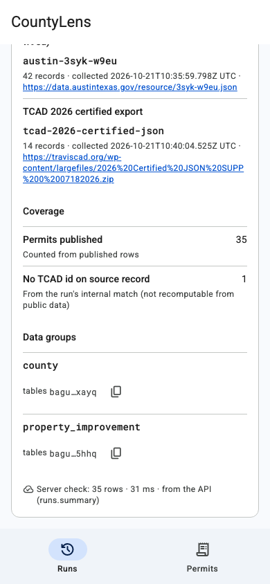
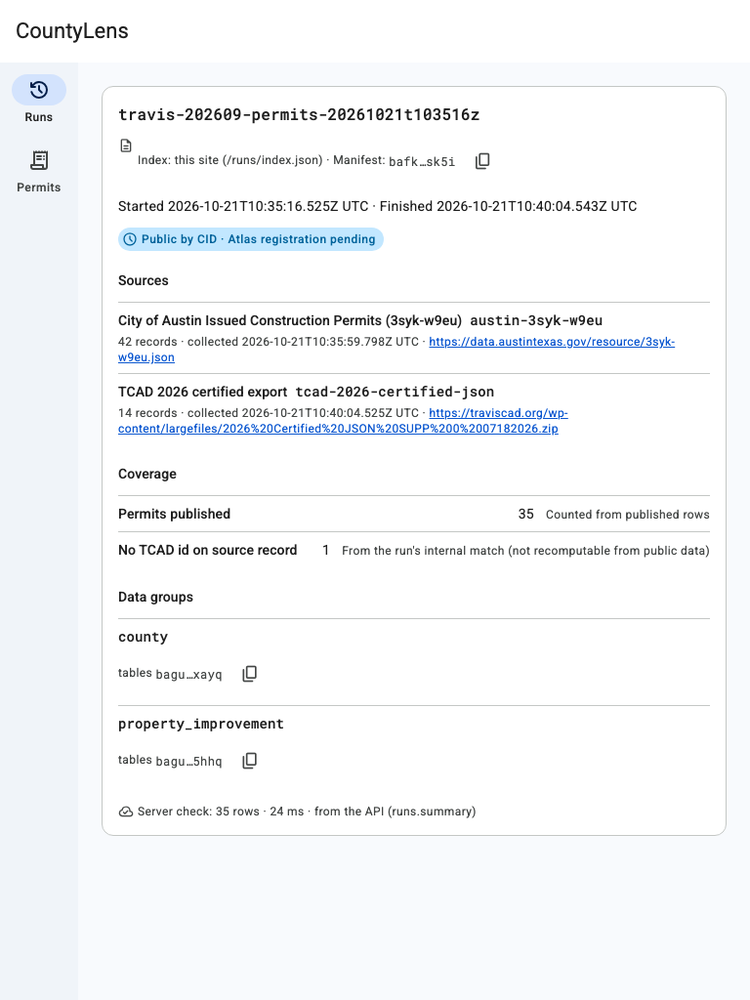
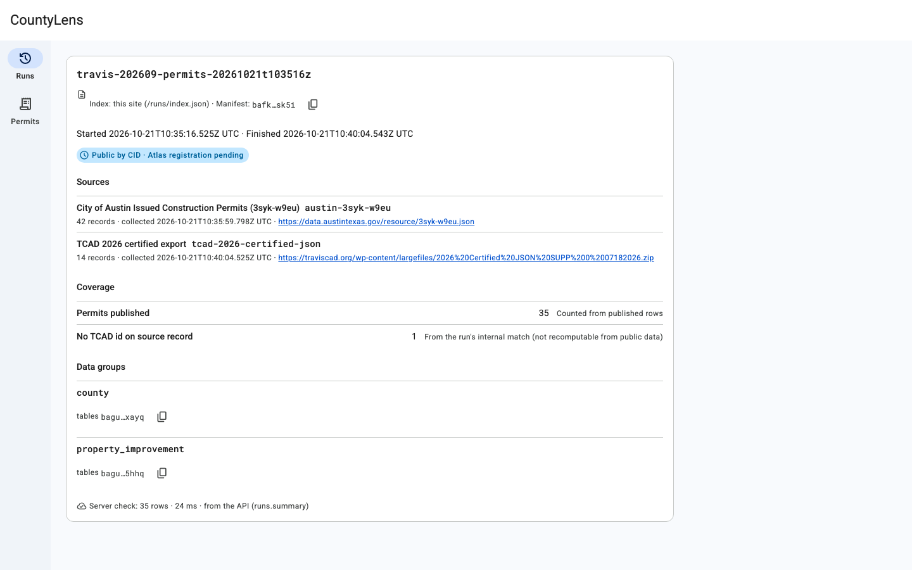
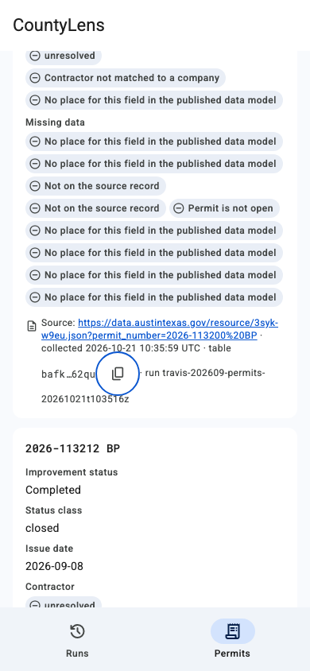
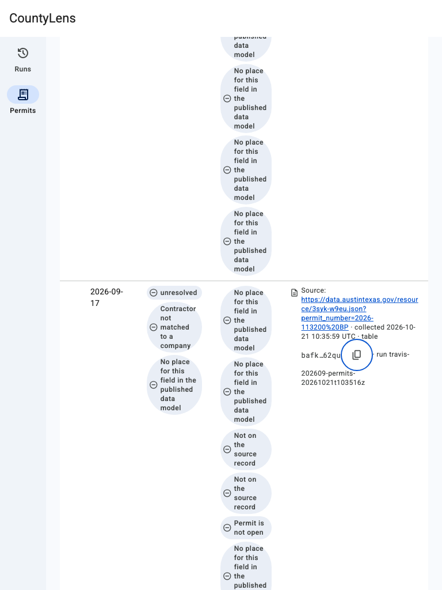
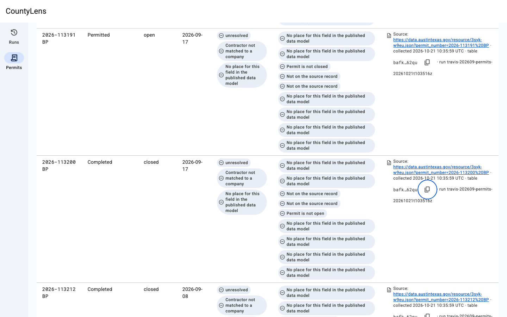
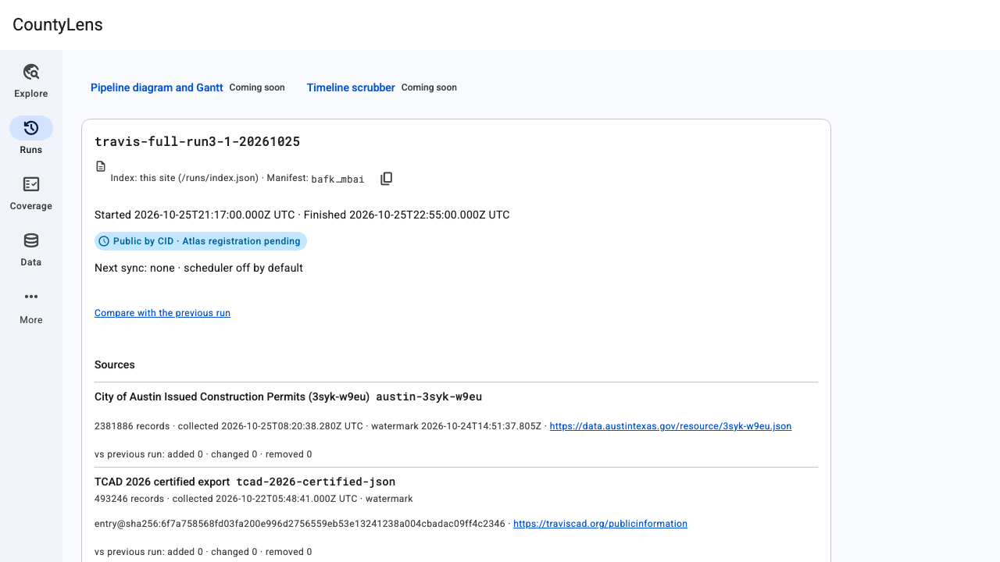
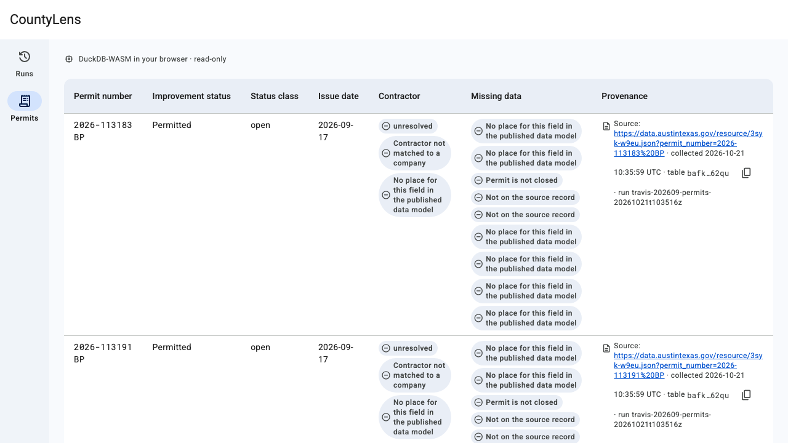
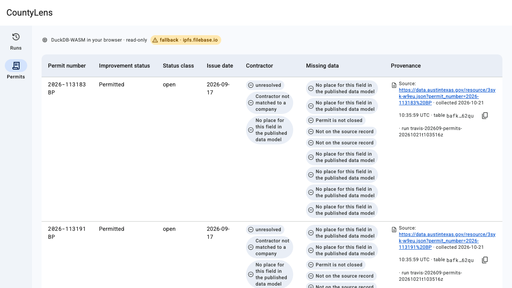

# A-03 Publish one month of Austin roofing permits by CID and show them in the hosted UI

**Status: DRAFT.** Hosted run 1 (build `1380ad3`) found defects ERR-10 to ERR-18. All nine were fixed in `660f73c` and `a1fd50a`, and all nine passed their re-test in **hosted run 2** (build `fbdb68b`, 2026-10-21): **42 / 43 cases pass**. The one failure was TC-NF-04 (API cold start), ERR-19, fixed in `9191b3c`. **Hosted run 3** (build `86694cc`, 2026-10-21 16:52:18Z) re-ran TC-050 and TC-NF-04: **both PASS**, so ERR-19 is re-tested PASS (cold start 2,525 ms < 3,000 ms). TC-051 re-runs against the run 3 pair recorded below after this update. Numbers labelled "run 1" or "run 2" are kept as history.

| Field | Value |
| --- | --- |
| Runtime URL | https://003-walking-skeleton.d2lx0utip89u18.amplifyapp.com (`/runs`, `/permits`). This is the Amplify branch URL, used as the hosted runtime under ASM-8 (spec FR-010). The custom domain https://countylens.aldarraj.com is AVAILABLE (TLS ok, `/runs` 200, run-log 17:08). It serves the production branch `feature/oracle-pipeline`, which gets this code at the G7 merge. |
| Build SHA (`/build.json`) | `86694ccef1d35f5e18833988cb471dfa6859b589` in run 3 (TC-050, TC-NF-04; Api redeployed with the ERR-19 fix). Run 2 read `fbdb68b3b8d3db93d741dbef96637abb032b699f` and run 1 `1380ad3969ad3eeec60d1cc38ad4c1cbf6f6a2a2` at https://003-walking-skeleton.d2lx0utip89u18.amplifyapp.com/build.json |
| Date | 2026-10-21. Run 1: 17:09–17:48 EEST. Run 2: 15:54:13Z–16:30:53Z UTC (18:54–19:31 EEST). Run 3: 16:52:18Z UTC, 47.7 s (TC-050, TC-NF-04) |
| Data snapshot | manifest `bafkreiasycmsr2qdlxqcfg3yc2conpn3jxmohz7gs55hkseipplhpqsk5i`, run `travis-202609-permits-20261021t103516z` |
| Playwright | `tests/e2e/runs.spec.ts` › `@scenario:A-03-TC-010` (demo D-2) and `tests/e2e/permits.spec.ts` › `@scenario:A-03-TC-020` (demo D-1/D-4): both **PASS** in run 2. HTML reports with traces of the failed case: `tests/e2e/playwright-report/run2-*` (local, gitignored) |
| Logs / trace | x-correlation-id `FmoW9j89Ai0EJQg=`, X-Ray trace `1-6ad8edc5-40a028cb6df370d02e8422da` (TC-050, run 3; see § Observability evidence) |
| Test report | `docs/reports/A-03-test-report.md` (run 2: 42 / 43 pass, TC-NF-04 FAIL → ERR-19; run 3: TC-050 and TC-NF-04 PASS, ERR-19 re-tested) |
| PO check | ✋ A-5: PO private-window check of `/runs` and `/permits` on the 003 preview, build `fbdb68b`: "looks right" (run-log 19:05) |
| Code review | `docs/reviews/CR-A-03.md`: 0 open Critical. oracle 84 (early) and 72 → **88** (final), metagross 70 → **81**, `/code-review` 0 Critical / 4 Major (all fixed) |

## Observability evidence (TC-050 → TC-051)

This is TC-050 from hosted run 3 (build `86694cc`, Lambda 3,008 MB): one `runs.summary` call from the hosted Runs page, at 2026-10-21T16:52:21Z, in the format set by `tests/e2e/README.md` § "Observability evidence". Source: the Playwright attachment `tc-050-evidence.json` of run 3.

- x-correlation-id: `FmoW9j89Ai0EJQg=`
- x-trace-id: `1-6ad8edc5-40a028cb6df370d02e8422da`

```json
{
  "level": "INFO",
  "message": "query",
  "timestamp": "2026-10-21T16:52:21.738Z",
  "service": "countylens-api",
  "cold_start": false,
  "function_arn": "arn:aws:lambda:eu-north-1:515618610572:function:countylens-api",
  "function_memory_size": "3008",
  "function_name": "countylens-api",
  "function_request_id": "48d4e164-8bd6-4127-8d9f-f9c92ad8d7b1",
  "sampling_rate": 0,
  "xray_trace_id": "1-6ad8edc5-40a028cb6df370d02e8422da",
  "correlation_id": "FmoW9j89Ai0EJQg=",
  "procedure": "runs.summary",
  "query": "runSummarySql",
  "manifestCid": "bafkreiasycmsr2qdlxqcfg3yc2conpn3jxmohz7gs55hkseipplhpqsk5i",
  "queryDurationMs": 20,
  "durationMs": 21,
  "rows": 1,
  "ok": true,
  "coldStart": false,
  "statusCode": 200
}
```

The trace has the `duckdb.query` subsegment (21 ms; annotations `query = runSummarySql`, `procedure = runs.summary`, the manifest CID) and the `## index.handler` subsegment (23 ms). The metrics `QueryDurationMs`, `ItemsProcessed` and `ItemsFailed` each returned datapoints (40 each). TC-050 PASS in run 3. TC-051 re-runs against this pair after this update.

### Earlier TC-050 pairs (history)

These pairs are kept for the record only; TC-051 reads the run 3 pair above.

- **Run 2** (build `fbdb68b`, Lambda 3,008 MB), 2026-10-21T15:54:19Z: correlation ID `Fmf20heHgi0EJRA=`, trace `1-6ad8e02b-0c1240f93a969a680f1320f2` (`queryDurationMs` 18, `duckdb.query` 20 ms, `## index.handler` 21 ms, 6 datapoints per metric). TC-050 PASS in run 2.
- **Run 1** (build `1380ad3`, Lambda 1,769 MB), 2026-10-21T14:03:31Z: correlation ID `FmPoDgILAi0ENSQ=`, trace `1-6ad8c633-2b06389c3c725a9129f5852b` (`queryDurationMs` 270, `duckdb.query` 272 ms, 8 datapoints per metric). TC-050 failed then on a test defect (it read the `aws:*` annotations as its own), fixed in `a1fd50a`. TC-051 passed in run 2 (16:30:43Z) against the run 1 pair.

### AC-7: API warm and cold start (TC-NF-04, hosted run 3)

TC-NF-04 PASS in run 3 (build `86694cc`, after `cdk deploy CountyLensApi` with the ERR-19 fix `9191b3c`). Source: the Playwright attachment `tc-nf-04-evidence.json`; the cold start is read from X-Ray only.

| Measure | Value | Threshold |
| --- | --- | --- |
| Cold start (new sandbox forced by env nonce `2026-10-21T16:52:42.220Z`) | **2,525 ms** = `Init` 593 ms + `## index.handler` 1,932 ms; trace `1-6ad8eddd-11c91b3a6ff67e456052d4ea`, correlation ID `FmoawjXUAi0EKYg=` (2 trace reads) | < 3,000 ms |
| Warm response, 30 calls | p50 **212** / p95 **243** / max 367 ms, all 200 | < 1,000 ms |
| Warm `QueryDurationMs`, 30 calls | p50 18.7 / p95 21.8 / max 25.2 ms | — |

Run 2 (history): cold start about 5.3–6.3 s (`Init` 693 + handler 5,637 ms; re-run 563 + 4,701 ms) → ERR-19. **ERR-19 re-tested PASS** in run 3.

## Action

1. **Capture and build.** The kit runtime's Socrata adapter (`pipeline/oracle-runtime/travis/adapters/socrata/`) captured September 2026 Austin reroof permits from `3syk-w9eu` and their TCAD 2026 certified parcels. The run was `travis-202609-permits-20261021t103516z`, rebuilt at `327c11f` (run-log 13:50): 44 requests, all HTTP 200, no 403. The publication sequence ran in its fixed order for each data group: validate → hash with CAR → validate CAR → export-tables (`--part-size 48m`), then upload with readback.
2. **First public upload (PO D-8, re-confirmed 16:02 EEST).** Only the approved build was uploaded: `public-files.json` sha256 `ea5fb9d1833a552cda1c4e6875f5f6ac44c047f4f2c2a07cf678d869770e835a`, 27 files, 212,217 B. The upload ran 2026-10-21T13:03:20Z → 13:03:45Z with exit 0. Preflight passed, readback passed (county 16 parts, property_improvement 7 parts), 4 `carCid` adds were made, and 35 roofing rows were bound locally. It wrote the manifest `bafkreiasycmsr2qdlxqcfg3yc2conpn3jxmohz7gs55hkseipplhpqsk5i` and `runs/index.json`.
3. **Verify.** `npx tsx scripts/verify-manifest.ts runs/travis-202609-permits-20261021t103516z/manifest.json` ran on the Pinata and Filebase public gateways at 2026-10-21 13:05:27Z.
4. **Infrastructure (PO D-10).** The five stacks were deployed from the operator laptop (profile `assess`, account 515618610572, region eu-north-1) in the order Data → Api → Web → Ops → Cert (AM-02). CI never deploys (AM-08).
5. **CID copy.** The 28 objects were written to the CloudFront CID copy and read back over `d2xsqoqv09bd0q.cloudfront.net`.
6. **Hosted run 1.** Playwright ran against `https://003-walking-skeleton.d2lx0utip89u18.amplifyapp.com` (build `1380ad3`). `smeargle` checked 390 / 768 / 1440 px.
7. **Hosted run 2 (build `fbdb68b`).** The full Playwright suite plus the `@needs-aws` cases ran from an `assess` session in five batches (2026-10-21 15:54:13Z–16:30:53Z): b1 32 cases, b2 the six infra and performance cases, b3 TC-032, 033 and 034 one at a time about 90 s apart, b4 the TC-NF-04 re-run and TC-051 / TC-061. `verify-manifest` ran again, and `smeargle` re-checked 390 / 768 / 1440. The PO opened `/runs` and `/permits` in a private window (✋ A-5): "looks right".
8. **Hosted run 3 (build `86694cc`).** After the ERR-19 fix (`9191b3c`) and `cdk deploy CountyLensApi`, TC-050 and TC-NF-04 ran from an `assess` session on 2026-10-21 at 16:52:18Z (47.7 s, 1 worker): 2 passed, 0 failed.

## Expected

From the story's acceptance criteria (with the PO amendments of 2026-10-21):

- **AC-1:** each publication step runs in order with none skipped (a test asserts the order). The manifest lists every artifact with a CIDv1, name, codec, size and SHA-256. The tables directory has a `carCid`.
- **AC-2:** Runs shows the run ID, UTC start and finish, both sources (Austin `3syk-w9eu` first, then `tcad-2026-certified-json`), the record count and the manifest CID. The `county` and `property_improvement` groups are published. The page passes at 390 / 768 / 1440 with Atlas tokens only.
- **AC-3:** DuckDB-WASM reads the CID copy and lists every published permit with its contract columns and provenance. Every absent field shows its reason label. The engine line reads "DuckDB-WASM in your browser · read-only".
- **AC-4:** in the spike, COUNT / radius / roof-age p95 < 3 s and first load ≤ 8 s. Radius and roof-age switched to the Lambda DuckDB fallback (D-4), and the Lambda's in-region p95 must be < 3 s over 20 direct invocations on a private full-size copy.
- **AC-5:** every `missing` reason is labelled. The permit with no `tcad_id` is not published, and Runs shows `permits_no_tcad_geoid` as "No TCAD id on source record". When the CID copy is unreachable, the page reads through Filebase and labels the result "fallback".
- **AC-6:** `verify-manifest` on Pinata and Filebase prints `ALL ARTIFACTS VERIFIED`.
- **AC-7:** one JSON log line with the correlation ID, an X-Ray trace with the DuckDB subsegment, and a `QueryDurationMs` metric. Warm API p95 < 1 s and cold start < 3 s. Logs are kept 14 days, and the query log 30 days. Each DLQ has an alarm that emails the operator through SNS. A $10 budget exists. CDK assertions check all of these.

## Observed

### AC-1: publication sequence and manifest

The facts come from `runs/travis-202609-permits-20261021t103516z/manifest.json` and `runs/index.json`.

| Item | Value |
| --- | --- |
| Run | `travis-202609-permits-20261021t103516z`, started 2026-10-21T10:35:16.525Z, finished 2026-10-21T10:40:04.543Z |
| Manifest | `bafkreiasycmsr2qdlxqcfg3yc2conpn3jxmohz7gs55hkseipplhpqsk5i`, 11,641 B, sha256 `12c09928ea035de0229b781684e6bdbb4dd8e3e7e6977a7548887bd677c24aea`, schema `oracle-travis-run-manifest.v1` |
| Artifacts | 27 (2 CARs, 2 tables directories, 23 table parts), each with a CIDv1, name, codec, size and SHA-256 |
| `carCid` | `car/travis-county.car` `bafkreie3bw7zbk6u5gxhvxu5k2y3i56s6zsyytc5gdyvyjpw4z5ky2cglu` · `tables/county` `bafkreigvadapfn3si4ygl6apmjjjjcvahomr2lg3pcwqyjj6ldtqaikqfe` · `car/travis-property_improvement.car` `bafkreifgqjcms7shxsc3p5m6elpjuctdhrh6u2ak6pmfokcjswoecoaokq` · `tables/property_improvement` `bafkreigg3yd3qkcvit74nzvaizmmc5i55fvnvz4rzcjxvd7touqiojflmq` |
| Profiles | `travis-austin@1.0.0` (sha256 `c8fd15cf8deb654c2959d7cca3b05560bc9830de2518c56a092bd87bdf53dfa6`), `travis-austin-roof-profile`, `travis-places`, all at `gitCommit` `327c11f` |
| Run index | `runs/index.json` (`oracle-travis-runs-index.v1`): 1 run, `manifestCid` as above |
| Order test | TC-001 and TC-002 PASS in hosted run 1 (Vitest `publish-order.test.ts` at the deployed SHA) |
| Determinism (T046, CR-A-03 OR-12) | **PASS.** T046 ran `export-tables --part-size 48m` a second time on each kept CAR into a scratch directory and compared the tables root CID and every part CID: "determinism PASS" (`specs/003-walking-skeleton/run-log.md` 12:37, run `travis-202609-permits-20261021t093125z`: county tables 16 parts, property_improvement 7 parts). The rebuild at `327c11f` (run-log 13:50, run `travis-202609-permits-20261021t103516z`, the published run) produced the same CAR and tables roots as before |
| Austin limitation | `sources[0].limitations` has `Comptroller baseline not loaded (A-07)` |
| TCAD limitation | `sources[1].limitations` has `Confidential owner records redacted (Texas Tax Code §25.025): 0` |

### AC-2 and AC-5: Runs page counts (from the manifest `coverage`)

| Count | Value | Derivation |
| --- | --- | --- |
| Sources | `austin-3syk-w9eu` records 42 (captured 2026-10-21T10:35:59.798Z); `tcad-2026-certified-json` records 14 (captured 2026-10-21T10:40:04.525Z) | |
| `permits_captured` | 42 | capture_receipt |
| `permits_accepted` | 38 | aggregate_match |
| `permits_excluded` (trade sub-permits) | 4 | aggregate_match |
| `permits_emitted` (Permits published) | **35** | published_rows |
| `permits_no_tcad_geoid` ("No TCAD id on source record") | **1**: permit `2026-122340 BP`, the null-`tcad_id` permit named in `testplans/A-02-test-cases.md` | aggregate_match |
| `permits_tcad_id_unmatched` | 1 | aggregate_match |
| `permits_ambiguous_geoid` | 1 | aggregate_match |
| `parcels_published` | 14 | published_rows |
| `contractor_unresolved` | 35 ("Comptroller baseline not loaded (A-07)") | aggregate_match |
| `roof_age_permit_anchor` / `roof_age_built_year` | 7 / 7 | published_rows |

38 accepted − 35 emitted = 3, which are exactly the no-`tcad_id`, unmatched and ambiguous permits. Nothing is padded (edge case 1). The Runs page states "Public by CID · Atlas registration pending". Hosted run 1: TC-010, TC-011, TC-013, TC-014 and TC-031 PASS; TC-012 FAIL showed the ERR-10/12 symptoms on the old build. **Run 2: TC-010 to TC-014 and TC-031 all PASS**, including TC-012 (published count 35 = `permits_emitted` on Runs and Permits). Screenshots `img/A-03-TC-010-*` to `img/A-03-TC-014-*` and `img/A-03-TC-031-*`.

### AC-3: Permits list

In hosted run 1, the first batch (17:09) failed TC-020, 021, 022, 025, 026 and 030 because every row was rejected (ERR-10) and the raw zod text was shown (ERR-11). On re-run (17:46) they passed. TC-023 and TC-028 failed because DuckDB autoloaded extensions from `extensions.duckdb.org` (ERR-14). Rows listed in run 1: 35 per load (TC-NF-02).

**Run 2 (build `fbdb68b`): TC-020 to TC-028 and TC-030 all PASS.** The list shows 35 permits with the contract columns, provenance and every missing-reason label. The engine line is exact and no database server is contacted (TC-023). The engine binary arrives compressed (`duckdb-eh-*.wasm.gz`, 200, 8,090,760 B, TC-028). The loading state shows a progress bar with no empty-table flash (TC-024). Screenshots `img/A-03-TC-020-*` to `img/A-03-TC-030-*`.

### AC-4: read path (spike and Lambda fallback)

**Spike, browser DuckDB-WASM over CloudFront signed URLs** (`docs/decisions/0001-read-path.md`). Full Austin table, 2,380,939 rows, Brotli WASM, range reads, 20 runs per cell, ms (p50 / p95):

| Variant | First load | COUNT(*) | Radius | Roof-age cold | Measured (UTC) |
| --- | --- | --- | --- | --- | --- |
| 1g (= 256m) | 3,019 / 3,292 | 24 / 25 | 38,814 / 40,540 | 15,077 / 15,968 | 00:54–01:09; cold 01:52–01:58 |
| 128m | 3,041 / 3,381 | 790 / 840 | 38,539 / 40,072 | not run (time box) | 01:09–01:23 |
| 48m | 2,831 / 3,454 | 10,980 / 11,668 | 41,660 / 42,535 | 26,416 / 31,069 | 01:23–01:42; cold 01:58–02:08 |

**Decision (PO D-4, "Accept (Recommended)"):** radius and roof-age switched to the Lambda DuckDB fallback over the same Parquet, with `--part-size 48m`. The browser keeps first load, COUNT, small reads and free-form SQL. With the uncompressed WASM, first load p95 was 8,618 ms; with Brotli it was 3,292 ms.

**Gateway legs, re-measured after D-8 on A-03's own CIDs** (T067, 2026-10-21 13:08:35Z → 13:11:17Z, 10 samples per leg):

| Gateway | Plain GET | TTFB p50 / max (ms) | Range `bytes=0-1023` | SHA-256 = CID digest | 429s | Preflight (`range`) |
| --- | --- | --- | --- | --- | --- | --- |
| `ipfs.filebase.io` | 200 (10/10) | 70 / 316 | 206 (10/10) | 10/10 | 0 | 204, allows `Range` |
| `gateway.pinata.cloud` | 200 (10/10) | 4,450 / 6,729 | 206 (10/10) | 10/10 | 0 | 204, no `Access-Control-Allow-Headers` |

ipfs.io and dweb.link retired on 2026-09-21 (every request 429, Finding 3). In node DuckDB, a range read through Filebase on `tables/county/structure/part-00000.parquet` took a first-query p50 / max of 290 / 618 ms.

**Lambda fallback, hosted run 1 (TC-NF-05, pre-fix numbers).** Run on the API Lambda at 1,769 MB with 20 direct invocations on a private-prefix copy of the full table (40 parts):

| Query | p95, preset TC_NF_05 | p95, preset ADR_0001 | Target |
| --- | --- | --- | --- |
| count | 2,843 ms | n/a | < 3,000 ms |
| radius | 6,194 ms | 6,493 ms | < 3,000 ms |
| roofAge | 4,988 ms | 4,871 ms | < 3,000 ms |

Radius and roof-age missed the target (ERR-18). The fix in `a1fd50a` sets Lambda arm64 to 3,008 MB, DuckDB `threads = 4` and a warm read cache, with a 15 s timeout and no reserved concurrency (account limit 10, AD-11). The new memory size is an AM-06 sizing note for the PO at G7. The private prefix was emptied after run 1 (run-log 17:48): all 40 keys returned HEAD 404 at 2026-10-21T14:30:57Z.

**Lambda fallback, hosted run 2 (TC-NF-05 PASS, ERR-18 re-tested).** Lambda arm64 3,008 MB, threads 4, the same private full-size copy (40 parts, 2,380,939 rows, receipt total = expected), 1 warm-up + 20 direct invocations per query × preset, 2026-10-21 16:15:31Z–16:17:04Z. `queryDurationMs` in ms:

| Query | Preset | p50 | p95 | First query in a fresh sandbox | Target |
| --- | --- | --- | --- | --- | --- |
| count | TC_NF_05 | 3 | 5 | 6 | p95 < 3,000 |
| radius | TC_NF_05 | 189 | 200 | 2,818 | p95 < 3,000 |
| roofAge | TC_NF_05 | 85 | 95 | 82 | p95 < 3,000 |
| radius | ADR_0001 | 191 | 200 | 186 | p95 < 3,000 |
| roofAge | ADR_0001 | 85 | 93 | 80 | p95 < 3,000 |

The bench copy was refused publicly: CloudFront 403 on the first and last part, the API 400 (`runs.summary` with the bench key) and 404 (`/api/private/...`). After the bench the prefix was emptied (all 40 keys HEAD 404 at 2026-10-21T16:17:14Z, no keys left) and the Lambda env was restored to its baseline (TC-NF-05 attachment `tc-nf-05-evidence.json`; run-log 19:33).

**Browser, hosted run 1 (pre-fix):** first load p50 9,520 / p95 11,425 ms against ≤ 8,000 ms (ERR-17; DuckDB init p95 3,996 ms). COUNT p95 68 ms and list p95 44 ms (TC-NF-02, PASS).

**Browser, hosted run 2 (build `fbdb68b`):** first load over 20 cold loads p50 **3,822** / p95 **4,170** / max 4,319 ms (≤ 8,000 ms, TC-NF-01 PASS, ERR-17 re-tested), with DuckDB init p50 3,101 / p95 3,545 ms and the progress bar at about 0.3–0.8 s. COUNT p50 56.8 / p95 59.7 ms and listing p50 30.7 / p95 33.7 ms over 20 runs, 35 rows each (TC-NF-02 PASS).

### AC-5: fallback

In hosted run 1, TC-030 passed (the no-`tcad_id` permit is not listed) and TC-031 passed (Runs shows the count with its label). TC-032 to TC-034 failed. The page correctly switched the manifest read to Filebase, but the table-part reads then failed with `net::ERR_FAILED`. The cause was Filebase answering 429 without CORS headers after about 50–65 requests (ERR-15). The fix reads each part once, CID-verified, with 3 parallel reads on the gateway and backoff. TC-024 failed with a 2 s delay on each copy request (ERR-16), fixed by parallel part reads.

**Run 2 (build `fbdb68b`): TC-030, TC-031 and TC-024 PASS, and TC-032, TC-033 and TC-034 PASS** (ERR-15 and ERR-16 re-tested). The three fallback cases ran one at a time about 90 s apart (16:23:36Z, 16:25:16Z, 16:26:54Z), because the Filebase per-IP budget is shared. With the copy aborted (TC-032) or answering 500 (TC-033), the page reads through Filebase and labels the rows "fallback". With the copy delayed (TC-034), the first gateway request went out 4,001 ms after the first copy request. Screenshots `img/A-03-TC-032-*`, `img/A-03-TC-033-*`, `img/A-03-TC-034-*`.

### AC-6: verify-manifest

Output from the operator session's `verify-manifest` run, 2026-10-21 13:05:27 UTC (also in `docs/decisions/0001-read-path.md` and run-log 16:07). 28 lines `ok` on each gateway: the manifest plus 27 artifacts, with the 4 CARs and tables directories fetched by `carCid`. 0 × 429, exit 0. First and last lines:

```text
ok   ipfs.filebase.io manifest cid=bafkreiasycmsr2qdlxqcfg3yc2conpn3jxmohz7gs55hkseipplhpqsk5i size=11641 match sha256 match bytes match runs/travis-202609-permits-20261021t103516z/manifest.json
ok   gateway.pinata.cloud manifest cid=bafkreiasycmsr2qdlxqcfg3yc2conpn3jxmohz7gs55hkseipplhpqsk5i size=11641 match sha256 match bytes match runs/travis-202609-permits-20261021t103516z/manifest.json
…
ok   gateway.pinata.cloud tables/property_improvement/property_has_property_improvement/part-00000.parquet cid=bafkreicctwvnuzjhly2ilhzbqq4u2gkjacbtyojqyvwqpt45dekottxnyi size=4777 match sha256 match
ALL ARTIFACTS VERIFIED
EXIT=0
```

In hosted run 1, TC-040 and TC-042 passed. TC-041 and TC-043 failed because of a test defect: the tamper fixtures were not exact JCS bytes. The test was fixed in `a1fd50a`.

**Run 2:** TC-040 to TC-043 all PASS. TC-041 (tampered size or SHA-256) and TC-043 (corrupted CAR) now end with `VERIFICATION FAILED: 4 of 56 checks failed`, and TC-042 refuses CloudFront, ipfs.io, dweb.link and w3s.link. The operator session ran `verify-manifest` again after run 2 (run-log 19:33): 28 `ok` lines per gateway (Filebase and Pinata) and `ALL ARTIFACTS VERIFIED`.

### CI

From `gh run list --branch 003-walking-skeleton` (read 2026-10-21) and the run-log:

| Workflow | Commit | Conclusion | Run |
| --- | --- | --- | --- |
| ci (e2e-hosted re-run) | `fbdb68b` (HEAD) | failure: 31 passed, 3 failed, all CI configuration: TC-006 needs the runtime's npm deps, TC-030 needs `NO_TCAD_PERMIT_NUMBERS`, TC-061 needs this evidence file (run-log 19:10). The workspace, oracle-runtime and gitleaks jobs passed (run-log 18:53) | https://github.com/HebaGaber/oracle-property-intelligence-platform-pipeline-travis-tx/actions/runs/39626119607 |
| ci | `36783c1` | failure (Linux-only app-shell test, fixed in `a1fd50a`) | https://github.com/HebaGaber/oracle-property-intelligence-platform-pipeline-travis-tx/actions/runs/39617581666 |
| ci | `0698288` | failure (web.test.ts timeout on the runner) | https://github.com/HebaGaber/oracle-property-intelligence-platform-pipeline-travis-tx/actions/runs/39616530023 |
| pipeline-ci (old, removed by T078 once ci is green) | `0698288` | failure (expected) | https://github.com/HebaGaber/oracle-property-intelligence-platform-pipeline-travis-tx/actions/runs/39616530057 |
| ci | `1380ad3` | failure | https://github.com/HebaGaber/oracle-property-intelligence-platform-pipeline-travis-tx/actions/runs/39612090689 |

No `ci` run is green on this branch yet. The three CI-configuration fixes are not committed yet; a green `ci` run is still to come.

## Missing data or limitations seen

- **Contractor:** all 35 permits are `contractor_unresolved` because the Comptroller baseline is not loaded (A-07). The UI shows the label, never a blank.
- **No-`tcad_id` permit** (`2026-122340 BP`): not published, and counted as `permits_no_tcad_geoid` = 1 with the derivation helper text "From the run's internal match (not recomputable from public data)".
- **Roof age:** the estimator saw only one month of each parcel's Austin permits (`partial_history`, manifest `limitations`).
- **Owners:** 7 parcels have no dated sale (`owner_no_dated_sale`) and 3 have names that could not be split (`owner_unparsed`). 0 records were confidential.
- **Atlas:** the run is public by CID, and Atlas registration is pending (A-11). Only one pin (Filebase) exists. A second pin and GitHub Release CARs are not part of A-03 (OR-13).
- **Filebase at scale:** this run's largest public file is 78.5 KB, so the gateway rows prove behaviour and per-request latency, not throughput (A-11).
- **Spike limits:** the Parquet is a DuckDB proxy for the CLI writer, measured from one laptop and one edge (MRS).

## Screenshot

`smeargle` hosted re-check on build `fbdb68b` (run-log 18:56): **6/6 PASS** (Runs and Permits × 390 / 768 / 1440). 35 rows = `permits_emitted`, 0 token violations, 0 contrast issues, provenance on every row, the engine line exact, and nav before main. ERR-10 to ERR-13 are resolved. One advisory: at 768 the table scrolls inside its own box. These screenshots replace run 1's failure screenshots at the same paths:








Playwright run 2 screenshots (build `fbdb68b`), one or more per case, are in `docs/evidence/img/A-03-TC-*.png`. For the demo lines:






## Quickstart check (T079)

Run 2026-10-21 against `fe2b26a` (step 1) and the hosted runtime `https://003-walking-skeleton.d2lx0utip89u18.amplifyapp.com` (step 5).

| Step | Command (specs/003-walking-skeleton/quickstart.md) | Result |
| --- | --- | --- |
| 1 | `pnpm turbo typecheck lint test synth`; `(cd pipeline/oracle-runtime && npm test)` | 22/22 turbo tasks successful; runtime 647/647 passed |
| 5 | `RUNTIME_URL=… pnpm --filter @countylens/e2e exec playwright test` (+ `-g "A-03-TC-NF-05"`) | every `@scenario:A-03-TC-*` passed across hosted runs 2–3 (43/43); smeargle 6/6; TC-NF-05 radius p95 200 ms, roofAge p95 95 ms; private copy deleted (bench prefix empty) |

Drift found in step 5: the one-line command also needs `CID_COPY_HOST`, `FILEBASE_GATEWAY_HOST`, `PINATA_GATEWAY_HOST`, `NO_TCAD_PERMIT_NUMBERS`, the region and account variables, and the `assess` / `assess-cid-writer` profiles (tests/e2e/README.md lists them); and TC-032–034 must run about 90 s apart because the Filebase gateway rate-limits per IP (ERR-15). The quickstart is otherwise accurate.

## Amplify GitHub token (TZ02, constitution XII)

The classic token `countylens-amplify` (scopes `repo`, `admin:repo_hook`, 7-day expiry) was created by the PO on 2026-10-21 and stored only as the SSM SecureString `/countylens/github/amplify-access-token`; it was read once at deploy time inside the deploy command and never printed or committed. PO decision at G7 preparation: "Keep for now" — the token stays active until it expires on its own by 2026-10-28; Amplify does not need it after the app was created.

## CI (T078)

First fully green `ci.yml` run on the story branch: https://github.com/HebaGaber/oracle-property-intelligence-platform-pipeline-travis-tx/actions/runs/39641644469 (commit `5fbc811`, 2026-10-21) — `workspace` ✅, `oracle-runtime` ✅, `gitleaks` ✅, `e2e-hosted` ✅ (Playwright on the Amplify branch URL from GitHub's runner; `@needs-aws` cases run from the PO's laptop, AM-08).

Step parity: the `oracle-runtime` job runs every step of the A-01 workflow `.github/workflows/pipeline-ci.yml` unchanged and in order (setup-node with the npm cache on the lockfile, Python 3.12 + PyYAML 6.0.3, `npm ci`, typecheck, lint, format:check, `npm test`, validator `--self-test`, `check-catalog`, readiness diff against `docs/evidence/A-01-readiness.json`), after one prerequisite (the pnpm workspace install, because the runtime imports workspace packages). `infra/test/ci-workflow.test.ts` › "keeps the pipeline-ci.yml steps in order after the prerequisite" asserts it on every CI run. With parity shown and `ci.yml` green, `pipeline-ci.yml` is deleted (T078); `a01-us-gis-probe.yml` stays (disabled pattern).
