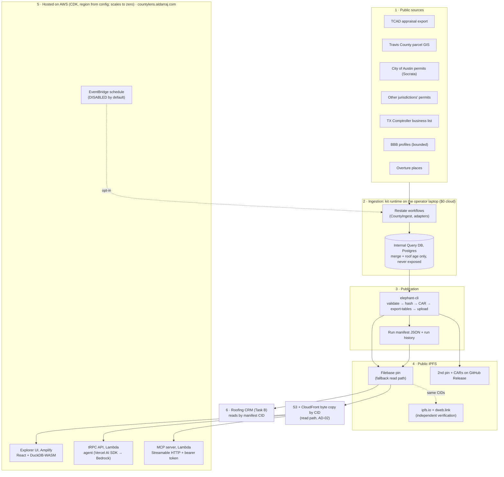
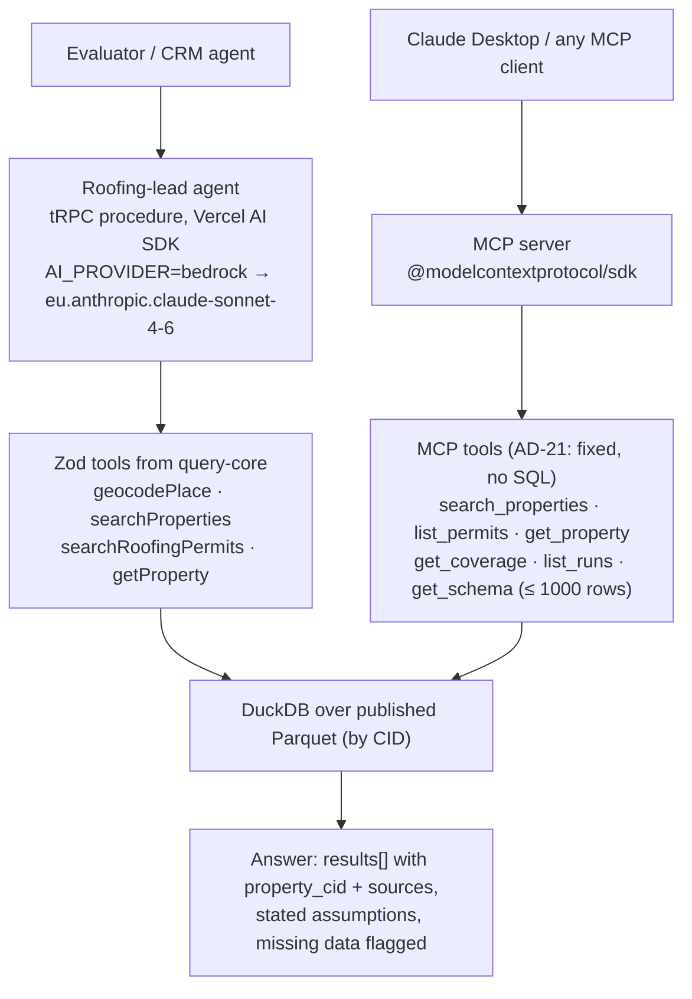
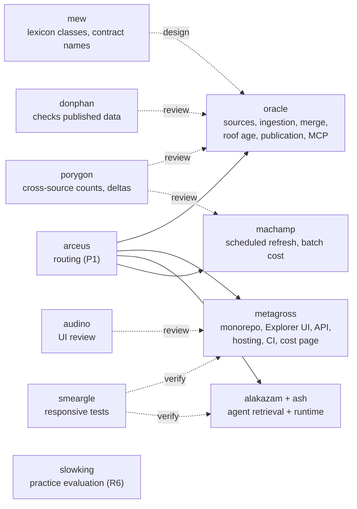
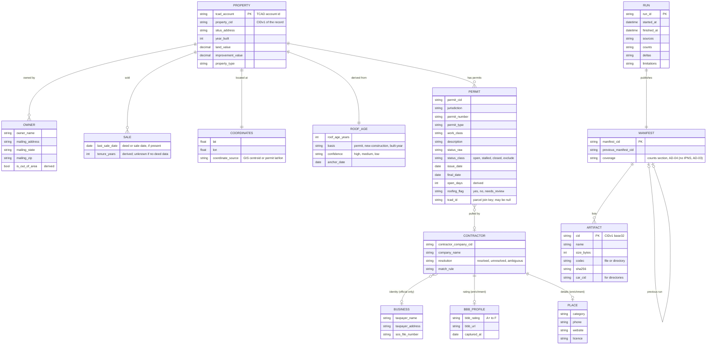

# High-Level Implementation Plan: Oracle Pipeline (Travis County, TX)

> Generated by `developmentsupport-hlplan` from the feature list (FL-A) and the approved intent (VIS-A). It sequences the 16 features into five delivery phases that feed Spec Kit, one story branch per feature. Build order and days come from `../assessment-guide/PLAYBOOK-A-oracle.md` Part 3; architecture from `../assessment-guide/reference/A-oracle.md` § 3.

## 1. Plan overview

We complete the Travis County Oracle pipeline end to end:
- discover and load every public property, permit, owner, contractor, BBB, business and location source;
- merge duplicates, derive roof age, and publish each run as immutable CIDv1 artifacts on public IPFS;
- prove the data is usable through a hosted explorer, a source-backed agent and an MCP server.

The users are the Roofing CRM (and its agent) and the evaluator, who walks the README demo transcript on the hosted URL.

Delivery is **walking skeleton first**: a real slice of Austin roofing permits goes from source to IPFS to a hosted page by day 3. Scale then grows behind that working page.

Ingestion runs on the kit's local runtime, so it costs nothing in the cloud. Everything hosted scales to zero.

**Delivery approach:** Spec-Driven Development.
1. Each FEAT becomes `stories/{ID}.md`.
2. `/speckit-specify` creates the branch `NNN-slug` from `feature/oracle-pipeline`.
3. Then: clarify → kit design agents (`agent-design.md`) → plan → tasks → analyze → tests first → implement through the kit builder agent → reviewer agents score it → deploy → Playwright on the hosted URL → G7 → `merge --no-ff`.

Before the stories are written, two planning steps remain:
- **P5:** UX and market research, then the screen design in Claude Design (prompt script to follow the research).
- **P6:** the architecture constitution (G3).

## 2. Traceability

| Source | Reference | Role |
| --- | --- | --- |
| Vision | VIS-A (`docs/01-intent.md`, approved 2026-10-17) | Problem, outcome, evaluation points A1–A6 (§ 8), access boundaries |
| Feature list | FL-A (`docs/feature-list.md`) | 16 features assigned to phases (§ 8) |
| Architecture | ARD-A (`docs/architecture-constitution.md`, written in P6 / G3) | Rules every story is checked against; § 3 here is its input |
| Requirements | `docs/traceability.md` | README criteria and demo lines → FEAT → story → evidence |
| Data model explainer | [Travis Oracle Data Model](https://claude.ai/artifact/WVXg9kX4CVDrveBrvrGXd6) (private page) | Visual version of § 3.3 |

## 3. Architecture summary (conceptual)

Conceptual only. **G3 froze the decisions in [architecture-constitution.md](architecture-constitution.md) (ARD-A, AD-01 to AD-30), which wins wherever this section differs.** The read-path spike (before A-03 Stage 3) confirms the query path.

### 3.1 System overview

Read top to bottom: data flows from public sources, through the operator's laptop, onto public IPFS, and out to the hosted apps and the CRM.

**Major components**
- **Kit Oracle runtime** (`pipeline/oracle-runtime`, vendored as provided): durable ingestion workflows with Travis adapters and profiles. It runs locally on Restate + Postgres; the stack is already up.
- **Internal Query DB:** merging duplicates, contractor matching and roof age. It is never published or exposed (constitution A2).
- **Publication:** `elephant-cli` is the only path to public data. It produces CARs, Parquet tables and a manifest per run, all pinned on Filebase, with a second pin and the CARs attached to a GitHub Release.
- **`packages/query-core`:** one set of DuckDB views, SQL builders and Zod tool schemas, shared by the UI, agent and MCP. This is the "data contract".
- **Explorer UI** (`apps/web`): runs, coverage, manifest verification, lead finder and SQL panel. It queries in the browser with DuckDB-WASM.
- **API** (`apps/api`): tRPC on Lambda, hosting the agent and the MCP endpoint.
- **Scheduler:** CDK-defined incremental refresh, off by default (constitution A7).

### 3.2 Agent components

There are two kinds of agent in this project:
- **Runtime AI components:** the product's own agent and MCP tools.
- **Build-time kit agents:** the Soofi team-kit agents that design, build and review each part.

**Runtime AI components** (what the evaluator talks to):

- **The agent retrieves over the real published records** through typed tools, not free-text SQL. Every answer carries CIDs and source URLs (constitution XI).
- **The model is a setting** (`AI_PROVIDER`). Bedrock `eu.` inference profiles are confirmed working (quota approved, live call on 2026-10-17). The Vercel AI Gateway is the fallback.
- **Golden queries G1–G6** (`reference/checks.md` § 7) run as Vitest against the deployed endpoint.

**Build-time kit agents** (who owns which part; from `AGENT-MAP.md` § 4 and the P1 routing):

### 3.3 Data structure (reference)

This is the planned model. Field names here are descriptive. Story A-02 confirms the exact lexicon class and column names with `mew` and from the `elephant-cli` export output (`tables-export.json`), then freezes them in `packages/query-core/views.sql` and `contract/v1/`. Sources: `reference/A-oracle.md` §§ 4–5 and § 9, live Socrata checks on 2026-10-17, and the Atlas schema for Jackson County, FL.

#### 3.3.1 Record groups

| Group | Records | Main sources |
| --- | --- | --- |
| Property | Property, Owner, Sale, Coordinates, Roof age (derived) | TCAD certified roll, Travis County parcel GIS, permits (reroof dates) |
| Permits and contractors | Permit, Contractor, Business, BBB profile, Place | City of Austin Socrata `3syk-w9eu` + other jurisdictions, TX Comptroller `9cir-efmm`, bbb.org, Overture Maps |
| Runs and publication | Pipeline run, Manifest, Artifact | The pipeline itself, IPFS |
| Provenance (on every record) | Source record | The source each fact was captured from |

#### 3.3.2 Entity-relationship diagram

#### 3.3.3 Record reference

| Record | One per | Key fields | Source | Notes |
| --- | --- | --- | --- | --- |
| Property | TCAD account in the certified roll | TCAD account id, `property_cid`, situs address, year built, land and improvement values, property type | TCAD Certified Special Export (JSON) | The certified roll count is the property denominator (VIS ASM-6). Supplemental exports drive incremental property updates. |
| Owner | owner of a property | name, mailing address, state, ZIP, out-of-area flag | TCAD | Out-of-area = mailing ZIP outside Travis County; a configurable "regional" list covers neighbouring counties. |
| Sale | recorded sale | last sale date, tenure in years | TCAD (if deed or sale dates are present) | Without deed data, tenure is **unknown**, never "long tenure". |
| Coordinates | property | lat, lon, coordinate source | Travis County GIS `TCAD_PARCELS` centroids, joined on TCAD id; fallback Austin permit lat/lon via `tcad_id` | Target ≥ 99% of the roll. GIS is not the population: its feature count is compared with the roll. |
| Roof age | property | years, basis, confidence, anchor date | Derived by the kit roof-age estimator with a Travis profile | Best evidence first: last completed reroof permit → new-construction date → year built. An open replacement permit does not reset it. |
| Permit | permit in any jurisdiction | jurisdiction, number, type, work class, description, raw and classified status, issue and final dates, open days, roofing flag, `tcad_id` | Austin Socrata `3syk-w9eu` (2,380,507 rows on 2026-10-17); other jurisdictions as classified in A-01 | Unmatched permits are kept (63,019 Austin rows have no `tcad_id`) and matched by address hash where possible. Incremental via `:updated_at` watermark. |
| Contractor | contractor company named on permits | company CID, name, resolution, match rule | Permit contractor fields (search keys only) | Linked to a Business only on an unambiguous official match; otherwise **unresolved**. |
| Business | registered Texas taxpayer | taxpayer name, address, SOS file number | TX Comptroller Active Franchise Tax Permit Holders `9cir-efmm` | The official identity source (constitution A5). |
| BBB profile | contractor with a BBB page | rating, URL, capture time | bbb.org (API if granted, otherwise bounded harvest) | Enrichment only; stop on 403; missing shows "BBB not available". |
| Place | Overture point of interest | category, phone, website, licence | Overture Maps places | Enrichment only; separate publication group; licence recorded. |
| Pipeline run | execution of the pipeline | run id, start and end, sources, counts, deltas, limitations | The pipeline | At least 3 runs on different days; runs 2+ are windowed. |
| Manifest | run | manifest CID, previous manifest CID, `coverage` section (no IPNS: AD-03, AD-04) | The pipeline, published to IPFS | Published CIDs never change; history keeps every manifest. |
| Artifact | published object | CID (v1, base32), name, size, codec, SHA-256, CAR for directories | `elephant-cli` output | Verified on ipfs.io and dweb.link with size and digest match. |
| Source record | every record above | source URL, capture time, digest or CID, run id | The source of each fact | Shown with every displayed record and agent answer (constitution XI). |

#### 3.3.4 Contract views (what the UI, agent, MCP and CRM read)

| View | One row per | Columns | Answers |
| --- | --- | --- | --- |
| `v_property` | property | `property_cid`, `request_identifier`, situs address, `lat`, `lon`, `year_built`, `roof_age_years`, `roof_age_basis`, `roof_age_confidence`, `last_sale_date`, `owner_name`, `owner_mailing_state`, `owner_mailing_zip`, `owner_is_out_of_area`, source URLs | Radius + roof age, owner tenure, out-of-area owners |
| `v_roofing_permit` | roofing permit | `permit_cid`, `property_cid`, jurisdiction, permit number, status, `issue_date`, `final_date`, `is_open`, `open_days`, work class, description, `contractor_company_cid`, contractor name, `contractor_resolution`, `bbb_rating`, `bbb_url`, source URL | Open and stalled permits by open duration, with contractor and BBB |
| `v_contractor` | contractor company | identity source, BBB rating, permit count, roofing permit count | Contractor profile and activity |
| `v_run` | pipeline run | `run_id`, start and end time, sources, counts, deltas, limitations, `manifest_cid`, `previous_manifest_cid` | Run history and immutability |

The views live in `packages/query-core/views.sql`, with the SQL builders and Zod tool schemas next to them. `contract/v1/` holds the README and `sample.parquet` with 20 real rows, cited by CID for Task B.

#### 3.3.5 Derivation rules

| Rule | Definition | Evidence |
| --- | --- | --- |
| Roofing permit | A reviewed term list on `description` (REROOF, RE-ROOF, ROOF REPLACE), excluding solar/PV, Auxiliary Power, RTU, roof deck and "roof-mounted"; unclear terms go to `needs_review` | `work_class = 'Roof'` matches only 52 Austin permits; the description terms match 22,083 (live, 2026-10-17) |
| Permit status class | **Open:** Active, Pending, Pending Permit, On Hold, Suspended, Inactive Pending Revision, Re Review (~28.4k). **Stalled:** Expired, Expired - License (~169.7k). **Closed:** Final, Closed (~2.01M). **Exclude:** VOID, Withdrawn, Cancelled, Aborted, Denied but Closed, Revoked, Rejected (~172k) | Austin `status_current` vocabulary, `reference/A-oracle.md` § 5 (2026-10-15) |
| Open days | `as_of − issue_date` for open and stalled permits | Stalled reroofs are shown as their own labelled lead signal |
| Roof age | From the kit estimator (`use-oracle/runtime/src/roof-age/`): basis permit → new-construction → built-year, with high / medium / low confidence | Re-running the apply step must write 0 rows |
| Owner tenure | `as_of − last_sale_date > 10 years`; **unknown** if there is no deed data | README "not exchanged ownership in more than 10 years" |
| Out-of-area owner | Mailing ZIP outside Travis County; configurable regional list of neighbouring counties | README "regional (or out-of-area) owners" |
| Contractor identity | Official registry match only; BBB and places never decide identity | Constitution A5 |

#### 3.3.6 Elephant storage pattern

Elephant stores each record as its own CID-addressed object and each link as a separate relationship record. Verified on the one county in Atlas today (Jackson County, FL, synced 2026-10-15):

| Table | Kind | Key |
| --- | --- | --- |
| `property` | record | `cid` |
| `parcel` | record | `cid` |
| `address` | record | `cid` |
| `property_has_address` | link: property → address | `relationship_cid` |
| `address_has_parcel` | link: address → parcel | `relationship_cid` |
| `properties` | flattened view, one row per property | `property_cid` |

Travis follows the same pattern with more classes (owners, sales, permits, companies). `elephant-cli export-tables` turns them into the Parquet tables that the contract views read.

### 3.4 Implementation approach with the Soofi kit agents

Each story runs the six-stage loop (playbook Part 2). The kit agent named in the story's front matter owns each stage (constitution XIII–XVII):

| Stage | What happens | Kit role |
| --- | --- | --- |
| 1 Ready | G4 pre-check on the story file | — |
| 2 Spec | `/speckit-specify`, `/speckit-clarify` | — |
| 3 Design | Design agents consulted read-only; answers saved to `specs/{NNN}/agent-design.md`; then plan, tasks, analyze, G5 | `agents.design` |
| 4 Tests first | Test cases from the acceptance criteria, G6 | — |
| 5 Build + review | `/speckit-implement` delegated to the builder subagent with its skills + `apply-engineering-guidelines`; `/code-review`; every reviewer scores ≥ 75 in `docs/reviews/CR-{ID}.md` | `agents.builder`, `agents.reviewers` |
| 6 Prove live | Deploy; Playwright on the hosted URL; `smeargle` for UI; evidence; G7 | `agents.verify` |

| Story | Design | Builder | Reviewers | Key skills |
| --- | --- | --- | --- | --- |
| A-01 | oracle | oracle | oracle | onboard-county, county-discovery, county-readiness-preflight, bootstrap-oracle-infra |
| A-02 | mew, oracle | oracle | oracle, donphan | use-oracle, use-neutral-lexicon |
| A-03 | metagross, oracle | metagross (app), oracle (publish) | metagross, oracle | build-frontend-backends, integrate-ci-cd, use-oracle, county-permit-adapter |
| A-04 | oracle | oracle | oracle, donphan | county-seed-data, county-appraisal-onboarding, build-county-transform, county-ingest-run, monitoring-county-ingestion |
| A-05 | oracle | oracle | oracle, donphan | use-oracle, query-db-loading-matching |
| A-06 | oracle | oracle | oracle, donphan | county-permit-adapter, county-ingest-run, durable-workflow-builder |
| A-07 | oracle, mew | oracle | oracle, donphan | query-db-loading-matching |
| A-08 | oracle | oracle | oracle, donphan | bbb-harvest |
| A-09 | oracle | oracle | oracle | overture-places-ingest |
| A-10 | oracle | oracle | oracle, donphan, porygon | query-db-loading-matching, use-oracle, unify-metrics |
| A-11 | oracle | oracle | oracle, donphan | use-oracle |
| A-12 | oracle, machamp | oracle (runs), machamp (scheduler) | oracle, machamp, porygon | use-oracle, build-batch-workflows, durable-workflow-builder, monitoring-oracle-ingestion |
| A-13 | metagross | metagross | metagross, audino | build-frontend-backends, frontend-bug-fix, responsive-design-tests |
| A-14 | alakazam, ash | alakazam (retrieval), ash (runtime) | alakazam, ash | build-rag-systems, build-ai-agents |
| A-15 | oracle | oracle | oracle, donphan | deploy-open-data-mcp, use-elephant-mcp |
| A-16 | metagross, machamp | metagross | metagross, machamp | build-frontend-backends, build-batch-workflows |

`babysit-release` is not used: the PR is never merged (P1 decision, `docs/kit-usage.md`).

## 4. Technology stack

| Tier | Technology | Justification |
| --- | --- | --- |
| Ingestion | Kit `use-oracle` runtime (TypeScript) on local Restate 1.7 + Postgres 16 in Docker | Kit-prescribed (constitution A1); $0 cloud; durable resume after sleep or restart |
| Publication | `elephant-cli` (validate, hash, CAR, export-tables, upload); Filebase IPFS pinning; second pin; CARs on GitHub Release | Only allowed public-data path (A2); CIDv1 identity (A3); survives any single vendor |
| Data / query | Parquet tables from `export-tables`; DuckDB-WASM in the browser, DuckDB (`@duckdb/node-api`) in Lambda; reads a byte-for-byte copy of the published files on S3 + CloudFront keyed by CID, with the Filebase gateway as fallback (AD-02) | No Oracle-hosted database; compute runs on the consumer side (README "DuckDB", zero idle cost). Fallback if browser p95 > 3 s: DuckDB in Lambda over the same Parquet |
| Frontend | React + Vite in a Turborepo (`apps/web`) on Amplify Hosting; Atlas (Material 3) tokens and components; mobile-first | Golden Path; `build-frontend-backends`; design system mandated by `CLAUDE.md`. Map library chosen at G3 |
| API | tRPC on Lambda behind API Gateway; Zod on every input; shared `packages/api-client` | Golden Path; constitution IV, V |
| AI | Vercel AI SDK (`ai`) with `@ai-sdk/amazon-bedrock`; `AI_PROVIDER=bedrock` with `eu.anthropic.claude-sonnet-4-6` (confirmed 2026-10-17); Gateway fallback | Constitution VI; no direct provider SDKs |
| MCP | `@modelcontextprotocol/sdk`, stateless Streamable HTTP on Lambda with a bearer token in SSM Parameter Store and six fixed Zod tools, no SQL (AD-10, AD-14, AD-21), plus a stdio build | The kit MCP serves only Jackson, FL today, so our own MCP over our CIDs proves MCP-readiness |
| IaC / CI | AWS CDK (TypeScript), region from config (demo `eu-north-1`, default `us-east-2`), tag `project_name=oracle-travis`; GitHub Actions: Vitest, Playwright (hosted URL only), ESLint, Prettier, `tsc`, gitleaks | Constitution III, X, XII |
| Observability | Powertools Logger, Tracer and Metrics; X-Ray; one DLQ alarm per queue | Constitution VII, VIII |

## 5. Scope (G2 required)

| # | In scope | Delivered in |
| --- | --- | --- |
| S-01 | Source discovery, readiness preflight and the frozen data contract | Phase 0 |
| S-02 | Walking skeleton: one month of Austin reroof permits by CID on the hosted explorer | Phase 0 |
| S-03 | Full-county property, owner, coordinate and permit data | Phase 1 |
| S-04 | Contractor identity, BBB ratings, business and places data | Phase 2 |
| S-05 | Duplicate merging and roof age with lineage | Phase 2 |
| S-06 | Full-county publication (Run 1) verified on two gateways | Phase 3 |
| S-07 | Explorer UI covering every UI demo line | Phase 3 |
| S-08 | Incremental Runs 2 and 3 with history and immutable prior CIDs | Phase 4 |
| S-09 | Roofing-lead agent and MCP server | Phase 4 |
| S-10 | Zero-idle-cost proof and documented source limits | Phase 4 |

| # | Out of scope | Rationale |
| --- | --- | --- |
| OS-01 | Roofing CRM UI, map pin/GPS interaction design, lead outreach | README Out of Scope (roofing-crm repo) |
| OS-02 | Live outbound messaging to property owners | README Out of Scope |
| OS-03 | Counties other than Travis | README targets Travis County |
| OS-04 | Paid sources and anything behind a CAPTCHA or bot challenge | Constitution A6, XI |
| OS-05 | Atlas registration | Not required by the README; pending (VIS ASM-2) |

## 6. Dependencies (G2 required)

| ID | Type | Dependency | Needed by | Status |
| --- | --- | --- | --- | --- |
| DEP-01 | Inter-phase | Phase 0 → Phase 1: sources classified (A-01) and contract frozen (A-02) before full ingestion | Phase 1 | — |
| DEP-02 | Inter-phase | Phase 0 → Phases 3–4: the hosted app, CI and deploy path (A-03) before the explorer, agent and MCP | Phase 3 | — |
| DEP-03 | Inter-phase | Phase 1 → Phase 2: properties and permits loaded before contractor matching, merging and roof age | Phase 2 | — |
| DEP-04 | Inter-phase | Phase 2 → Phase 3: only reconciled data is published as Run 1 | Phase 3 | — |
| DEP-05 | Inter-phase | Phase 3 → Phase 4: incremental runs build on Run 1's CIDs; the agent and MCP query the published tables | Phase 4 | — |
| EXT-01 | External | AWS demo account (`eu-north-1`), CDK bootstrap | Phase 0 | Available |
| EXT-02 | External | Bedrock model quota (`eu.` profiles) | Phase 4 | Available (confirmed 2026-10-17) |
| EXT-03 | External | Filebase account; plan limits measured in the spike | Phase 0 | Account available; limits unmeasured |
| EXT-04 | External | Domain `aldarraj.com` for `countylens.aldarraj.com` | Phase 0 (A-03) | Owned by the PO; DNS on Namecheap (records added in A-03) |
| EXT-05 | External | TCAD export download path within its terms | Phase 1 | At risk (403 on 2026-10-17; RISK-03) |
| EXT-06 | External | BBB official API key | Phase 2 | Not requested; bounded harvest with stop-on-403 instead |
| EXT-07 | External | Atlas access | Phase 3 | Not requested; listed as pending |
| EXT-08 | External | Local Docker stack (Restate + Postgres) | Phase 0 | Available (running since 2026-10-17) |
| ORG-01 | Organisational | Assessor answers to access questions | — | Not needed: working assumptions decided 2026-10-17 (VIS § 12) |
| ORG-02 | Organisational | Task B (Roofing CRM) consumes the A-02 contract and Run CIDs | Task B | Same owner; contract delivered on day 2 |
| ORG-03 | Organisational | PO approval at each gate | Every phase | G0 and G1 approved 2026-10-17 |

## 7. Constraints (G2 required)

| # | Type | Constraint | Impact |
| --- | --- | --- | --- |
| CON-01 | Technical | TypeScript only (Python only for PySpark/Glue); CDK only; region from config; kit runtime and kit-bundled skills only; `elephant-cli` the only publish path | No quick scripts in other languages; adapters extend the kit runtime instead of replacing it |
| CON-02 | Budget | Zero idle cost by default; $10 budget alert; AWS Free plan ($120 credits, ends 2027-04-16) blocks some services (Route 53 domain registration refused) | Scheduler disabled by default; no always-on database or search cluster; check plan state on unexpected "Access Denied" |
| CON-03 | Timeline | Speed is scored up to the last commit; plan assumes about 8 build days after planning (VIS ASM-4) | Walking skeleton by day 3; stories time-boxed to 0.5–1.5 days |
| CON-04 | Resourcing | One person, acting as Oracle and builder | Gates are self-approved with AI pre-checks; kit agents carry design, build and review |
| CON-05 | Access | Public sources only; no CAPTCHA bypass; stop on BBB 403; TCAD and GIS unreliable from this machine | BBB coverage may be partial; US-hosted GitHub Actions runner as the fallback for blocked sources |

## 8. Implementation phases

Order: Project-class enablers first, the walking skeleton live before feature work, Must before Should/Could, dependencies respected. Days follow playbook Part 3; Day 1 is the first build day (Q-01). Each phase ends with exit criteria tested on the **hosted** URL.

### Phase 0: Foundation and walking skeleton (Days 1–3)

- **Objective:** a hosted URL serving one real slice of Travis data, read by CID.
- **Features:** FEAT-A01, FEAT-A02, FEAT-A03.
- **Story branches:** `001-discover-sources`, `002-data-contract`, `003-walking-skeleton`.
- **Duration:** 3 days (A-01 day 1, A-02 day 2, A-03 days 2–3, with the 4-hour read-path spike before A-03 Stage 3).
- **Exit criteria:**
  - the readiness validator exits 0;
  - `contract/v1/sample.parquet` has 20 real rows;
  - the hosted explorer (private browser window, no login) lists one month of Austin reroof permits read through DuckDB from a gateway CID;
  - `runs/{runId}/manifest.json` exists;
  - a CloudWatch log and an X-Ray trace exist for the API.

### Phase 1: County backbone (Days 3–4)

- **Objective:** every TCAD property with owner, coordinates and permits, loaded and counted.
- **Features:** FEAT-A04, FEAT-A05, FEAT-A06.
- **Story branches:** `004-tcad-backbone`, `005-coordinates`, `006-permits`.
- **Duration:** 2 days.
- **Exit criteria:**
  - seeded property count = certified roll count, or a difference under 2% that is explained;
  - coordinate coverage of at least 99%, with the gap classified;
  - per-jurisdiction permit counts, with every jurisdiction classified;
  - counts visible on the hosted skeleton.

### Phase 2: Identity, enrichment and reconciliation (Day 5)

- **Objective:** contractors resolved from official records, enrichment added within source terms, duplicates merged, roof age derived.
- **Features:** FEAT-A07, FEAT-A08, FEAT-A09, FEAT-A10.
- **Story branches:** `007-contractor-identity`, `008-bbb-ratings`, `009-business-places`, `010-reconcile-roof-age`.
- **Duration:** 1 day (the four stories run as parallel workflows on the local stack).
- **Exit criteria:**
  - resolved / unresolved / ambiguous contractor counts;
  - BBB coverage %, with any 403 evidenced;
  - business and places counts, with the licence recorded;
  - merge statistics, roof-age coverage by confidence, and one worked example with full lineage;
  - a re-run of the roof-age step writes 0 rows.

### Phase 3: Run 1 publication and Explorer (Days 6–7)

- **Objective:** the full county published and verifiable, explored on the hosted UI.
- **Features:** FEAT-A11, FEAT-A13.
- **Story branches:** `011-full-publish`, `013-explorer-ui`.
- **Duration:** 2 days (A-11 day 6, A-13 days 6–7).
- **Exit criteria:**
  - `verify-manifest` prints `ALL ARTIFACTS VERIFIED` against ipfs.io and dweb.link;
  - CARs are attached to a GitHub Release;
  - the hosted explorer passes Playwright for demo lines D-2 to D-9;
  - `smeargle` responsive tests pass at 390, 768 and 1440 px.

### Phase 4: Continuity, agent, MCP and cost (Days 7–8)

- **Objective:** prove ongoing ingestion, AI and MCP access, and zero standing cost.
- **Features:** FEAT-A12, FEAT-A14, FEAT-A15, FEAT-A16.
- **Story branches:** `012-incremental-runs`, `014-agent`, `015-mcp`, `016-cost-limits`.
- **Duration:** 2 days (Run 2 on day 7, Run 3 on day 8; agent day 7; MCP and cost day 8).
- **Exit criteria:**
  - at least 3 runs in history, on different days, with deltas;
  - Run N's manifest still verifies after Run N+1;
  - the schedule is deployed with `state: DISABLED`;
  - golden queries G1–G6 pass against the deployed agent;
  - `donphan` answers a question through the hosted MCP;
  - `docs/cost.md` and `docs/source-limits.md` are shown on the Coverage page, with a billing screenshot.

### 8.x Feature-to-phase coverage

| FEAT-ID | Feature | MoSCoW | Phase | Branch |
| --- | --- | --- | --- | --- |
| FEAT-A01 | Source discovery and readiness | Must | 0 | `001-discover-sources` |
| FEAT-A02 | Frozen data contract | Must | 0 | `002-data-contract` |
| FEAT-A03 | Walking skeleton | Must | 0 | `003-walking-skeleton` |
| FEAT-A04 | TCAD property and owner backbone | Must | 1 | `004-tcad-backbone` |
| FEAT-A05 | Property coordinates | Must | 1 | `005-coordinates` |
| FEAT-A06 | Permits from every jurisdiction | Must | 1 | `006-permits` |
| FEAT-A07 | Contractor identity | Must | 2 | `007-contractor-identity` |
| FEAT-A08 | BBB ratings | Must | 2 | `008-bbb-ratings` |
| FEAT-A09 | Business and places records | Must | 2 | `009-business-places` |
| FEAT-A10 | Duplicate merge and roof age | Must | 2 | `010-reconcile-roof-age` |
| FEAT-A11 | Verifiable full-county publication | Must | 3 | `011-full-publish` |
| FEAT-A12 | Incremental runs and history | Must | 4 | `012-incremental-runs` |
| FEAT-A13 | Explorer UI | Must | 3 | `013-explorer-ui` |
| FEAT-A14 | Roofing-lead agent | Must | 4 | `014-agent` |
| FEAT-A15 | MCP interface | Must | 4 | `015-mcp` |
| FEAT-A16 | Zero-cost proof and source limits | Must | 4 | `016-cost-limits` |
| FEAT-A17 | Admin sign-in and run commands (AD-12, built last) | Should | 4 (after all Musts) | `017-admin-login` |
| FEAT-A18 | Content and Coming soon pages | Should | 4 (after all Musts) | `018-content-pages` |

## 9. Risk register (G2 required: at least one mitigation per risk)

| Risk | Description | L | I | Mitigation | Owner |
| --- | --- | --- | --- | --- | --- |
| RISK-01 | Public gateways (ipfs.io, dweb.link) rate-limit (429) or are slow during verification | H | H | Live queries never use public gateways (S3 + CloudFront CID copy, AD-02); verification with backoff and a retry state in the UI; never mark "verified" on failure; pre-warm CIDs before the demo | HebaGaber |
| RISK-02 | Filebase free tier too small for the full county | M | H | Measure CAR and table sizes in the spike; Starter plan for one month or a self-run kubo node; CARs on a GitHub Release as an extra copy | HebaGaber |
| RISK-03 | TCAD download page returns 403 to this machine (seen 2026-10-17) | M | H | A-01 confirms a terms-compliant path first: browser download of the published export files; fallback US-hosted GitHub Actions runner; never evasion | HebaGaber |
| RISK-04 | Travis County GIS times out from this machine | M | M | Fallback coordinates from Austin permit lat/lon through `tcad_id`; US runner; record the coordinate source per property | HebaGaber |
| RISK-05 | BBB bot challenge blocks all harvesting | H | M | Bounded probe first; stop on 403 and record evidence; show "BBB not available"; README allows "where available" (ASM-5) | HebaGaber |
| RISK-06 | Other jurisdictions have no public permit history | H | M | Classify each with evidence (supported / records request / none) in A-01; document the gap on the Coverage page | HebaGaber |
| RISK-07 | Full backfill of 2.38M Austin permits takes longer than a day | M | M | Measure throughput in A-01; page by `:id` with bounded concurrency on the durable local stack (resumes after sleep); start the backfill early | HebaGaber |
| RISK-08 | DuckDB-WASM over IPFS too slow (p95 > 3 s) | M | H | Read-path spike before A-03; fallback DuckDB in Lambda over the same Parquet; tune export-tables part size | HebaGaber |
| RISK-09 | Bedrock 10 requests/minute throttles the agent | M | M | Retry with backoff in the AI SDK; small tool-call budgets; Gateway fallback via `AI_PROVIDER` | HebaGaber |
| RISK-10 | AWS Free plan blocks a needed service or credits run out | L | H | Serverless, pay-per-request services only; $10 budget alert; check `get-account-plan-state` on unexpected "Access Denied"; Paid plan keeps the credits if needed | HebaGaber |
| RISK-11 | Roofing classification picks up solar, HVAC or deck permits (false positives) | M | M | Reviewed term list with excludes in the frozen A-02 profile; unclear terms go to `needs_review`; spot-check 25 rows | HebaGaber |
| RISK-12 | Task A delays block Task B (CRM) | M | H | Freeze the contract and 20 sample rows on day 2; the CRM builds on `contract/v1/` before the full county lands | HebaGaber |
| RISK-13 | Laptop sleep or restart interrupts long local runs | M | L | Restate resumes durable workflows; containers restart automatically; restart the services process after a reboot | HebaGaber |
| RISK-14 | Nice-to-have helper features (query log, AI search, Street View, tour) crowd out Must work in A-13 and A-14 | M | M | Build them only after every demo line passes on the hosted URL; each sits behind a feature flag; the Street View key has a daily cap | HebaGaber |

## 10. Success criteria (G2 required: each traces to VIS)

| SC | Measurable criterion | Traces to | Verified in phase |
| --- | --- | --- | --- |
| SC-01 | Property count equals the TCAD certified roll count (or a difference under 2% that is explained); every source shows a count against its own denominator with a timestamp | VIS-A SC-1 (A1) "All available Travis County … records are loaded at full scale" | 1 |
| SC-02 | Coordinates on at least 99% of roll properties; every permit jurisdiction classified with evidence | VIS-A SC-1 (A1) "with source limits and speeds documented" | 1 |
| SC-03 | Merge statistics per entity type and one worked example with full lineage; 100% of displayed records show source URL, capture time and digest | VIS-A SC-2 (A2) "every record and answer cites its source" | 2 |
| SC-04 | At least 3 runs on different days; runs 2 and 3 are windowed with per-source deltas | VIS-A SC-3 (A3) "picked up by bounded or change-detected refreshes, and run history is kept" | 4 |
| SC-05 | Every manifest CID is CIDv1 and fetches from ipfs.io and dweb.link with matching size and SHA-256; Run 1's manifest still verifies after Run 3 | VIS-A SC-4 (A4) "retrievable from public IPFS without the candidate's environment" | 3, 4 |
| SC-06 | Standing AWS cost of $0/day with nothing enabled, shown by a billing screenshot | VIS-A SC-4 (A4) "at zero standing cost" | 4 |
| SC-07 | A 5-mile radius search with roof age over 15 years returns real properties with basis, coordinates and provenance in p95 < 3 s | VIS-A SC-5 (A5) "radius plus roof age over N years (with basis, coordinates, provenance)" | 3 |
| SC-08 | Open roofing permits ranked by open duration show contractor and BBB, or "not available" | VIS-A SC-5 (A5) "open roofing permits ranked by open duration, with contractor and BBB" | 3 |
| SC-09 | Golden queries G1–G6 pass against the deployed agent, each answer with CIDs, sources and stated assumptions | VIS-A SC-6 (A6) "answers both README prompts over real records with reasoning, evidence and stated assumptions" | 4 |
| SC-10 | The hosted MCP lists its tools and answers a query from `donphan` | VIS-A SC-6 (A6) "lists its tools and answers a query without changing the data model" | 4 |

## 11. Spec Kit mapping

Every branch is created from `feature/oracle-pipeline` and merged back with `--no-ff` after G7.

| Spec dir / branch | Story | Phase | Command sequence |
| --- | --- | --- | --- |
| `specs/001-discover-sources` | A-01 | 0 | specify → clarify → plan → tasks → analyze → implement |
| `specs/002-data-contract` | A-02 | 0 | specify → clarify → plan → tasks → analyze → implement |
| `specs/003-walking-skeleton` | A-03 | 0 | spike → specify → clarify → plan → tasks → analyze → implement |
| `specs/004-tcad-backbone` | A-04 | 1 | specify → clarify → plan → tasks → analyze → implement |
| `specs/005-coordinates` | A-05 | 1 | specify → clarify → plan → tasks → analyze → implement |
| `specs/006-permits` | A-06 | 1 | specify → clarify → plan → tasks → analyze → implement |
| `specs/007-contractor-identity` | A-07 | 2 | specify → clarify → plan → tasks → analyze → implement |
| `specs/008-bbb-ratings` | A-08 | 2 | specify → clarify → plan → tasks → analyze → implement |
| `specs/009-business-places` | A-09 | 2 | specify → clarify → plan → tasks → analyze → implement |
| `specs/010-reconcile-roof-age` | A-10 | 2 | specify → clarify → plan → tasks → analyze → implement |
| `specs/011-full-publish` | A-11 | 3 | specify → clarify → plan → tasks → analyze → implement |
| `specs/012-incremental-runs` | A-12 | 4 | specify → clarify → plan → tasks → analyze → implement |
| `specs/013-explorer-ui` | A-13 | 3 | specify → clarify → plan → tasks → analyze → implement |
| `specs/014-agent` | A-14 | 4 | specify → clarify → plan → tasks → analyze → implement |
| `specs/015-mcp` | A-15 | 4 | specify → clarify → plan → tasks → analyze → implement |
| `specs/016-cost-limits` | A-16 | 4 | specify → clarify → plan → tasks → analyze → implement |
| `specs/017-admin-login` | A-17 | 4 | specify → clarify → plan → tasks → analyze → implement |
| `specs/018-content-pages` | A-18 | 4 | specify → clarify → plan → tasks → analyze → implement |

## 12. Gate G2: Plan Approval

| # | Criterion | Status |
| --- | --- | --- |
| G2-01 | Correct artifact type for the classification (plan for a Project) | ☑ |
| G2-02 | Scope documented (§ 5) | ☑ |
| G2-03 | Dependencies of all three types documented (§ 6) | ☑ |
| G2-04 | Constraints documented (§ 7) | ☑ |
| G2-05 | Every risk has at least one concrete mitigation (§ 9) | ☑ |
| G2-06 | Every success criterion traces to VIS (§ 10) | ☑ |
| G2-07 | Every Must feature is assigned to a phase and a branch (§ 8.x) | ☑ |
| G2-08 | The walking skeleton is the first phase that ships to the hosted URL | ☑ |
| G2-09 | No `{placeholders}` or undocumented TBDs; open items are in § 13 | ☑ |
| G2-10 | AI pre-check (`developmentsupport-g2-precheck`): PASS | ☑ |

**AI pre-check report:** PASS, 0 FAILs, 2 notes. Full report: [gates/G2-PROJ-A-precheck.md](gates/G2-PROJ-A-precheck.md).

**Decision:** ☑ Approved ☐ Returned · HebaGaber · 2026-10-19 (v0.2)

## 13. Open questions and gaps

| # | Question / gap | Raised to | Status |
| --- | --- | --- | --- |
| Q-01 | Calendar date of build Day 1 (planning steps P5–P8 still come first) | PO | Open |
| Q-02 | Where the DNS for `aldarraj.com` is hosted, to point `countylens.aldarraj.com` at Amplify | PO | Resolved: Namecheap. In A-03, add the Amplify certificate-validation CNAME and the `explorer` CNAME there |
| Q-03 | Filebase plan limits for the full county | Read-path spike | Open: measured before A-03 Stage 3 |
| Q-04 | G1 decision on the feature list | PO | Resolved: approved 2026-10-17 |
| Q-05 | Update constitution VI, `CLAUDE.md` and `PUBLISHING.md` § 1.6, which still say Bedrock is blocked | PO | Resolved for this repo (2026-10-19): constitution VI (3.0.1) and `CLAUDE.md` say Bedrock works. `PUBLISHING.md` is in the shared assessment guide and is left as is. |
| Q-06 | UX and market research on comparable apps, then the Claude Design prompt script | PO + Claude | Resolved: [CountyLens UX Research and Design Brief](https://claude.ai/code/artifact/6d43751b-f645-449d-bfc9-0ff3a5af0e70) (2026-10-17) |
| Q-07 | How many real queries before "Most searched" chips replace "Suggested starting points" | PO | Resolved: 5 (2026-10-17) |
| Q-08 | Hosted address after the rename to CountyLens | PO | Resolved: `countylens.aldarraj.com` (2026-10-17) |

## 14. Change log

| Version | Date | Change |
| --- | --- | --- |
| 0.1 | 2026-10-17 | Initial draft: phases, architecture, agent components, data structure, kit-agent approach |
| 0.1 | 2026-10-17 | Domain DNS on Namecheap (Q-02); UX research done (Q-06); nice-to-have helper features and RISK-14 added |
| 0.1 | 2026-10-17 | System overview drawn top to bottom; § 3.3 expanded into the full data reference (ER diagram with fields, record reference, contract views, derivation rules, Elephant storage pattern) |
| 0.2 | 2026-10-19 | Aligned with the G3 architecture constitution (ARD-A): § 3 points at ARD-A; read path is the S3 + CloudFront CID copy with Filebase as fallback (AD-02); MCP has six fixed tools and no SQL (AD-21); no IPNS fields in the manifest (AD-03, AD-04); secrets in SSM (AD-14); RISK-01 mitigation updated. No scope, phase or feature change. |
