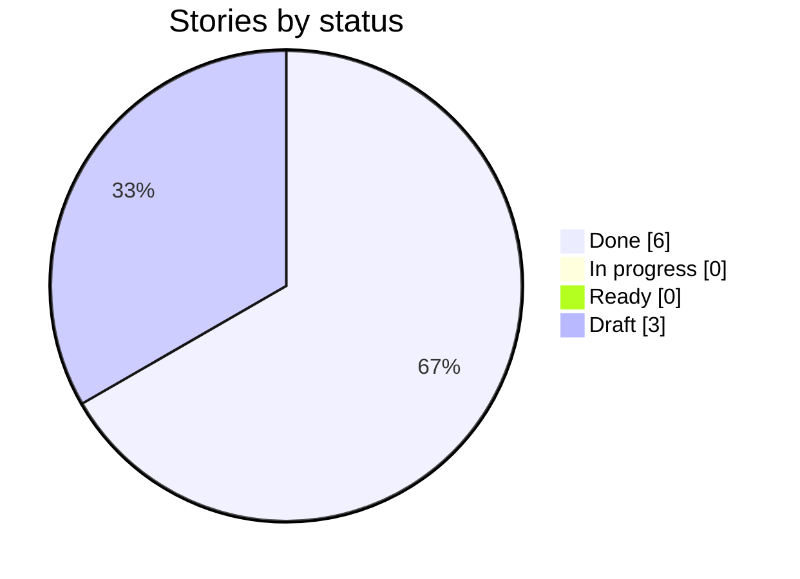
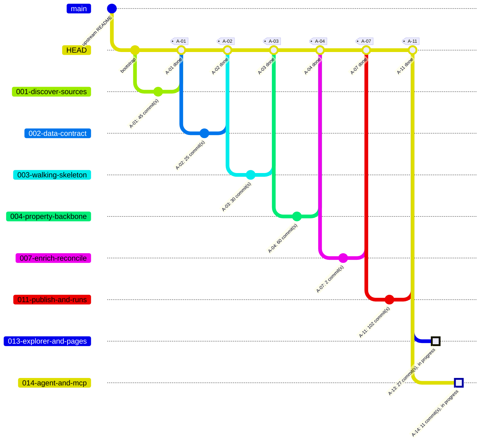

# Delivery Progress: `HEAD`

Generated by `scripts/progress.sh` at 2026-10-25T02:15Z from `HEAD` @ `b00d7ab`. Do not edit by hand.

**6 of 9 stories done** · 0 in progress · 0 ready · 3 draft

## Status



## Branch graph (one branch and merge per story)



## Board

| Story | Title | Status | Branch | Merged | G4 | G5 | G6 | G7 | Evidence | Last commit |
| --- | --- | --- | --- | --- | --- | --- | --- | --- | --- | --- |
| ✅ A-01 | Discover Travis County sources and pass readiness preflight | Done | `001-discover-sources` | yes | ✅ | ✅ | ✅ | ✅ | [✅](evidence/A-01.md) | 2026-10-20 |
| ✅ A-02 | Freeze the property-intelligence data contract | Done | `002-data-contract` | yes | ✅ | ✅ | ✅ | ✅ | [✅](evidence/A-02.md) | 2026-10-21 |
| ✅ A-03 | Publish one month of Austin roofing permits by CID and show them in the hosted UI | Done | `003-walking-skeleton` | yes | ✅ | ✅ | ✅ | ✅ | [✅](evidence/A-03.md) | 2026-10-21 |
| ✅ A-04 | Load the county backbone: TCAD properties and owners, coordinates, and permits from every jurisdiction | Done | `004-property-backbone` | yes | ❌ | ✅ | ✅ | ✅ | [✅](evidence/A-04.md) | 2026-10-22 |
| ✅ A-07 | Enrich and reconcile: contractor identity, BBB ratings, business and places data, duplicate merge and roof age | Done | `007-enrich-reconcile` | yes | ? | ? | ? | ✅ | [✅](evidence/A-07.md) | 2026-10-23 |
| ✅ A-11 | Publish the full county by CID and keep it current with incremental runs | Done | `011-publish-and-runs` | yes | ✅ | ✅ | ✅ | ✅ | [✅](evidence/A-11.md) | 2026-10-25 |
| ⬜ A-13 | Build the Explorer UI with its hub, legal, catalog and Coming soon pages | Draft | `013-explorer-and-pages` | no | — | — | — | — | — | 2026-10-22 |
| ⬜ A-14 | Answer roofing-lead questions through a source-backed agent and an MCP server | Draft | `014-agent-and-mcp` | no | — | — | — | — | — | 2026-10-23 |
| ⬜ A-16 | Prove zero idle cost and let the operator run the pipeline from the hosted app | Draft | `016-cost-and-admin` | no | — | — | — | — | — | — |

Legend: ✅ done · 🔄 in progress · 🟦 ready · ⬜ draft. Gate cells come from `docs/gates/` pre-check reports (✅ PASS, ❌ FAIL, — not run).

## Mismatches

None: story status and git history agree.

## Raw history (first parent = one line per merged story)

```text
b00d7ab 2026-10-25 A-07: merge post-merge run-log notes
9f7722a 2026-10-25 A-11: merge commit recorded in the evidence
4bb4c79 2026-10-25 A-11: update progress; G4 exceptions recorded
50f9a10 2026-10-25 A-11: merge publish and runs (G7 PASS)
97fc316 2026-10-23 A-07: update progress; merge commit recorded in the evidence
5cb3090 2026-10-23 A-07: merge enrich and reconcile (G7 PASS)
91af717 2026-10-22 A-04: update progress; merge commit recorded in the evidence
01ee900 2026-10-22 A-04: merge property backbone (G7 PASS)
27da8a7 2026-10-21 docs: FU-A-01 follow-up, publish situs address and contractor name in contract/v1.1
22668fa 2026-10-21 A-03: post-merge production smoke screenshots and final run-log lines
08b33a4 2026-10-21 A-03: update progress; draft PR body
8ae1870 2026-10-21 A-03: merge walking skeleton (G7 PASS)
6d9d8dd 2026-10-21 Story loop: light lane (no /speckit-checklist, G5+G6 together, one review round)
861efa1 2026-10-21 Merge stories A-04…A-18 into six stories (A-04, A-07, A-11, A-13, A-14, A-16)
03c6e41 2026-10-21 A-02: update progress
e98c12e 2026-10-21 A-02: merge data contract (G7 PASS)
42a93bc 2026-10-20 A-01: update progress
6c1383a 2026-10-20 A-01: merge discover sources (G7 PASS)
baf4f08 2026-10-19 A-01: gate log and progress after G4
2f56287 2026-10-19 A-01: story ready (G4)
c5c7b19 2026-10-19 docs: align review-log file names with the G7 pre-check (CR-A-NN.md)
c615a37 2026-10-19 docs: G1 re-approval for feature list 0.2
72f44e6 2026-10-19 docs: P8 draft stories A-01..A-18; feature list 0.2; traceability
df080b5 2026-10-19 docs: regenerate progress board after G3
794b949 2026-10-19 docs: G2 and G3 approved; architecture constitution ARD-A v0.2; constitution 3.0.3
3f4de6f 2026-10-19 docs: Design Checkpoint approved after the G3 design update
5549aab 2026-10-19 docs: G3 architecture decisions (AD-01..AD-16) and design update brief
7458edf 2026-10-18 docs: P6 design checkpoint — CountyLens prototype, review log, design map
8b25b48 2026-10-17 docs: P5 UX research and Claude Design brief for CountyLens
1027cfd 2026-10-17 chore: local Oracle runtime stack (Restate + Postgres) for ingestion
b5b5d49 2026-10-17 docs: planning P1–P5 — intent (G0), feature list (G1), high-level plan (G2), kit routing
eac58c7 2026-10-17 docs: align constitution, templates and CLAUDE.md with the demo setup
b02028f 2026-10-15 docs: add fill-in playbooks (planning, per story, release)
74fc115 2026-10-15 chore: add Spec Kit git extension for branch-per-story
a9f7086 2026-10-15 chore: bootstrap Spec Kit, kit plugin, developmentSupport skills and docs skeleton
e778d6f 2026-10-11 Initial Travis County, TX Oracle pipeline assignment.
```
