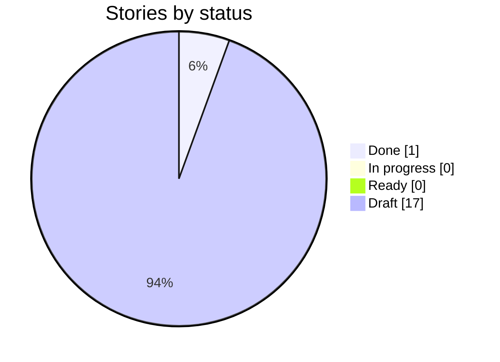
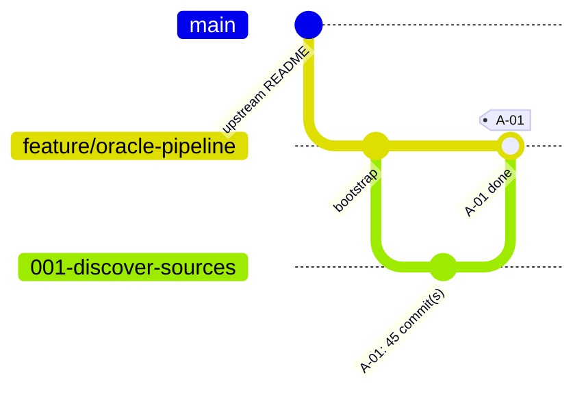

# Delivery Progress: `feature/oracle-pipeline`

Generated by `scripts/progress.sh` at 2026-10-20T20:18Z from `feature/oracle-pipeline` @ `6c1383a`. Do not edit by hand.

**1 of 18 stories done** · 0 in progress · 0 ready · 17 draft

## Status



## Branch graph (one branch and merge per story)



## Board

| Story | Title | Status | Branch | Merged | G4 | G5 | G6 | G7 | Evidence | Last commit |
| --- | --- | --- | --- | --- | --- | --- | --- | --- | --- | --- |
| ✅ A-01 | Discover Travis County sources and pass readiness preflight | Done | `001-discover-sources` | yes | ✅ | ✅ | ✅ | ✅ | [✅](evidence/A-01.md) | 2026-10-20 |
| ⬜ A-02 | Freeze the property-intelligence data contract | Draft | `002-data-contract` | no | — | — | — | — | — | — |
| ⬜ A-03 | Publish one month of Austin roofing permits by CID and show them in the hosted UI | Draft | `003-walking-skeleton` | no | — | — | — | — | — | — |
| ⬜ A-04 | Ingest the TCAD property and owner backbone for the full county | Draft | `004-tcad-backbone` | no | — | — | — | — | — | — |
| ⬜ A-05 | Attach coordinates to every property and reconcile GIS with the roll | Draft | `005-coordinates` | no | — | — | — | — | — | — |
| ⬜ A-06 | Harvest permits from every classified jurisdiction | Draft | `006-permits` | no | — | — | — | — | — | — |
| ⬜ A-07 | Resolve contractor identity from official business records | Draft | `007-contractor-identity` | no | — | — | — | — | — | — |
| ⬜ A-08 | Enrich contractors with BBB ratings within source boundaries | Draft | `008-bbb-ratings` | no | — | — | — | — | — | — |
| ⬜ A-09 | Load business and places data for the county | Draft | `009-business-places` | no | — | — | — | — | — | — |
| ⬜ A-10 | Reconcile duplicates and derive roof age with lineage | Draft | `010-reconcile-roof-age` | no | — | — | — | — | — | — |
| ⬜ A-11 | Publish the full county as verifiable CIDs (Run 1) | Draft | `011-full-publish` | no | — | — | — | — | — | — |
| ⬜ A-12 | Run incremental refreshes and keep run history | Draft | `012-incremental-runs` | no | — | — | — | — | — | — |
| ⬜ A-13 | Build the Explorer UI for runs, coverage, manifest verification and roofing queries | Draft | `013-explorer-ui` | no | — | — | — | — | — | — |
| ⬜ A-14 | Answer roofing-lead questions with a source-backed agent | Draft | `014-agent` | no | — | — | — | — | — | — |
| ⬜ A-15 | Expose the data through an MCP server | Draft | `015-mcp` | no | — | — | — | — | — | — |
| ⬜ A-16 | Prove zero idle cost and document source speed limits | Draft | `016-cost-limits` | no | — | — | — | — | — | — |
| ⬜ A-17 | Let the operator sign in and start, stop or retry a pipeline run from the hosted app | Draft | `017-admin-login` | no | — | — | — | — | — | — |
| ⬜ A-18 | Show the hub, legal and catalog pages and mark planned features as Coming soon | Draft | `018-content-pages` | no | — | — | — | — | — | — |

Legend: ✅ done · 🔄 in progress · 🟦 ready · ⬜ draft. Gate cells come from `docs/gates/` pre-check reports (✅ PASS, ❌ FAIL, — not run).

## Mismatches

None: story status and git history agree.

## Raw history (first parent = one line per merged story)

```text
6c1383a 2026-10-20 A-01: merge discover sources (G7 PASS)
baf4f08 2026-10-19 A-01: gate log and progress after G4
2f56287 2026-10-19 A-01: story ready (G4)
c5c7b19 2026-10-19 docs: align review-log file names with the G7 pre-check (CR-A-NN.md)
c615a37 2026-10-19 docs: G1 re-approval for feature list 0.2
72f44e6 2026-10-19 docs: P8 draft stories A-01..A-18; feature list 0.2; traceability
df080b5 2026-10-19 docs: regenerate progress board after G3
794b949 2026-10-19 docs: G2 and G3 approved; architecture constitution ARD-A v0.2; constitution 3.0.3
3f4de6f 2026-10-19 docs: Design Checkpoint approved after the G3 design update
5549aab 2026-10-19 docs: G3 architecture decisions (AD-01..AD-16) and design update brief
7458edf 2026-10-18 docs: P6 design checkpoint — CountyLens prototype, review log, design map
8b25b48 2026-10-17 docs: P5 UX research and Claude Design brief for CountyLens
1027cfd 2026-10-17 chore: local Oracle runtime stack (Restate + Postgres) for ingestion
b5b5d49 2026-10-17 docs: planning P1–P5 — intent (G0), feature list (G1), high-level plan (G2), kit routing
eac58c7 2026-10-17 docs: align constitution, templates and CLAUDE.md with the demo setup
b02028f 2026-10-15 docs: add fill-in playbooks (planning, per story, release)
74fc115 2026-10-15 chore: add Spec Kit git extension for branch-per-story
a9f7086 2026-10-15 chore: bootstrap Spec Kit, kit plugin, developmentSupport skills and docs skeleton
e778d6f 2026-10-11 Initial Travis County, TX Oracle pipeline assignment.
```
