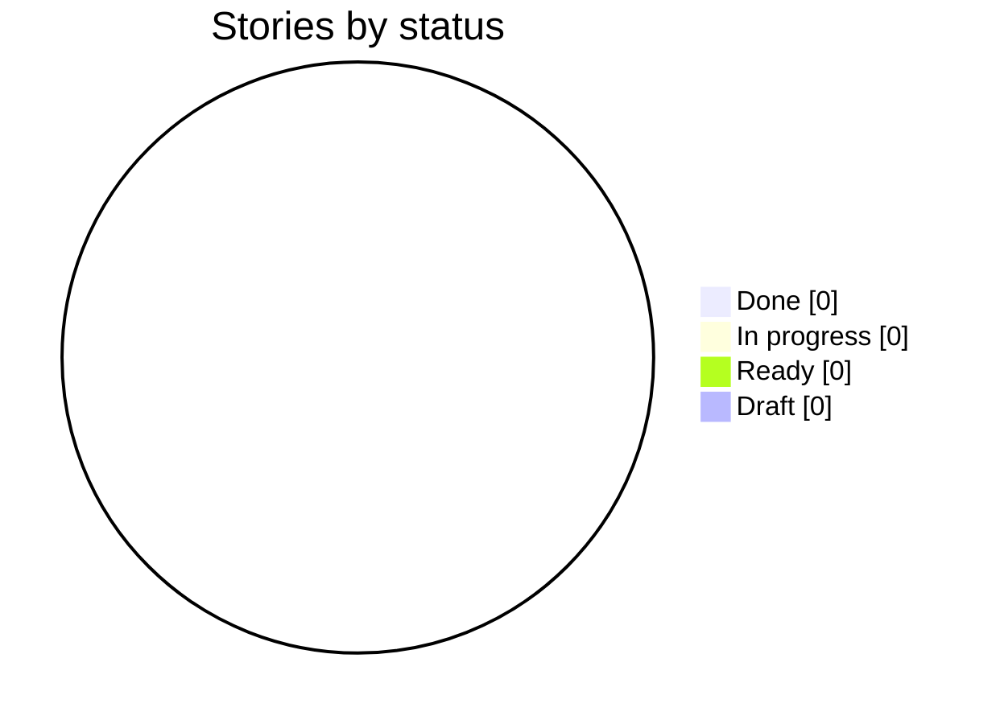
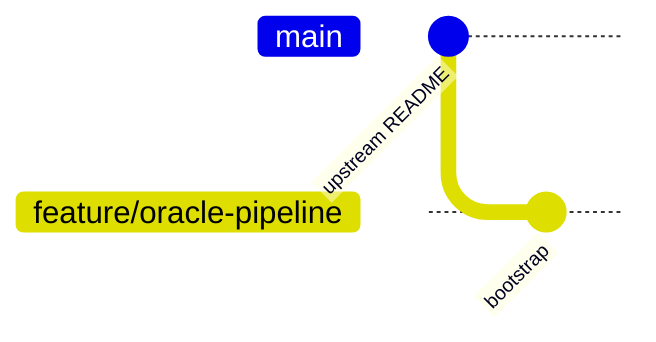

# Delivery Progress: `feature/oracle-pipeline`

Generated by `scripts/progress.sh` at 2026-10-19T14:26Z from `feature/oracle-pipeline` @ `794b949`. Do not edit by hand.

**0 of 0 stories done** · 0 in progress · 0 ready · 0 draft

## Status



## Branch graph (one branch and merge per story)



## Board

| Story | Title | Status | Branch | Merged | G4 | G5 | G6 | G7 | Evidence | Last commit |
| --- | --- | --- | --- | --- | --- | --- | --- | --- | --- | --- |

Legend: ✅ done · 🔄 in progress · 🟦 ready · ⬜ draft. Gate cells come from `docs/gates/` pre-check reports (✅ PASS, ❌ FAIL, — not run).

## Mismatches

None: story status and git history agree.

## Raw history (first parent = one line per merged story)

```text
794b949 2026-10-19 docs: G2 and G3 approved; architecture constitution ARD-A v0.2; constitution 3.0.3
3f4de6f 2026-10-19 docs: Design Checkpoint approved after the G3 design update
5549aab 2026-10-19 docs: G3 architecture decisions (AD-01..AD-16) and design update brief
7458edf 2026-10-18 docs: P6 design checkpoint — CountyLens prototype, review log, design map
8b25b48 2026-10-17 docs: P5 UX research and Claude Design brief for CountyLens
1027cfd 2026-10-17 chore: local Oracle runtime stack (Restate + Postgres) for ingestion
b5b5d49 2026-10-17 docs: planning P1–P5 — intent (G0), feature list (G1), high-level plan (G2), kit routing
eac58c7 2026-10-17 docs: align constitution, templates and CLAUDE.md with the demo setup
b02028f 2026-10-15 docs: add fill-in playbooks (planning, per story, release)
74fc115 2026-10-15 chore: add Spec Kit git extension for branch-per-story
a9f7086 2026-10-15 chore: bootstrap Spec Kit, kit plugin, developmentSupport skills and docs skeleton
e778d6f 2026-10-11 Initial Travis County, TX Oracle pipeline assignment.
```
