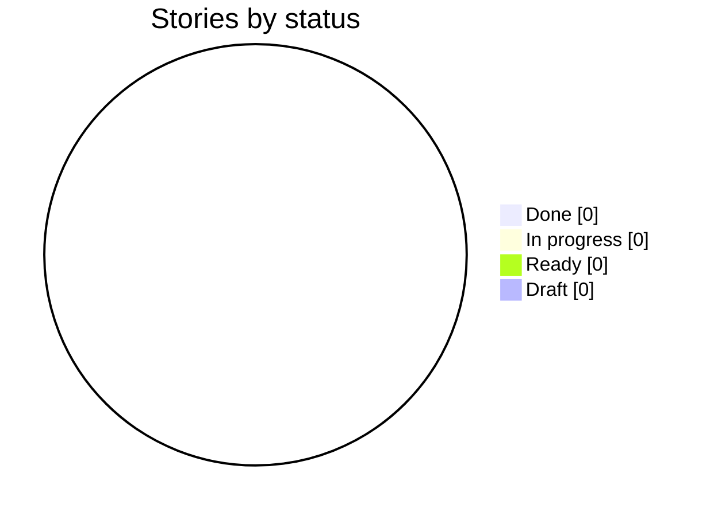
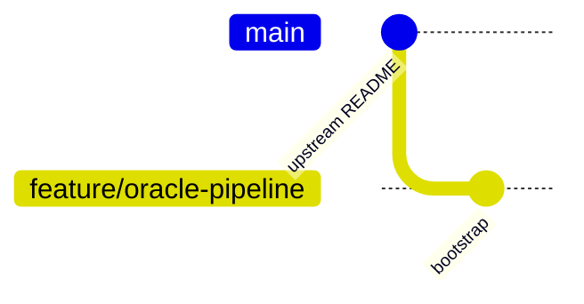

# Delivery Progress: `feature/oracle-pipeline`

Generated by `scripts/progress.sh` at 2026-10-15T12:18Z from `feature/oracle-pipeline` @ `e778d6f`. Do not edit by hand.

**0 of 0 stories done** · 0 in progress · 0 ready · 0 draft

## Status



## Branch graph (one branch and merge per story)



## Board

| Story | Title | Status | Branch | Merged | G4 | G5 | G6 | G7 | Evidence | Last commit |
| --- | --- | --- | --- | --- | --- | --- | --- | --- | --- | --- |

Legend: ✅ done · 🔄 in progress · 🟦 ready · ⬜ draft. Gate cells come from `docs/gates/` pre-check reports (✅ PASS, ❌ FAIL, — not run).

## Mismatches

None: story status and git history agree.

## Raw history (first parent = one line per merged story)

```text
e778d6f 2026-10-11 Initial Travis County, TX Oracle pipeline assignment.
```
